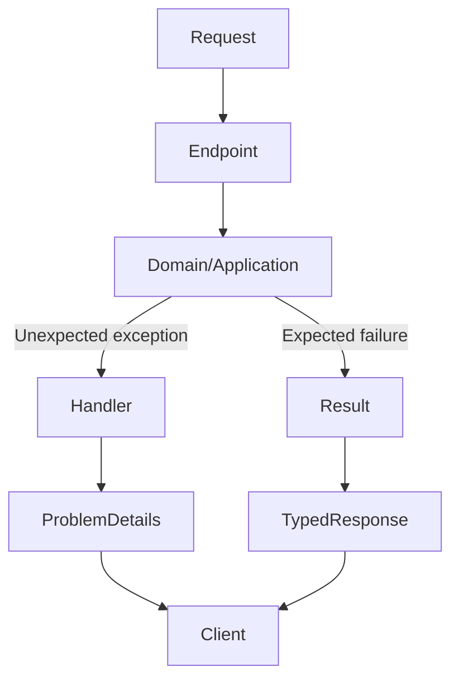
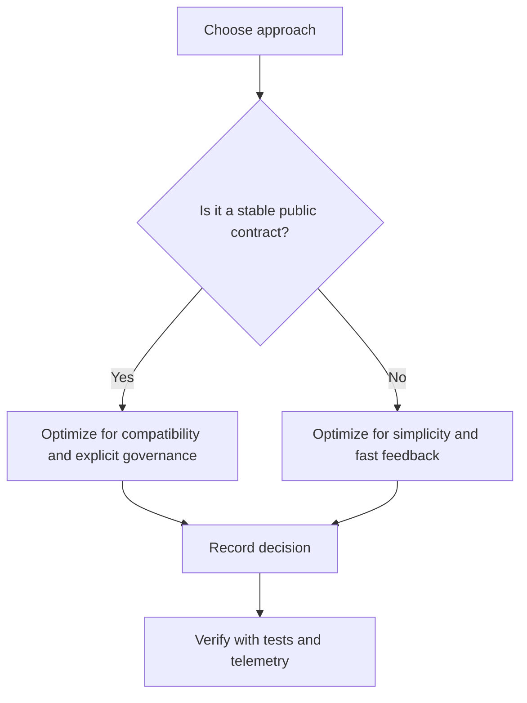

# Exception Handling

## Purpose

Create a predictable error boundary that protects clients and operators. This module assumes the reader already builds ASP.NET Core systems professionally. The goal is to sharpen engineering judgment: why a design exists, how it behaves under load, how it fails, and what evidence a principal engineer needs before launch.

> [!IMPORTANT]
> The standard is not whether the API works on a developer machine. The standard is whether the design remains understandable, observable, secure, and operable when customers, incidents, and organizational pressure arrive.

## Table of Contents

- [Purpose](#purpose)
- [Theory](#theory)
- [Deep Dive](#deep-dive)
- [How It Works Internally](#how-it-works-internally)
- [Production Usage](#production-usage)
- [Common Mistakes](#common-mistakes)
- [Trade-offs](#trade-offs)
- [Best Practices](#best-practices)
- [Examples](#examples)
- [Code Snippets](#code-snippets)
- [Architecture Notes](#architecture-notes)
- [Principal Thinking](#principal-thinking)
- [Review Questions](#review-questions)
- [References](#references)
- [Summary](#summary)

## Theory

The production-ready Web API foundation is a set of architectural constraints and runtime behaviors, not a checklist of NuGet packages. A principal engineer treats each framework feature as a design decision with blast radius across security, operability, performance, cost, and long-term maintainability.

Core ideas in this module:

- exception taxonomy
- global handler
- domain failures
- security
- observability

A mature API design separates policy from detail. HTTP, persistence, messaging, cloud configuration, logging, and documentation are details that serve the business capability. They must be explicit, replaceable where necessary, and observable when they fail.

## Deep Dive

| Concern | Principal-level question |
|---|---|
| exception taxonomy | Runtime behavior, production failure mode, test evidence, and decision owner |
| global handler | Runtime behavior, production failure mode, test evidence, and decision owner |
| domain failures | Runtime behavior, production failure mode, test evidence, and decision owner |
| security | Runtime behavior, production failure mode, test evidence, and decision owner |
| observability | Runtime behavior, production failure mode, test evidence, and decision owner |

Deep understanding requires following the request from socket acceptance through endpoint execution, dependency resolution, validation, exception translation, response writing, logging, metrics, and cloud platform feedback. The interesting engineering work happens at boundaries: when dependencies are slow, configuration is wrong, clients misuse the API, or the team needs to evolve the contract without breaking revenue-generating consumers.

Performance impact is rarely isolated. A small allocation in middleware can multiply by every request. A missing timeout can exhaust threads. A verbose log property can create significant Application Insights or Log Analytics cost. A poorly scoped dependency can leak memory or corrupt tenant state. A vague error contract can turn every client integration into custom support work.

## How It Works Internally

ASP.NET Core builds a host, loads configuration providers in order, constructs an IServiceProvider, starts Kestrel, and executes requests through a composed middleware pipeline. Endpoint routing selects metadata and delegates. Model binding and validation prepare inputs. Application services execute use cases. Infrastructure adapters talk to databases and remote services. Result execution serializes responses and emits telemetry.

Internal mechanics to reason about:

- The dependency injection container resolves constructor graphs and enforces lifetimes only when scope validation is enabled.
- Middleware executes in registration order on the way in and reverse order on the way out.
- Async request handling uses the .NET thread pool; blocking work can starve unrelated requests.
- Configuration values are layered; later providers override earlier providers.
- Logging providers receive structured events, scopes, categories, and levels; downstream sinks decide storage and cost.
- Exceptions are expensive control-flow mechanisms and should represent unexpected failure, not ordinary business decisions.



## Production Usage

Use this capability as part of the launch foundation. Define the production contract, add tests around externally visible behavior, record the operational assumptions, and make the behavior visible through telemetry. Production usage means the team knows how the feature behaves during deploys, scale-out, dependency failure, secret rotation, and partial regional outage.

Operational checklist:

- Define the owner and review cadence.
- Document environment-specific behavior.
- Add observable signals: log events, metrics, traces, health checks, or dashboards.
- Add failure-mode tests where the blast radius is high.
- Record rollout and rollback instructions.
- Estimate cost impact before high-volume launch.

## Common Mistakes

| Mistake | Why it hurts in production | Better approach |
|---|---|---|
| Treating framework defaults as architecture | Defaults optimize for broad usability, not your launch risk | Make explicit decisions and document them |
| Mixing domain logic with transport code | Makes tests brittle and contract evolution risky | Keep use cases independent of HTTP details |
| Ignoring cancellation and timeouts | Slow dependencies can consume threads and sockets | Propagate CancellationToken and bound every call |
| Logging unbounded payloads | Increases cost and may leak sensitive data | Log identifiers, states, and safe dimensions |
| Adding abstractions for style only | Creates indirection without resilience | Add abstractions where they protect policy or enable tests |

## Trade-offs

| Decision pressure | Optimize for | Cost |
|---|---|---|
| Fast launch | Simpler architecture and fewer moving parts | Less isolation if requirements grow quickly |
| Enterprise contract stability | Versioning, compatibility tests, documentation | More governance and slower breaking changes |
| Deep observability | Faster incident response | Storage cost and data classification work |
| Strong validation | Safer inputs and clearer client errors | More rules to maintain and test |
| Cloud-native behavior | Better scaling and operations | Requires platform knowledge and automated verification |



## Best Practices

- Make external contracts explicit: OpenAPI, status codes, ProblemDetails, versioning, pagination, and error semantics.
- Prefer simple architectural boundaries with strong tests over elaborate layering with weak ownership.
- Design for failure first: dependency timeout, invalid configuration, expired secret, partial outage, and noisy client.
- Use structured logs and stable dimensions; avoid high-cardinality values unless necessary.
- Validate configuration on startup for critical settings.
- Keep middleware order intentional and reviewed.
- Define health checks for orchestrators, not for human curiosity alone.
- Use architecture decision records for choices that affect multiple teams or production operations.

## Examples

### Architecture Decision Record Excerpt

| Field | Example |
|---|---|
| Decision | Use typed HttpClient for cohesive downstream APIs |
| Status | Accepted |
| Context | The API calls a billing service on the critical request path |
| Consequence | Better testability and encapsulated resilience policy; more classes to own |
| Review trigger | New downstream endpoint, latency SLO change, or incident involving billing |

### Production Review Evidence

- Unit tests for domain and application rules.
- Integration tests for HTTP contract and middleware behavior.
- Load test showing latency, CPU, memory, and dependency behavior at target concurrency.
- Dashboard covering request rate, error rate, duration, saturation, dependency calls, and log volume.
- Runbook explaining rollback, configuration ownership, and incident triage.


## Code Snippets

```csharp
builder.Services.AddProblemDetails(options =>
{
    options.CustomizeProblemDetails = context =>
    {
        context.ProblemDetails.Extensions["traceId"] = context.HttpContext.TraceIdentifier;
    };
});

app.UseExceptionHandler();
app.UseStatusCodePages();
```

## Architecture Notes

The architecture should keep decisions visible. A principal engineer should be able to point to the code and answer: where does policy live, where do side effects happen, where does the public contract get shaped, and where will the team look during an incident?

Recommended baseline:

```text
src/
  Api/              HTTP, middleware, authentication, OpenAPI, controllers/endpoints
  Application/      Use cases, ports, validation orchestration, DTOs
  Domain/           Entities, value objects, invariants, domain services
  Infrastructure/   EF Core, external HTTP clients, cloud adapters, logging adapters
  Contracts/        Public request/response contracts if shared deliberately
tests/
  UnitTests/
  IntegrationTests/
  ArchitectureTests/
```

Architecture notes for this module:

- Runtime behavior must be knowable from code and docs.
- Security boundaries must be enforced close to the request boundary and repeated in domain rules where invariants require it.
- Maintainability comes from fewer hidden dependencies and clear ownership.
- Scalability comes from bounded work, async I/O, stateless request handling, and thoughtful dependency limits.
- Cost control is an architecture concern when telemetry, retries, and cloud resources scale with traffic.

## Principal Thinking

A principal engineer asks different questions from an implementation owner:

- Why this approach, and what evidence would change our mind?
- Why not the simpler built-in default?
- Why not a more sophisticated platform pattern?
- When should we avoid this design?
- What failure mode does this design make easier to detect?
- What failure mode does it hide?
- How would Microsoft implement this for a broad Azure customer base?
- How would Amazon implement this for high-scale, operationally strict service ownership?

Microsoft-style implementation usually emphasizes documented contracts, platform integration, secure defaults, compatibility, and tooling support. Amazon-style implementation usually emphasizes service ownership, operational metrics, blast-radius reduction, explicit runbooks, and continuous correction through incidents. A strong principal engineer can combine both instincts without cargo-culting either company.

## Review Questions

1. What production failure is most likely if this area is implemented casually?
2. Which behavior is part of the public contract, and how is it tested?
3. Which runtime cost grows with request volume?
4. Which cloud platform feature changes the design assumption?
5. How would you explain the trade-off to a CTO, an SRE, and a feature team?
6. What would cause you to revisit this decision in six months?

## References

- [ASP.NET Core documentation](https://learn.microsoft.com/aspnet/core/)
- [ASP.NET Core fundamentals](https://learn.microsoft.com/aspnet/core/fundamentals/)
- [Microsoft REST API Guidelines](https://github.com/microsoft/api-guidelines)
- [Azure Architecture Center](https://learn.microsoft.com/azure/architecture/)
- [Cloud Design Patterns](https://learn.microsoft.com/azure/architecture/patterns/)
- Robert C. Martin, Clean Architecture
- Mark Seemann, Dependency Injection Principles, Practices, and Patterns
- Jeffrey Richter, CLR via C#
- Andrew Lock, ASP.NET Core in Action
- Martin Kleppmann, Designing Data-Intensive Applications
- Martin Fowler architecture essays
- Nick Chapsas, advanced .NET and ASP.NET Core content

## Summary

Exception Handling is part of the launch foundation for an enterprise-grade public API. The principal-level expectation is not memorizing framework APIs; it is understanding runtime behavior, making trade-offs explicit, proving the design with tests and telemetry, and leaving behind a system that other engineers can operate confidently.
