# 05B - Inside OAuth 2.0 Device Authorization Grant (RFC 8628)

> "When your application has no browser, no local web server, and no graphical UI, you cannot redirect to a loopback address.
>
> RFC 8628 decouples the device requesting the token from the user agent approving it, turning input-constrained environments into first-class security citizens."

---

# Why This Chapter Exists

Modern engineering systems are not limited to Single-Page Applications and mobile apps:
- Developers authenticate via CLI tools (`az login`, `gh auth login`, `docker login`, custom corporate CLIs).
- Headless servers, background cron jobs, and IoT devices need delegated user access.
- Smart TVs, conferencing consoles, and media devices lack keyboards for secure credential entry.

Historically, teams resorted to anti-patterns:
1. **Hardcoding Client Secrets in CLI binaries** (trivially extracted via decompilation).
2. **Promoting Resource Owner Password Credentials (ROPC)** (forcing users to type their corporate Active Directory passwords into a third-party terminal, bypassing MFA and Zero-Trust conditional access).
3. **Spinning up local HTTP listeners on `http://localhost:5001/callback`** (often blocked by enterprise firewalls, VPN split-tunneling, or port collisions).

**RFC 8628 (OAuth 2.0 Device Authorization Grant)** resolves this by establishing an out-of-band authentication channel. The device initiates the flow, displays a short human-friendly code, and polls the Identity Provider while the user approves the request on their secure workstation or smartphone browser.

---

# 1. The RFC 8628 Protocol Architecture

```mermaid
sequenceDiagram
    autonumber
    participant Device as CLI / Device (Headless)
    participant User as End User (Browser)
    participant IdP as Identity Provider (OAuth 2.0)

    Device->>IdP: POST /device/code (client_id, scope)
    IdP-->>Device: 200 OK (device_code, user_code, verification_uri, interval)
    
    Device->>User: Display: "Navigate to https://id.novacommerce.com/device and enter: BZKR-9941"
    
    rect rgb(20, 25, 40)
        Note over Device,IdP: Polling Loop (interval = 5s)
        Device->>IdP: POST /token (grant_type=device_code, device_code)
        IdP-->>Device: 400 Bad Request (error: "authorization_pending")
    end

    User->>IdP: Open verification_uri, enter user_code, complete MFA & Consent
    IdP->>IdP: Mark device_code as Authorized for User

    Device->>IdP: POST /token (grant_type=device_code, device_code)
    IdP-->>Device: 200 OK (access_token, refresh_token, id_token)
    Device->>Device: Securely store tokens in OS Credential Manager
```



---

# 2. Wire-Level Protocol Handshake

### Step 1: Device Authorization Request
The CLI or headless device sends an unauthenticated `POST` request to the authorization server's device endpoint:

```http
POST /connect/device HTTP/1.1
Host: id.novacommerce.com
Content-Type: application/x-www-form-urlencoded

client_id=nova-developer-cli&scope=openid%20profile%20api%3A%2F%2Fnovacommerce%20offline_access
```

### Step 2: Authorization Server Response
The IdP generates two distinct, cryptographically independent tokens:
1. `device_code`: High-entropy string (e.g., 256 bits) used only by the device to poll the token endpoint. Never shown to the user.
2. `user_code`: Short, low-entropy alphanumeric code (e.g., 8 characters) designed to be typed or scanned by a human.

```http
HTTP/1.1 200 OK
Content-Type: application/json;charset=UTF-8
Cache-Control: no-store
Pragma: no-cache

{
  "device_code": "GmRhmhcxhwAzkoEqiMEg_DnyEysNkuNhszIySk9eS",
  "user_code": "BZKR-9941",
  "verification_uri": "https://id.novacommerce.com/device",
  "verification_uri_complete": "https://id.novacommerce.com/device?user_code=BZKR-9941",
  "expires_in": 900,
  "interval": 5
}
```

*Parameters Breakdown:*
- `verification_uri`: The URL the user visits on their laptop or mobile phone.
- `verification_uri_complete`: Optional URL with pre-filled code, perfect for QR code rendering in terminal.
- `expires_in`: Lifetime of the codes in seconds (typically 10–15 minutes).
- `interval`: Minimum number of seconds the client **must** wait between polling requests (default: 5s).

---

# 3. The Polling Engine & Error State Machine

While the user is opening their browser and satisfying MFA challenges, the client polls the token endpoint:

```http
POST /connect/token HTTP/1.1
Host: id.novacommerce.com
Content-Type: application/x-www-form-urlencoded

grant_type=urn%3Aietf%3Aparams%3Aoauth%3Agrant-type%3Adevice_code
&client_id=nova-developer-cli
&device_code=GmRhmhcxhwAzkoEqiMEg_DnyEysNkuNhszIySk9eS
```

The RFC specifies five distinct error responses the client state machine must handle:

| Response / Error Code | Meaning | Mandatory Client Action |
|---|---|---|
| `authorization_pending` | User has not yet completed authentication/consent. | Sleep for `interval` seconds, then poll again. |
| `slow_down` | Client polled faster than the allowed rate limit. | Add **5 seconds** to current polling interval (`interval += 5`), sleep, then poll. |
| `access_denied` | End user explicitly clicked "Deny" or failed tenant policy. | Terminate immediately with message: "Authentication declined by user." |
| `expired_token` | `expires_in` elapsed before user approval. | Terminate immediately: "Device code expired. Please initiate login again." |
| `invalid_grant` | The `device_code` is malformed or invalid. | Terminate polling immediately with error. |

---

# 4. Production Resilient C# Implementation

Here is an enterprise-grade, zero-allocation, resilient Device Code client built with `SocketsHttpHandler` and cancellation support:

```csharp
using System.Net.Http.Json;
using System.Text.Json.Serialization;

public sealed class DeviceAuthorizationClient
{
    private readonly HttpClient _httpClient;
    private readonly string _clientId;
    private readonly string _authority;

    public DeviceAuthorizationClient(HttpClient httpClient, string clientId, string authority)
    {
        _httpClient = httpClient;
        _clientId = clientId;
        _authority = authority.TrimEnd('/');
    }

    public async Task<TokenResponse> AuthenticateAsync(string scope, CancellationToken ct = default)
    {
        // 1. Initiate Device Authorization
        var deviceInitRequest = new FormUrlEncodedContent(new Dictionary<string, string>
        {
            ["client_id"] = _clientId,
            ["scope"] = scope
        });

        using var initResponse = await _httpClient.PostAsync($"{_authority}/connect/device", deviceInitRequest, ct);
        initResponse.EnsureSuccessStatusCode();

        var deviceCodeInfo = await initResponse.Content.ReadFromJsonAsync<DeviceCodeResponse>(cancellationToken: ct)
            ?? throw new InvalidOperationException("Failed to deserialize device authorization response.");

        // 2. Display User Prompt in Terminal
        Console.WriteLine();
        Console.ForegroundColor = ConsoleColor.Cyan;
        Console.WriteLine("===============================================================");
        Console.WriteLine($"To authenticate, visit: {deviceCodeInfo.VerificationUri}");
        Console.WriteLine($"And enter code:         {deviceCodeInfo.UserCode}");
        if (!string.IsNullOrWhiteSpace(deviceCodeInfo.VerificationUriComplete))
        {
            Console.WriteLine($"Or direct link:         {deviceCodeInfo.VerificationUriComplete}");
        }
        Console.WriteLine("===============================================================");
        Console.ResetColor();

        // 3. Polling Loop with Exponential Backoff Guard
        int pollIntervalSeconds = deviceCodeInfo.Interval > 0 ? deviceCodeInfo.Interval : 5;
        var expiresAt = DateTimeOffset.UtcNow.AddSeconds(deviceCodeInfo.ExpiresIn);

        while (DateTimeOffset.UtcNow < expiresAt)
        {
            await Task.Delay(TimeSpan.FromSeconds(pollIntervalSeconds), ct);

            var tokenRequestBody = new FormUrlEncodedContent(new Dictionary<string, string>
            {
                ["grant_type"] = "urn:ietf:params:oauth:grant-type:device_code",
                ["client_id"] = _clientId,
                ["device_code"] = deviceCodeInfo.DeviceCode
            });

            using var tokenResponse = await _httpClient.PostAsync($"{_authority}/connect/token", tokenRequestBody, ct);

            if (tokenResponse.IsSuccessStatusCode)
            {
                var tokens = await tokenResponse.Content.ReadFromJsonAsync<TokenResponse>(cancellationToken: ct);
                Console.ForegroundColor = ConsoleColor.Green;
                Console.WriteLine("\n[+] Authentication successful! Token issued.");
                Console.ResetColor();
                return tokens!;
            }

            var errorResponse = await tokenResponse.Content.ReadFromJsonAsync<OAuthErrorResponse>(cancellationToken: ct);

            switch (errorResponse?.Error)
            {
                case "authorization_pending":
                    // Normal state: continue polling
                    Console.Write(".");
                    break;

                case "slow_down":
                    // RFC 8628 Section 3.5: Client MUST increase interval by 5 seconds
                    pollIntervalSeconds += 5;
                    Console.WriteLine($"\n[!] Rate-limited by IdP. Polling interval increased to {pollIntervalSeconds}s.");
                    break;

                case "access_denied":
                    throw new UnauthorizedAccessException("Authentication declined by user.");

                case "expired_token":
                    throw new TimeoutException("Device code expired before user completed authentication.");

                default:
                    throw new HttpRequestException($"OAuth error during polling: {errorResponse?.Error} - {errorResponse?.ErrorDescription}");
            }
        }

        throw new TimeoutException("Device code authentication timed out.");
    }
}

public sealed record DeviceCodeResponse(
    [property: JsonPropertyName("device_code")] string DeviceCode,
    [property: JsonPropertyName("user_code")] string UserCode,
    [property: JsonPropertyName("verification_uri")] string VerificationUri,
    [property: JsonPropertyName("verification_uri_complete")] string? VerificationUriComplete,
    [property: JsonPropertyName("expires_in")] int ExpiresIn,
    [property: JsonPropertyName("interval")] int Interval
);

public sealed record TokenResponse(
    [property: JsonPropertyName("access_token")] string AccessToken,
    [property: JsonPropertyName("refresh_token")] string? RefreshToken,
    [property: JsonPropertyName("id_token")] string? IdToken,
    [property: JsonPropertyName("token_type")] string TokenType,
    [property: JsonPropertyName("expires_in")] int ExpiresIn
);

public sealed record OAuthErrorResponse(
    [property: JsonPropertyName("error")] string Error,
    [property: JsonPropertyName("error_description")] string? ErrorDescription
);
```

---

# 5. Security Architecture & Threat Vectors

### Threat 1: User Code Guessing & Brute Force
Because `user_code` is short (e.g. 8 characters, `[B-DF-HJ-NP-TV-Z0-9]` to prevent phonetic confusion), an attacker might attempt to brute-force code verification endpoints to hijack pending logins:
* **Mitigation**:
  1. Strict rate-limiting on the verification endpoint: lockout after 5 consecutive failed code submissions per IP/session.
  2. Character set design: Base-20 alphabet with vowels excluded (prevents accidental profanity and typos, yielding $20^8 \approx 25.6 \text{ billion}$ combinations).
  3. Short expiration windows: TTL strictly $\le 15$ minutes.

### Threat 2: Cross-Device Phishing & Code Substitution
An attacker sends a legitimate user a link to `id.novacommerce.com/device?user_code=ATTACKER_CODE`, asking the user to approve a fake authorization request:
* **Mitigation**:
  1. Consent screen must display the requesting client name, IP address, and geographic location of the device.
  2. The confirmation page should ask the user: *"Are you actively logging into the Nova Developer CLI from London, UK?"*
  3. High-privilege scopes must trigger biometric or hardware security key re-authentication.

### Threat 3: Insecure Credential Storage on Developer Machines
Once tokens are returned to a CLI, storing them in plain text files like `~/.nova/credentials.json` exposes developers to token exfiltration from local malware or malicious npm/NuGet scripts:
* **Operating System Native Credential Vaults**:
  * **Windows**: DPAPI via `ProtectedData.Protect(data, optionalEntropy, DataProtectionScope.CurrentUser)`.
  * **macOS**: Apple Keychain Services API via `Security.framework`.
  * **Linux**: Freedesktop Secret Service API via D-Bus / `libsecret`.

---

# 6. Principal Architectural Defense Questions

### Question 1: Why not just use a local HTTP loopback server (`http://localhost:5000/callback`) for CLI login?
> **Principal Answer**: Loopback redirects work well on local desktop machines, but fail completely in remote developer environments (SSH sessions, GitHub Codespaces, devcontainers, headless build agents, Smart TVs, and IoT hardware). Furthermore, local loopbacks require opening a listening socket, which frequently causes port conflicts or triggers corporate host-based intrusion prevention system (HIPS) alarms. Device Code Flow (RFC 8628) operates entirely over outbound HTTP(S), traversing corporate proxies and NAT without opening listening ports.

### Question 2: How does RFC 8628 prevent Denial of Service on the Identity Provider's token endpoint?
> **Principal Answer**: Through two explicit protocol invariants:
> 1. The IdP dictates the initial polling rate via the `interval` field in the authorization response.
> 2. The IdP dynamically enforces backoff using the `slow_down` error code. Any conformant client that receives `slow_down` MUST increment its delay by 5 seconds. If a malicious or buggy client ignores this and floods the token endpoint, the IdP terminates the `device_code` with `invalid_grant` and rate-limits the client IP.

---

# 7. Summary & Invariant Laws

1. **Law of Physical Decoupling**: The device consuming the token never needs direct user interaction or credentials; user approval happens out-of-band on a trusted user agent.
2. **Law of Mandatory Slow-Down**: A device code client that does not handle `slow_down` is broken and dangerous; backoff logic must be hardcoded into the polling loop.
3. **Law of Zero Plaintext Persistence**: Tokens retrieved by CLI or headless devices must never touch plain text files on disk; always wrap token storage in OS-native secure credential vaults.
