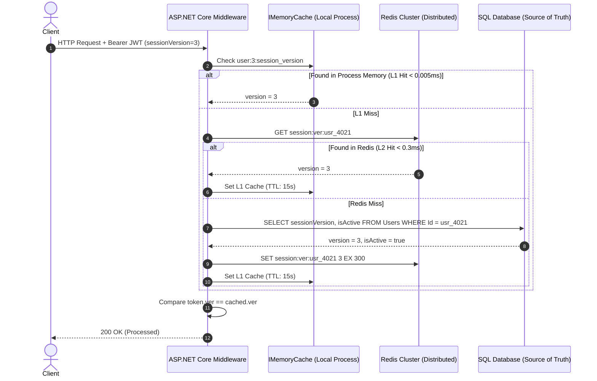

# 09A - Inside Session Versioning & Hybrid Stateful Invalidation

> "Statelessness is a performance virtue until the moment an account is compromised.
> 
> A Principal Engineer bridges the gap between purely stateless tokens and instant multi-device revocation using the monotonic session versioning pattern."

---

# Why This Chapter Exists

In modern distributed architectures, teams are taught that JSON Web Tokens (JWT) must be purely stateless. The application signs the token, sends it to the client, and forgets it. Verification occurs purely in-memory via cryptographic signature checks without hitting the database.

However, in production enterprise platforms, **strict statelessness creates a severe security loophole**:
- When a user changes their password, how do you instantly terminate their active sessions across 5 other devices?
- When an administrator demotes an employee or locks a compromised account, why should the attacker retain 15 to 60 minutes of unauthorized access?
- When a multi-tenant corporate client suspends their subscription, why do active tokens continue executing billable operations?

Relying on short access token lifetimes (e.g., 10 minutes) merely reduces the blast window—it does not eliminate it. Conversely, hitting the SQL database on every HTTP request to check user status destroys API throughput and induces database connection pool starvation.

This chapter uncovers the **Hybrid Session Versioning Architecture (`sessionVersion`)**: combining monotonic integer counters, JWT claim binding, and multi-tiered Redis cache invalidation to achieve **sub-millisecond instant revocation across all active devices**.

---

# The Mechanics of `sessionVersion`

```
                                  Database ("User" Record)
                               ┌─────────────────────────────┐
                               │ id: "usr_4021"              │
                               │ email: "sarah@company.com"  │
                               │ sessionVersion: 3           │ ◄── Current Canonical Version
                               └──────────────┬──────────────┘
                                              │
                    ┌─────────────────────────┴─────────────────────────┐
                    ▼                                                   ▼
         [ Active Web Session ]                              [ Compromised Phone ]
       JWT Payload Claims:                                  JWT Payload Claims:
       {                                                    {
         "sub": "usr_4021",                                   "sub": "usr_4021",
         "sessionVersion": 3                                  "sessionVersion": 3
       }                                                    }
                    │                                                   │
                    │       [ SECURITY EVENT OCCURS ]                   │
                    │       • Sarah clicks "Reset Password"             │
                    │       • UPDATE Users SET sessionVersion = 4       │
                    │                                                   │
                    ▼                                                   ▼
       Old Token Presented (ver = 3)                       Attacker Presents Old Token (ver = 3)
                    │                                                   │
                    ├─────────────────────────┬─────────────────────────┤
                                              ▼
                             Verification Engine Check:
                     token.sessionVersion (3) != DB/Cache.sessionVersion (4)
                                              │
                                              ▼
                                 [ 401 UNAUTHORIZED ]
                          INSTANT GLOBAL REVOCATION ENFORCED!
```

### Monotonic Version Increment Triggers
The integer column `sessionVersion: int` (defaulting to `1` upon user creation) is incremented atomically (`UPDATE Users SET sessionVersion = sessionVersion + 1 WHERE Id = @UserId`) whenever any of the following high-risk security events occur:
1. **Password Change or Reset**: The user updates their credentials; all existing sessions on all browsers, tablets, and phones must die immediately.
2. **Role or Permission Demotion**: An administrator strips the `FinancialApprover` or `NURSERY_ADMIN` role; the caller must not retain elevated privileges for even one second.
3. **Tenant Suspension or Archival**: The tenant's account is locked due to billing default or security breach.
4. **MFA Deactivation**: When 2FA is reset or disabled, all established sessions must be severed to prevent an attacker from persisting.
5. **Admin Kill-Switch / "Log Out Everywhere"**: A self-service or security operations command to terminate all active sessions.

---

# The Performance Trilemma: Stateful vs Stateless vs Hybrid

| Metric / Dimension | Pure Stateless JWT | Pure Stateful Session (DB per Request) | Hybrid Session Versioning + Redis Cache |
|---|---|---|---|
| **Latency per Request** | **< 0.1 ms** (In-memory crypto) | **3 - 15 ms** (PostgreSQL / SQL Server roundtrip) | **< 0.4 ms** (Redis $O(1)$ lookup or L1 memory cache) |
| **Database Load** | **0 Queries** on API hot-paths | **50,000 queries/sec** at 50k RPS (Connection pool death) | **0 SQL Queries** (Only hits SQL on cache miss or token renewal) |
| **Revocation Speed** | **Zero control** (Must wait until TTL expires) | **Instantaneous (0 ms)** | **Instantaneous (0 ms)** via pub/sub or short 30s TTL fallback |
| **Cross-Device Invalidation** | Impossible without distributed blacklists | Trivial (UPDATE row) | Trivial (UPDATE row + Redis key deletion) |
| **Architectural Complexity** | Low | Low | Medium (Requires distributed cache) |

---

# The Distributed Caching Strategy for `sessionVersion`

To protect the primary relational database from serving tens of thousands of version checks per second, we implement a **Two-Tier Distributed Invalidation Cache**:



### Cache Invalidation on Mutation
When `sessionVersion` is incremented in SQL, the command publishes a cache eviction event:
```csharp
public async Task IncrementSessionVersionAsync(string userId, CancellationToken ct)
{
    // 1. Atomically increment in SQL
    await dbContext.Database.ExecuteSqlInterpolatedAsync(
        $"UPDATE Users SET SessionVersion = SessionVersion + 1 WHERE Id = {userId}", ct);

    // 2. Invalidate Distributed Redis Cache immediately
    var db = redis.GetDatabase();
    await db.KeyDeleteAsync($"session:ver:{userId}");

    // 3. Publish Invalidation Message to all API nodes (to clear local L1 caches)
    var subscriber = redis.GetSubscriber();
    await subscriber.PublishAsync(
        RedisChannel.Literal("session:invalidations"), 
        userId);
}
```

---

# Implementation in ASP.NET Core (.NET 9)

Here is how a Principal Engineer integrates `sessionVersion` verification directly into the ASP.NET Core authentication pipeline:

### 1. The Custom Token Validation Event

```csharp
public sealed class SessionVersionValidationEvents(
    IConnectionMultiplexer redis,
    IMemoryCache localCache,
    IServiceScopeFactory scopeFactory,
    ILogger<SessionVersionValidationEvents> logger) : JwtBearerEvents
{
    public override async Task TokenValidated(TokenValidatedContext context)
    {
        var principal = context.Principal;
        var userId = principal?.FindFirst(ClaimTypes.NameIdentifier)?.Value 
                     ?? principal?.FindFirst("sub")?.Value;

        var tokenVersionClaim = principal?.FindFirst("sessionVersion")?.Value;

        if (string.IsNullOrEmpty(userId) || !int.TryParse(tokenVersionClaim, out var tokenVersion))
        {
            logger.LogWarning("Token rejected: Missing or invalid sessionVersion claim for user {UserId}", userId);
            context.Fail("Missing or malformed sessionVersion claim.");
            return;
        }

        // Check L1 Process Memory Cache first (Zero network latency)
        var l1Key = $"l1:session_ver:{userId}";
        if (localCache.TryGetValue(l1Key, out int cachedVersion))
        {
            if (tokenVersion != cachedVersion)
            {
                logger.LogWarning("Revoked session detected (L1) for user {UserId}. TokenVer={TokenVer}, CurrentVer={CurrentVer}",
                    userId, tokenVersion, cachedVersion);
                context.Fail("Session has been revoked.");
            }
            return;
        }

        // Check L2 Redis Cache
        var redisDb = redis.GetDatabase();
        var redisKey = $"session:ver:{userId}";
        var redisValue = await redisDb.StringGetAsync(redisKey);

        int canonicalVersion;
        if (redisValue.HasValue && int.TryParse(redisValue, out canonicalVersion))
        {
            // Populate L1 cache with 15-second sliding expiration
            localCache.Set(l1Key, canonicalVersion, TimeSpan.FromSeconds(15));
        }
        else
        {
            // Cache Miss: Query Database via Scoped DbContext
            using var scope = scopeFactory.CreateScope();
            var db = scope.ServiceProvider.GetRequiredService<ApplicationDbContext>();

            var user = await db.Users
                .AsNoTracking()
                .Select(u => new { u.Id, u.SessionVersion, u.IsActive })
                .FirstOrDefaultAsync(u => u.Id == userId);

            if (user == null || !user.IsActive)
            {
                context.Fail("User account does not exist or is inactive.");
                return;
            }

            canonicalVersion = user.SessionVersion;

            // Warm L2 Redis Cache (TTL: 5 minutes)
            await redisDb.StringSetAsync(redisKey, canonicalVersion, TimeSpan.FromMinutes(5));
            localCache.Set(l1Key, canonicalVersion, TimeSpan.FromSeconds(15));
        }

        // Final Security Gate: Enforce Version Equality
        if (tokenVersion != canonicalVersion)
        {
            logger.LogWarning("Revoked session detected: TokenVersion={TokenVer}, CanonicalVersion={CanonicalVer} for User={UserId}",
                tokenVersion, canonicalVersion, userId);
            context.Fail("Session has been terminated due to credential change or administrative action.");
        }
    }
}
```

### 2. Registration in `Program.cs`

```csharp
builder.Services.AddSingleton<SessionVersionValidationEvents>();

builder.Services.AddAuthentication(JwtBearerDefaults.AuthenticationScheme)
    .AddJwtBearer(options =>
    {
        options.Authority = builder.Configuration["Identity:Authority"];
        options.Audience = "nova-commerce-api";
        options.SaveToken = false;
        
        // Wire custom session validation events
        options.EventsType = typeof(SessionVersionValidationEvents);
    });
```

---

# Production Incident: The Ghost Session Exfiltration

### Context
A senior logistics manager at an international supply chain firm was terminated for industrial espionage at 4:30 PM on a Friday. The IT administrator immediately logged into Active Directory, locked the employee's account, and initiated an emergency password reset.

### The Attack Vector
At 5:15 PM, 45 minutes after termination, the company's internal inventory API registered 12,000 bulk exports of shipping manifests. The queries were authenticated with a valid JWT issued to the terminated manager at 4:15 PM on their personal laptop.

### Root Cause Analysis (The 5 Whys)
1. **Why did the API allow 12,000 records to be exported?**  
   The API received a valid Bearer JWT signed with the company's private key.
2. **Why was the token valid if the user was locked in Active Directory?**  
   The token was issued with a standard 1-hour expiration time (`exp: 5:15 PM`).
3. **Why didn't the password reset cancel the token?**  
   The API was designed as "purely stateless"; it verified the signature and claims purely in-memory without consulting the database or identity state.
4. **Why didn't the team use a token blacklist?**  
   The team assumed that storing blacklist entries in Redis for every issued token was unnecessary overhead for a standard internal API.
5. **Why wasn't session versioning implemented?**  
   The engineering team did not embed `sessionVersion` into the JWT claims, creating a disconnect between the identity store lifecycle and token verification.

### Permanent Architectural Remedy
1. Introduced monotonic `SessionVersion` into the `Users` entity.
2. Wired `SessionVersionValidationEvents` with Redis L2 caching and in-process L1 caching.
3. Hooked identity mutation events (password resets, role updates, account deactivation) to atomically increment `SessionVersion` and evict cache keys.

---

# Self Assessment

1. Why does an atomic integer counter (`sessionVersion`) provide a superior multi-device invalidation model compared to maintaining a list of active token JTIs?
2. If an API processes 40,000 requests per second, what prevents `SessionVersionValidationEvents` from exhausting the SQL connection pool?
3. How does combining a 15-second local in-memory L1 cache with Redis Pub/Sub invalidation achieve both ultra-low latency (< 0.05ms) and near-instantaneous global revocation?
