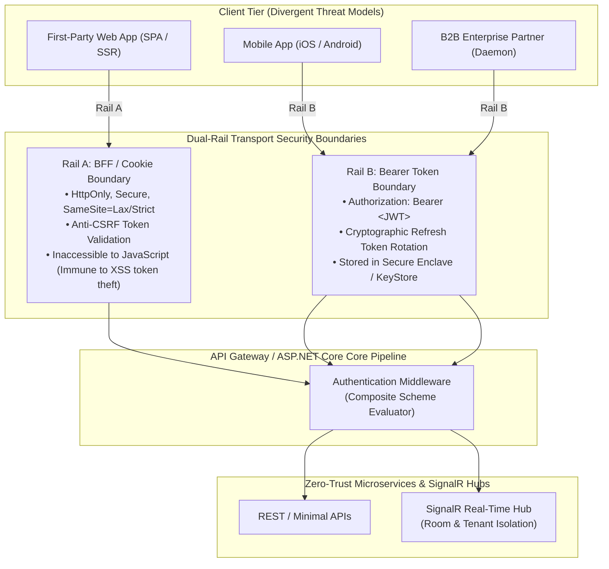

# 10B - Dual-Rail Architecture & Real-Time Connection Security

> "A secure architecture does not treat all clients identically.
> 
> A Principal Engineer tailors the transport security boundary to the client's threat profile: encrypted cookies for browsers, bearer tokens for native clients, and zero-trust protocol negotiation for real-time WebSockets."

---

# Why This Chapter Exists

Engineering teams frequently fall into one of two dangerous architectural traps:
1. **The Single-Rail Bearer Fallacy**: They force browser Single Page Applications (SPAs) to store JWT Bearer tokens in `localStorage` or `sessionStorage`. Any Cross-Site Scripting (XSS) vulnerability in any third-party npm package instantly exfiltrates all user tokens without resistance.
2. **The Single-Rail Cookie Fallacy**: They use HTTP cookies for everything, including native mobile apps and third-party partner APIs, creating massive Cross-Site Request Forgery (CSRF) vulnerabilities and breaking cross-domain microservice integration.

Furthermore, when modern applications introduce **Real-Time WebSockets or SignalR** (for live dashboards, order tracking, bus GPS streaming, or instant notifications), the entire security model collapses:
- The standard browser `WebSocket` JavaScript API **does not support custom HTTP headers**. You cannot pass `Authorization: Bearer <token>`.
- Developers resort to passing JWTs in the query string (`ws://api.company.com/hub?token=ey...`), leading to token exposure across reverse proxy logs, cloud monitoring traces, and browser history.
- Once a WebSocket connection is established, it remains open for hours. If a user is banned or their session is revoked, how do you forcibly terminate their live WebSocket connection immediately?

This chapter establishes the **Dual-Rail Security Architecture** and the **Real-Time Connection Governance Model**.

---

# The Dual-Rail Architecture



---

# Rail Comparison: Browser vs Native Mobile vs Real-Time

| Dimension | Rail A (First-Party Web / BFF) | Rail B (Mobile & Machine-to-Machine) | Real-Time (WebSockets / SignalR) |
|---|---|---|---|
| **Primary Credential** | Encrypted Session Cookie (`hadana_session` / `.AspNetCore.Cookies`) | Short-lived Access Token (`Authorization: Bearer <JWT>`) | Connection Handshake Token (Cookie or Query String with Header Fallback) |
| **Storage Location** | Browser Cookie Jar (Flagged `HttpOnly`) | iOS Keychain / Android EncryptedSharedPreferences | Handshake only; connection held in memory |
| **XSS Vulnerability** | **Immune to token theft** (JavaScript cannot read `HttpOnly` cookies) | N/A (Native apps lack browser DOM XSS) | **Immune** once connection handshake concludes |
| **CSRF Threat** | Requires Anti-CSRF header or `SameSite=Lax/Strict` | **Immune** (Browsers never attach Bearer headers automatically) | Validated during initial HTTP Upgrade handshake |
| **Refresh Strategy** | Sliding session expiration via cookie refresh | Refresh Token Rotation (RFC 6749) | Heartbeat ping + reconnection protocol |

---

# Real-Time WebSocket & SignalR Security Mechanics

### The Browser WebSocket Limitation
When a browser executes `new WebSocket("wss://api.example.com/hub")`, the W3C standard **forbids adding custom HTTP headers**. The browser sends standard cookies, but cannot send `Authorization: Bearer <JWT>`.

A Principal Engineer evaluates the three architectural solutions to this limitation:

```
Option 1: Cookie-Based Handshake (Preferred for Web Rail)
┌────────────────────────────────────────────────────────────────────────┐
│ The browser automatically sends the HttpOnly session cookie during the │
│ HTTP 101 Switching Protocols upgrade request. Zero token in URLs!       │
└────────────────────────────────────────────────────────────────────────┘

Option 2: Negotiated Short-Lived Ticket / Ephemeral Nonce
┌────────────────────────────────────────────────────────────────────────┐
│ 1. POST /api/v1/realtime/negotiate (Bearer Header) ──► Returns Ticket │
│ 2. Connect to wss://hub?ticket=xyz (Single-use ticket, 10-sec TTL)    │
│ 3. Eliminates persistent JWT leakage in server access logs!           │
└────────────────────────────────────────────────────────────────────────┘

Option 3: SignalR Query String Token Extraction (Standard Mobile Rail)
┌────────────────────────────────────────────────────────────────────────┐
│ ASP.NET Core SignalR client passes token in query string:              │
│ /hub?access_token=<JWT>. Reverse proxies MUST scrub query parameters.  │
└────────────────────────────────────────────────────────────────────────┘
```

---

# Implementing Real-Time Security in ASP.NET Core (.NET 9)

### 1. Unified Authentication Scheme & SignalR Query-String Provider

```csharp
public static class AuthenticationExtensions
{
    public static IServiceCollection AddDualRailAuthentication(this IServiceCollection services, IConfiguration config)
    {
        services.AddAuthentication(options =>
        {
            // Default to Bearer for API, but support Cookie for Web Rail
            options.DefaultScheme = "DualRailScheme";
            options.DefaultChallengeScheme = JwtBearerDefaults.AuthenticationScheme;
        })
        .AddPolicyScheme("DualRailScheme", "Cookie or Bearer", options =>
        {
            options.ForwardDefaultSelector = context =>
            {
                // If Authorization header exists, use Bearer
                var authHeader = context.Request.Headers.Authorization.FirstOrDefault();
                if (!string.IsNullOrEmpty(authHeader) && authHeader.StartsWith("Bearer ", StringComparison.OrdinalIgnoreCase))
                {
                    return JwtBearerDefaults.AuthenticationScheme;
                }

                // If Cookie exists, use Cookie Authentication
                if (context.Request.Cookies.ContainsKey(".NovaCommerce.Session"))
                {
                    return CookieAuthenticationDefaults.AuthenticationScheme;
                }

                // Default fallback for APIs
                return JwtBearerDefaults.AuthenticationScheme;
            };
        })
        .AddCookie(CookieAuthenticationDefaults.AuthenticationScheme, options =>
        {
            options.Cookie.Name = ".NovaCommerce.Session";
            options.Cookie.HttpOnly = true;
            options.Cookie.SecurePolicy = CookieSecurePolicy.Always;
            options.Cookie.SameSite = SameSiteMode.Lax;
            options.ExpireTimeSpan = TimeSpan.FromDays(7);
            options.SlidingExpiration = true;
        })
        .AddJwtBearer(JwtBearerDefaults.AuthenticationScheme, options =>
        {
            options.Authority = config["Identity:Authority"];
            options.Audience = "nova-commerce-api";
            
            // SignalR WebSocket Token Extraction Hook
            options.Events = new JwtBearerEvents
            {
                OnMessageReceived = context =>
                {
                    var accessToken = context.Request.Query["access_token"];
                    var path = context.HttpContext.Request.Path;
                    
                    // Only extract query string token for real-time Hub endpoints
                    if (!string.IsNullOrEmpty(accessToken) && path.StartsWithSegments("/hubs"))
                    {
                        context.Token = accessToken;
                    }
                    return Task.CompletedTask;
                }
            };
        });

        return services;
    }
}
```

### 2. Multi-Tenant Room Isolation & User Security Boundaries

In real-time systems, broadcasting messages blindly to `Clients.All` is an unforgivable security breach. Clients must be strictly isolated into **Tenant and User Boundary Rooms**:

```csharp
[Authorize]
public sealed class NotificationHub(
    ITenantContext tenantContext,
    ILogger<NotificationHub> logger) : Hub
{
    public override async Task OnConnectedAsync()
    {
        var userId = Context.UserIdentifier;
        var tenantId = tenantContext.TenantId;

        if (string.IsNullOrEmpty(userId) || string.IsNullOrEmpty(tenantId))
        {
            logger.LogWarning("Rejecting unauthenticated real-time connection attempt.");
            Context.Abort();
            return;
        }

        // 1. Join Tenant-Wide Broadcast Room
        await Groups.AddToGroupAsync(Context.ConnectionId, $"tenant:{tenantId}");

        // 2. Join User-Specific Private Room (For personal alerts & push notifications)
        await Groups.AddToGroupAsync(Context.ConnectionId, $"tenant:{tenantId}:user:{userId}");

        logger.LogInformation("Client {ConnectionId} bound to Tenant {TenantId}, User {UserId}", 
            Context.ConnectionId, tenantId, userId);

        await base.OnConnectedAsync();
    }
}
```

### 3. Immediate Real-Time Eviction (`disconnectRealtimeUser`)

When an account is suspended or `sessionVersion` increments, the user must not remain connected to live GPS coordinates or order streams:

```csharp
public sealed class RealtimeSessionManager(
    IHubContext<NotificationHub> hubContext,
    ILogger<RealtimeSessionManager> logger)
{
    public async Task ForciblyDisconnectUserAsync(string tenantId, string userId)
    {
        var userGroup = $"tenant:{tenantId}:user:{userId}";
        
        logger.LogWarning("Security Eviction: Terminating all active real-time connections for User {UserId}", userId);

        // Send termination signal to client so frontend clears local state
        await hubContext.Clients.Group(userGroup).SendAsync("ForceLogout", "Session revoked.");

        // Forcibly abort all underlying WebSocket connections
        // In ASP.NET Core SignalR, Clients.User(userId) targets all connection IDs for this user
        // Note: You can also manage a ConcurrentDictionary of ConnectionIds in a distributed Redis store
    }
}
```

---

# Caddy & NGINX Reverse Proxy Hardening: Scrubbing Query String Tokens

When query-string authentication is used for WebSockets (`/hubs?access_token=ey...`), reverse proxies (Caddy, NGINX, Cloudflare) will record the entire query string into access logs by default.

### Caddyfile Log Masking Configuration
```caddy
example.com {
    reverse_proxy /hubs/* localhost:5000 {
        # Pass WebSocket upgrades
    }

    # Custom Logging to scrub sensitive access_token from access logs
    log {
        output file /var/log/caddy/access.log
        format json {
            # Transform or strip query parameters matching access_token
        }
    }
}
```

### NGINX Log Sanitization
```nginx
map $request_uri $sanitized_request_uri {
    ~*(?P<path>[^?]+)\?access_token=[^&]*(?P<rest>.*) $path?access_token=[REDACTED]$rest;
    default $request_uri;
}

log_format secure_log '$remote_addr - $remote_user [$time_local] '
                       '"$request_method $sanitized_request_uri $server_protocol" '
                       '$status $body_bytes_sent';

access_log /var/log/nginx/access.log secure_log;
```

---

# Production Incident: The Leaked Token Proxy Incident

### Context
A healthcare telemetry company allowed nurses and doctors to track live patient telemetry via WebSockets. The mobile application connected to `/telemetry-hub?access_token=<JWT>`.

### The Vulnerability
The infrastructure team enabled standard Datadog HTTP access log ingestion on their AWS Application Load Balancer (ALB). Every single WebSocket connection logged:
`GET /telemetry-hub?access_token=eyJhbGciOiJSUzI1NiIs... HTTP/1.1 101`

### The Breach
An internal junior DevOps engineer had read access to the Datadog log dashboard. By copying the raw JWTs from the access logs, the engineer replayed them to query sensitive patient medical histories directly, bypassing application-layer audit logs because the requests used legitimate doctor credentials.

### Root Cause Analysis (The 5 Whys)
1. **Why were doctor tokens exposed in Datadog?**  
   The ALB logged full request URIs including query parameters.
2. **Why was the token in the URI instead of an Authorization header?**  
   The mobile team used the same WebSocket URL endpoint as the web browser without differentiating authentication methods.
3. **Why did the web app need tokens in the URL?**  
   The web developers did not implement Rail A (HttpOnly cookies) or short-lived connection tickets; they simply appended the token to the URL.
4. **Why did the token stay valid for 8 hours?**  
   The engineering team issued 8-hour access tokens to avoid handling token refresh in WebSockets.
5. **Why wasn't log sanitization configured?**  
   The team treated query strings as harmless routing data rather than credential vectors.

### Permanent Architectural Remedy
1. Enforced **Dual-Rail**: Browser web clients use `HttpOnly` cookies for WebSocket upgrades.
2. For mobile clients unable to use cookies, implemented **Ephemeral Negotiation Nonces** (10-second single-use tickets) via `POST /hubs/negotiate`.
3. Reconfigured AWS ALB and reverse proxy log pipelines to redact `access_token` query parameters unconditionally.

---

# Self Assessment

1. Why does storing Bearer JWTs in `localStorage` in browser Single Page Applications fundamentally compromise defense-in-depth?
2. What are the three methods for passing authentication credentials during a WebSocket handshake, and what are their respective trade-offs?
3. How does room isolation (`tenant:{tenantId}:user:{userId}`) prevent multi-tenant cross-talk in real-time SignalR hubs?
4. When a user changes their password, what mechanism ensures that their running real-time WebSocket connection on another device is disconnected immediately?
