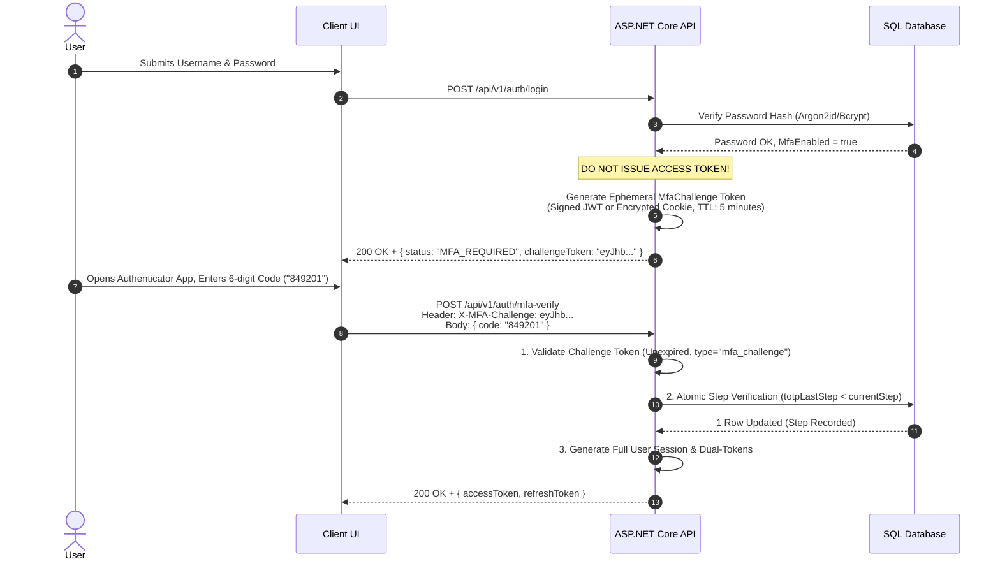

# 12A - Inside the Multi-Factor Authentication & TOTP RFC 6238 Engine

> "Two-factor authentication is not a third-party black box; it is an exact cryptographic protocol governed by RFC 6238 and RFC 4226.
> 
> A Principal Engineer understands every byte of the dynamic truncation algorithm, enforces atomic replay boundaries, and structures multi-stage challenge flows that cannot be bypassed."

---

# Why This Chapter Exists

Single-factor password authentication is obsolete. With billions of credentials leaked in public dumps, credential stuffing attacks and automated password sprays breach enterprise endpoints daily.

While SMS and Email verification exist, they are vulnerable to **SIM swapping, SS7 telecommunications interception, and email inbox compromise**. As a result, industry standards (NIST SP 800-63B, PCI-DSS 4.0, HIPAA) mandate **Time-based One-Time Passwords (TOTP)** or FIDO2 hardware tokens.

However, implementing TOTP incorrectly introduces devastating security flaws:
1. **The 30-Second Replay Vulnerability**: If a user submits their 6-digit token at second 3 of a 30-second window, an eavesdropping attacker can replay that identical code within the remaining 27 seconds unless the server enforces atomic step tracking.
2. **Plaintext Recovery Codes**: Storing backup emergency codes in plaintext in the database enables any SQL injection or database backup leak to compromise accounts even with 2FA enabled.
3. **Session Pre-Issuance**: Issuing a full session token upon password verification and relying on frontend client redirection to prompt for TOTP allows attackers to simply call protected APIs directly, skipping 2FA entirely.

This chapter details the internal mathematics of **RFC 6238 / RFC 4226**, the atomic replay defense, and the complete architecture of zero-dependency software authenticator engines.

---

# The Mathematical Foundations of TOTP (RFC 6238)

TOTP is an extension of HOTP (**HMAC-Based One-Time Password**, RFC 4226), replacing the monotonic sequence counter with a **time-step counter**:

$$T = \left\lfloor \frac{\text{CurrentUnixTime} - T_0}{X} \right\rfloor$$

Where:
- $T_0$ is the Unix epoch ($0$).
- $X$ is the time-step window in seconds (default is **30 seconds**).
- $T$ is the resulting 64-bit integer counter.

```
                  ┌──────────────────────────────────────────────────┐
                  │ 1. Current Unix Timestamp (e.g., 1,740,000,015)  │
                  └────────────────────────┬─────────────────────────┘
                                           │
                                           ▼ (Divide by 30 seconds)
                  ┌──────────────────────────────────────────────────┐
                  │ 2. Time-Step Counter T (e.g., 58,000,000)        │
                  │    Convert to 8-byte Big-Endian Byte Array       │
                  └────────────────────────┬─────────────────────────┘
                                           │
                        ┌──────────────────┴──────────────────┐
                        │ Shared Secret (Base32 Decoded Key)  │
                        └──────────────────┬──────────────────┘
                                           │
                                           ▼
                  ┌──────────────────────────────────────────────────┐
                  │ 3. Compute HMAC-SHA1(Secret, T) ──► 20-Byte Hash │
                  └────────────────────────┬─────────────────────────┘
                                           │
                                           ▼
                  ┌──────────────────────────────────────────────────┐
                  │ 4. Dynamic Truncation (DT):                      │
                  │    • Extract lower 4 bits of Hash[19] = Offset O │
                  │    • Read 4 bytes starting at Offset O           │
                  │    • Mask most significant bit: & 0x7FFFFFFF     │
                  └────────────────────────┬─────────────────────────┘
                                           │
                                           ▼
                  ┌──────────────────────────────────────────────────┐
                  │ 5. Code = TruncatedValue % 1,000,000             │
                  │    Pad left with zeroes to 6 digits ──► "849201" │
                  └──────────────────────────────────────────────────┘
```

---

# Step-by-Step Dynamic Truncation Mechanics

Let's trace the exact binary operations that transform a 20-byte HMAC hash into a 6-digit number:

Suppose the HMAC-SHA1 output is the following 20 bytes:
```
Index:    00 01 02 03 04 05 06 07 08 09 10 11 12 13 14 15 16 17 18 19
Bytes:    1f 86 98 69 0e 02 ca 16 61 85 50 ef 7f 19 da 8e 94 5b 55 5a
```

1. **Find Offset $O$**: Look at the last byte (index `19`): `0x5a`.
   Take the lower 4 bits: `0x5a & 0x0f = 0x0a` ($10$ in decimal).
2. **Read 4 Bytes Starting at Index 10**:
   `Bytes[10..13] = 50 ef 7f 19`.
3. **Mask Out the Most Significant Bit**:
   Bitwise AND with `0x7FFFFFFF`:
   `(0x50ef7f19 & 0x7fffffff) = 0x50ef7f19` ($1,357,872,921$ in decimal).
   *(This ensures the value is treated as a positive 31-bit integer across all CPU architectures)*.
4. **Modulo $10^6$**:
   $1,357,872,921 \pmod{1,000,000} = 872,921$.
5. **Formatted Output**: `"872921"`.

---

# The Replay Vulnerability & Atomic Last-Step Defense

### The Threat
If a user types `"872921"` at second $04$ of the 30-second cycle:
- The token remains mathematically valid until second $30$.
- If an attacker captures this token (via network sniffing or proxy logs), they can submit it at second $18$.
- A naive TOTP verifier that only checks `VerifyCode(code, secret)` will return `true` again!

### The Principal Solution: Atomic Monotonic Step Check
We store an integer column `totpLastStep: bigint?` in the user's record. A code is only accepted if the time-step counter is strictly greater than the recorded `totpLastStep`:

```sql
-- Atomic Verification & Update
UPDATE "Users"
SET "TotpLastStep" = @CurrentStep
WHERE "Id" = @UserId 
  AND ("TotpLastStep" IS NULL OR "TotpLastStep" < @CurrentStep);
```

If the SQL query updates `0` rows, the token has **already been consumed during this time-step**, and the authentication request is rejected immediately with a security alert.

---

# Ephemeral Challenge Flow Architecture

To prevent bypassing 2FA, authentication must be executed as a **strictly partitioned two-phase challenge**:



---

# Zero-Dependency TOTP Engine Implementation in C# (.NET 9)

```csharp
using System.Buffers.Binary;
using System.Security.Cryptography;
using System.Text;

public sealed class TotpEngine
{
    private const int TimeStepSeconds = 30;
    private const int Digits = 6;
    private static readonly int Modulo = (int)Math.Pow(10, Digits);

    public static string GenerateCode(byte[] secretKey, DateTimeOffset timestamp)
    {
        long step = timestamp.ToUnixTimeSeconds() / TimeStepSeconds;
        return ComputeCodeForStep(secretKey, step);
    }

    public static (bool IsValid, long ConsumedStep) VerifyCode(
        byte[] secretKey, 
        string candidateCode, 
        DateTimeOffset timestamp, 
        long? lastConsumedStep, 
        int windowToleranceSteps = 1)
    {
        if (candidateCode.Length != Digits || !int.TryParse(candidateCode, out _))
            return (false, 0);

        long currentStep = timestamp.ToUnixTimeSeconds() / TimeStepSeconds;

        // Check window: [currentStep - tolerance .. currentStep + tolerance]
        for (int offset = -windowToleranceSteps; offset <= windowToleranceSteps; offset++)
        {
            long candidateStep = currentStep + offset;

            // Replay Defense: Reject if candidate step has already been consumed
            if (lastConsumedStep.HasValue && candidateStep <= lastConsumedStep.Value)
                continue;

            string expectedCode = ComputeCodeForStep(secretKey, candidateStep);

            // Constant-time string comparison to defeat timing attacks
            if (CryptographicOperations.FixedTimeEquals(
                Encoding.UTF8.GetBytes(candidateCode), 
                Encoding.UTF8.GetBytes(expectedCode)))
            {
                return (true, candidateStep);
            }
        }

        return (false, 0);
    }

    private static string ComputeCodeForStep(byte[] key, long step)
    {
        Span<byte> stepBytes = stackalloc byte[8];
        BinaryPrimitives.WriteInt64BigEndian(stepBytes, step);

        using var hmac = new HMACSHA1(key);
        Span<byte> hash = stackalloc byte[20];
        hmac.TryComputeHash(stepBytes, hash, out _);

        // Dynamic Truncation
        int offset = hash[19] & 0x0F;
        int binaryCode = BinaryPrimitives.ReadInt32BigEndian(hash.Slice(offset, 4)) & 0x7FFFFFFF;

        int otp = binaryCode % Modulo;
        return otp.ToString("D6");
    }
}
```

---

# Emergency Single-Use Recovery Codes Architecture

When a user drops their phone in water or loses their hardware device, they need an emergency recovery fallback.

### Security Invariants for Recovery Codes:
1. **Unambiguous Character Set**: Format codes as `XXXXX-XXXXX` from characters that cannot be confused visually:  
   `Charset = "23456789ABCDEFGHJKLMNPQRSTUVWXYZ"` (Excludes `0, O, 1, I, L`).
2. **One-Way Hashing at Rest**: **Never store recovery codes in plaintext**. Store them in a `RecoveryCodes` table hashed with **SHA-256**:
   ```csharp
   public sealed record RecoveryCodeEntity(
       Guid Id,
       string UserId,
       string CodeHash, // SHA-256 Hash of plaintext code
       DateTimeOffset CreatedAt,
       DateTimeOffset? ConsumedAt);
   ```
3. **Atomic Single-Use Consumption**:
   When a recovery code is entered:
   ```csharp
   var presentedHash = Convert.ToHexString(SHA256.HashData(Encoding.UTF8.GetBytes(inputCode)));

   var codeRecord = await dbContext.RecoveryCodes
       .Where(r => r.UserId == userId && r.CodeHash == presentedHash && r.ConsumedAt == null)
       .FirstOrDefaultAsync();

   if (codeRecord != null)
   {
       codeRecord.ConsumedAt = DateTimeOffset.UtcNow;
       await dbContext.SaveChangesAsync();
       // Grant Emergency Access & Mandate 2FA Reset
   }
   ```

---

# Production Incident: The 20-Second Replay Interception

### Context
A financial brokerage platform implemented Google Authenticator 2FA for wires over \$100,000. An executive initiated a \$250,000 wire transfer at 10:01:05 AM and entered their 6-digit TOTP code.

### The Attack Vector
A compromised proxy extension on the executive's browser intercepted the outbound HTTP POST payload:
`{ "transferId": "tx_901", "mfaCode": "491823" }`

The malware immediately fired a parallel HTTP POST at 10:01:14 AM (9 seconds later):
`{ "transferId": "tx_902_FRAUDULENT", "mfaCode": "491823" }`

### The Breach
Both transfers succeeded! The backend verification logic was simply:
```csharp
if (TotpEngine.Verify(user.Secret, request.MfaCode)) { ProcessTransfer(); }
```
Because both requests occurred within the same 30-second window ($10:01:00 - 10:01:30$), the code was mathematically valid for both transactions.

### Root Cause Analysis (The 5 Whys)
1. **Why did two transfers execute with one TOTP code?**  
   The backend accepted the same code twice within its 30-second validity window.
2. **Why didn't the server reject the second code?**  
   The server did not record that time-step $T$ had already been consumed by user $U$.
3. **Why wasn't step tracking implemented?**  
   The developers assumed TOTP codes were single-use by default, failing to realize that TOTP is stateless unless the server enforces a stateful replay boundary.

### Permanent Architectural Remedy
Enforced atomic `totpLastStep` persistence on all MFA challenges. Once a step is consumed, any subsequent request bearing a code for that step (or earlier) fails atomically.

---

# Self Assessment

1. Explain the mathematical step where the 20-byte HMAC-SHA1 hash is truncated to a 6-digit number. Why is masking with `0x7FFFFFFF` necessary?
2. If two users enter their TOTP codes at the exact same second, do they share the same time-step counter $T$? What ensures their codes are completely different?
3. How does the atomic SQL condition `WHERE totpLastStep < @currentStep` prevent replay attacks during the remainder of a 30-second window?
4. Why must emergency recovery codes be stored as one-way cryptographic hashes (SHA-256) rather than encrypted with reversible symmetric keys?
