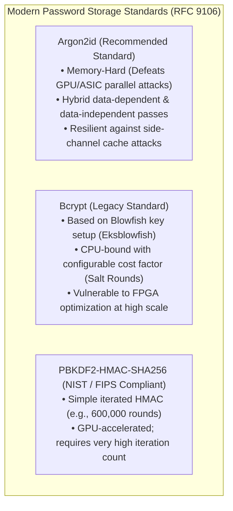

# 12B - Direct Credential Defense, Anti-Enumeration & Delegation Boundaries

> "A resilient identity architecture assumes that the database will eventually be leaked and that internal administrators may attempt unauthorized privilege escalation.
> 
> A Principal Engineer designs constant-time cryptographic defenses, hashes every token at rest, and hardens delegation boundaries so that permissions can never drift into compromise."

---

# Why This Chapter Exists

When an enterprise application manages its own first-party identities—handling user registrations, password resets, token storage, and administrative role assignments—it faces threats that external OAuth2 providers typically conceal:

1. **User Enumeration Side-Channels**: If a password reset endpoint responds in $12\text{ ms}$ with `"Email not found"` when an account does not exist, but takes $85\text{ ms}$ with `"Reset link sent"` when an account exists, attackers can enumerate an entire corporate employee roster in minutes using automated timing scripts.
2. **Timing Side-Channel Attacks**: Comparing secret tokens, hashes, or API keys using standard string equality (`tokenA == tokenB`) leaks timing information. Because runtime equality checks abort at the first non-matching byte, attackers can deduce secret values byte-by-byte by measuring network packet response deltas.
3. **Database Dump Exfiltration**: If sensitive operational tokens (Refresh tokens, Password reset tokens, MFA challenge tokens, Recovery codes) are stored in plaintext in SQL tables, a single database backup leak or read-only SQL injection compromises every active user simultaneously.
4. **Unchecked Administrative Delegation**: Without strict architectural boundaries, a local branch administrator can assign administrative privileges to their own account, or an administrator can accidentally delete the last remaining organization owner, permanently bricking tenant management.

This chapter establishes the engineering standards for **constant-time credential defense**, **token hashing at rest**, and **delegation boundary governance**.

---

# Direct Credential Defense: Modern Password Hashing

When storing user passwords, standard cryptographic hash functions (MD5, SHA-1, SHA-256, SHA-512) are **unconditionally prohibited** because GPUs and ASICs can compute tens of billions of SHA-256 hashes per second.

A Principal Engineer selects between memory-hard, tuned Key Derivation Functions (KDF):



### Parameterizing Argon2id in Enterprise Systems
- **Memory Size ($m$)**: $64\text{ MB}$ ($65,536\text{ KB}$) per hash.
- **Iterations / Time Cost ($t$)**: $3$ passes.
- **Parallelism ($p$)**: $4$ threads.
- This configuration forces an attacker attempting a dictionary attack to allocate $64\text{ MB}$ of high-speed RAM per attempt, rendering mass GPU cracking economically impossible.

---

# Anti-User-Enumeration: The Constant-Time Password Reset

To defeat account enumeration, a password reset endpoint must satisfy two invariants:
1. **Identical Semantic Contract**: Return the exact same JSON response regardless of whether the email exists.
2. **Constant-Time Execution**: If the account does not exist, the server must compute a **dummy password hash** to simulate the CPU delay of a real user lookup!

```csharp
public sealed class PasswordResetService(
    ApplicationDbContext db,
    IPasswordHasher hasher,
    IEmailSender emailSender,
    ILogger<PasswordResetService> logger)
{
    // Pre-computed dummy hash to equalize execution timing
    private static readonly string DummyHash = 
        "$argon2id$v=19$m=65536,t=3,p=4$dummy_salt_for_timing_attacks$dummy_hash_value";

    public async Task<GenericResult> RequestResetAsync(string email, CancellationToken ct)
    {
        var user = await db.Users.FirstOrDefaultAsync(u => u.Email == email, ct);

        if (user != null && user.IsActive)
        {
            // 1. Generate cryptographically strong random token (48 bytes)
            var rawToken = Convert.ToHexString(RandomNumberGenerator.GetBytes(48));

            // 2. Hash token with SHA-256 before storing in SQL
            var tokenHash = SHA256.HashData(Encoding.UTF8.GetBytes(rawToken));

            user.PasswordResetTokenHash = tokenHash;
            user.PasswordResetExpiresAt = DateTimeOffset.UtcNow.AddMinutes(15);
            await db.SaveChangesAsync(ct);

            // 3. Send plaintext token to user's email
            await emailSender.SendPasswordResetEmailAsync(user.Email, rawToken, ct);
        }
        else
        {
            // DEFENSE: Execute dummy hash verification to simulate real processing time!
            // Without this, nonexistent emails return in 2ms while real emails return in 80ms.
            hasher.VerifyHashedPassword(DummyHash, "simulated_timing_payload");
            
            // Random jitter (10-25ms) to mask minor execution path variations
            await Task.Delay(RandomNumberGenerator.GetInt32(10, 25), ct);
        }

        // Always return identical success response
        return GenericResult.Success(
            "If an active account exists for that email, password reset instructions have been dispatched.");
    }
}
```

---

# Defeating Timing Attacks: Constant-Time Comparison

In .NET, comparing two byte arrays or strings using `==` or `SequenceEqual` terminates on the first mismatched byte:

```csharp
// VULNERABLE: Aborts on first non-matching byte!
public bool InsecureCompare(byte[] a, byte[] b)
{
    if (a.Length != b.Length) return false;
    for (int i = 0; i < a.Length; i++)
    {
        if (a[i] != b[i]) return false; // Early exit leaks timing!
    }
    return true;
}
```

### The Principal Solution: `CryptographicOperations.FixedTimeEquals`
The .NET runtime provides hardware-level constant-time evaluation that compares every single byte using bitwise accumulator operations:

```csharp
// SECURE: Fixed-time execution regardless of where mismatch occurs
public bool SecureTokenCompare(ReadOnlySpan<byte> candidateHash, ReadOnlySpan<byte> expectedHash)
{
    return CryptographicOperations.FixedTimeEquals(candidateHash, expectedHash);
}
```

---

# One-Way Token Hashing at Rest

A core architectural invariant of zero-trust identity is: **Tokens that confer access must never be stored in plaintext in databases**.

```
                ┌────────────────────────────────────────────────────────┐
                │ Client holds: Plaintext Token T (48 Base64URL bytes)   │
                └───────────────────────────┬────────────────────────────┘
                                            │ Transmitted via HTTPS
                                            ▼
                ┌────────────────────────────────────────────────────────┐
                │ Server calculates: TokenHash = SHA-256(Plaintext Token)│
                └───────────────────────────┬────────────────────────────┘
                                            │
                                            ▼
                ┌────────────────────────────────────────────────────────┐
                │ Database stores ONLY: TokenHash (32 binary bytes)       │
                │ • If SQL database leaks, attacker cannot reverse hash  │
                │ • Zero tokens can be used to authenticate!             │
                └────────────────────────────────────────────────────────┘
```

This rule applies universally to:
- Refresh Tokens (`RefreshToken.TokenHash`)
- Password Reset Tokens (`User.PasswordResetTokenHash`)
- MFA Challenge Tokens (`MfaChallenge.TokenHash`)
- Emergency Recovery Codes (`RecoveryCode.CodeHash`)

---

# Administrative Delegation Boundaries & Permissions Governance

In multi-tenant SaaS applications, authorization is not just checking if a user has a role; it is **governing who has the authority to mutate roles**.

```
                    ┌────────────────────────────────────────┐
                    │    Platform Owner (SUPER_ADMIN)        │
                    └───────────────────┬────────────────────┘
                                        │ Can manage tenants & assign Tenant Admins
                    ┌───────────────────┴────────────────────┐
                    ▼                                        ▼
      ┌───────────────────────────┐            ┌───────────────────────────┐
      │ Tenant Admin (NURSERY)    │            │ Tenant Admin (HOSPITAL)   │
      └─────────────┬─────────────┘            └───────────────────────────┘
                    │ Can manage branch staff (TEACHER, DRIVER)
                    │ CANNOT assign SUPER_ADMIN or self-escalate!
                    ▼
      ┌───────────────────────────┐
      │ Branch Admin (BRANCH_ADM) │
      └─────────────┬─────────────┘
                    │ Can ONLY manage field operational roles in THEIR branch
                    │ CANNOT assign administrative roles!
                    ▼
      ┌───────────────────────────┐
      │ Field Staff (TEACHER)     │
      └───────────────────────────┘
```

### The 4 Invariants of Role Governance

1. **Branch Delegation Ceiling**:
   A `BRANCH_ADMIN` is strictly forbidden from assigning `NURSERY_ADMIN` or `BRANCH_ADMIN` roles to any user. They may only assign field operational roles (`TEACHER`, `DRIVER`) within their assigned branch.
2. **Self-Demotion & Self-Escalation Shield**:
   An administrator cannot modify their own role. A `NURSERY_ADMIN` cannot demote themselves to `TEACHER` (which would leave them unable to undo the mistake), nor can a `BRANCH_ADMIN` promote themselves to `NURSERY_ADMIN`.
3. **The Immutable Last-Owner Invariant**:
   A tenant must always possess at least one active, unarchived `NURSERY_ADMIN`. The API must reject any operation that attempts to delete, archive, or demote the final remaining administrator of a tenant.
4. **Domain Conflict-of-Interest Segregation**:
   Even high-privilege administrators must be barred from performing actions inherently reserved for counter-parties. For example, a `NURSERY_ADMIN` cannot submit parent satisfaction surveys (`feedback.submit`) or respond to field trip consents (`consents.respond`), preventing internal manipulation of audit logs.

### The Audit-Only Matrix Pattern (`/dashboard/access`)
Many software teams mistakenly build dynamic UI dashboards with checkboxes allowing administrators to check/uncheck individual permissions for roles on the fly.

**Why this is an architectural anti-pattern:**
- Dynamic runtime permission toggling bypasses source code version control, automated integration tests, and security reviews.
- A single accidental checkbox toggle in production can grant unvetted access to financial ledgers or child medical records.
- **The Principal Solution**: The Permissions Matrix must be **Code-Defined and Immutable at Runtime**. The UI dashboard (`/dashboard/access`) is explicitly **View-Only (Audit Mode)**, displaying the 35+ permissions mapped to roles for compliance audits, while role changes require formal code pull requests and regression testing.

---

# Production Incident: The Timing Side-Channel Account Scraping

### Context
A fintech platform used a standard REST endpoint `POST /api/v1/auth/forgot-password` to initiate account recovery for high-net-worth clients.

### The Attack Vector
A competitive intelligence group wrote an asynchronous Python script that queried the endpoint with a dictionary of 100,000 corporate executive email addresses.
- When an email did not exist, the API returned `200 OK` in an average of **$4.2\text{ ms}$** (fast DB index miss).
- When an email existed, the API generated a token, wrote to SQL, called SendGrid, and returned `200 OK` in an average of **$112.4\text{ ms}$**.

### The Breach
By analyzing the statistical distribution of response times, the attackers accurately identified 4,200 verified client email addresses with 99.8% precision, despite the API returning identical HTTP 200 response bodies for every request. The scraped list was subsequently targeted with hyper-personalized spear-phishing campaigns.

### Root Cause Analysis (The 5 Whys)
1. **Why was the attacker able to identify existing users?**  
   The endpoint exhibited a 100ms timing difference between existent and non-existent accounts.
2. **Why was the response time different if the HTTP body was identical?**  
   The non-existent path returned immediately, while the existent path performed database writes and cryptographic operations.
3. **Why wasn't dummy work performed on the negative path?**  
   The developers believed that returning a generic string message was sufficient to defeat user enumeration.
4. **Why wasn't rate limiting effective?**  
   The attackers rotated through 50,000 residential proxy IPs, keeping requests per IP well below the rate limit threshold.

### Permanent Architectural Remedy
Implemented the **Anti-Enumeration Equalization Pipeline**:
1. Synchronized execution timing by calculating dummy Argon2id hashes on negative paths.
2. Moved email delivery to an asynchronous outbox / background channel so SMTP latency does not influence HTTP response timing.
3. Injected random cryptographic timing jitter (10–25ms) to flatten response duration histograms.

---

# Self Assessment

1. Why are general-purpose cryptographic hash functions like SHA-256 unsuitable for storing user passwords, while being ideal for storing refresh tokens and recovery codes?
2. How does an attacker exploit early-exit string comparisons (`tokenA == tokenB`) to deduce a 48-byte secret key over a network connection?
3. Explain the mechanism of the "Dummy Work" pattern in password reset endpoints. What prevents the negative path from executing significantly faster than the positive path?
4. Why does a Principal Engineer advocate for a View-Only (Audit-Mode) Permissions Matrix rather than allowing administrators to toggle checkboxes for individual role permissions at runtime?
