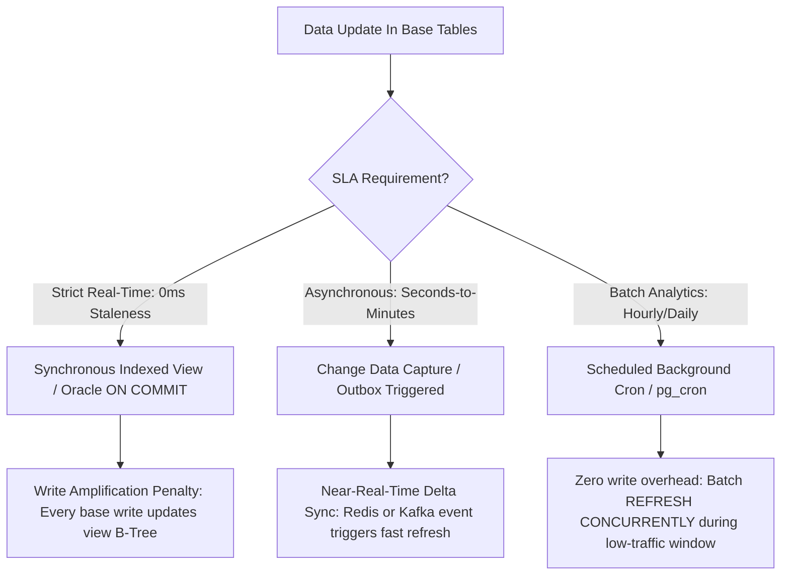

# 12A - Materialized Views vs Standard Views & Enterprise Refresh Strategies

> "A standard view is merely saved query text expanded by the query optimizer at runtime.
>
> A materialized view is a physical table whose storage, indexes, and statistics represent pre-computed truth. Mastering when and how to synchronize that truth is the difference between sub-millisecond dashboards and database lock collapse."

---

# 1. Structural Comparison: Standard View vs Materialized View

Every database architect must distinguish between syntactic views and materialized storage:

```text
┌────────────────────────────────────────────────────────────────────────────────────────┐
│ STANDARD VIEW (VIRTUAL MACRO)                                                          │
│ 1. Zero disk storage (only metadata in sys.views / pg_views).                          │
│ 2. Query expansion: At runtime, the query optimizer inlines the view definition into   │
│    the caller query, hitting underlying base tables and computing joins from scratch. │
│ 3. Always 100% real-time data, but zero performance acceleration for heavy queries.   │
└────────────────────────────────────────────────────────────────────────────────────────┘

┌────────────────────────────────────────────────────────────────────────────────────────┐
│ MATERIALIZED VIEW (PHYSICALLY PERSISTED CACHE)                                         │
│ 1. Dedicated physical 8KB pages allocated on disk with its own B-Tree indexes.         │
│ 2. Zero runtime join overhead: Caller reads pre-aggregated summary rows directly.      │
│ 3. Data is asynchronous or conditionally synchronized — introduces staleness trade-off.│
│ 4. Requires an explicit refresh strategy (Immediate, Scheduled, or Event-Driven).      │
└────────────────────────────────────────────────────────────────────────────────────────┘
```

### Physical Comparison Matrix

| Feature | Standard Virtual View | Materialized View (PostgreSQL / Oracle) | SQL Server Indexed View |
|---|---|---|---|
| **Storage Overhead** | 0 bytes | Dedicated table storage + indexes | Dedicated clustered index storage |
| **Execution Cost** | Evaluates base table joins every query | $O(\log N)$ index seek on pre-computed data | $O(\log N)$ clustered index seek |
| **Write Penalty** | 0 (No extra writes on `INSERT`/`UPDATE`) | 0 during writes (cost paid during refresh) | High: Synchronously updated in base write tx |
| **Staleness** | 0 ms (Always current) | Stale between refresh intervals | 0 ms (Strictly transactional) |
| **Indexable?** | No | Yes (Can create B-Tree, GIN, BRIN indexes) | Yes (Unique clustered index required first) |

---

# 2. PostgreSQL: Physical Mechanics & Zero-Downtime Concurrent Refresh

In PostgreSQL, a materialized view is physically stored like a regular heap table (`pg_class.relkind = 'm'`).

### Creation and Indexing:
```sql
-- 1. Create the Materialized View with aggregated financial data
CREATE MATERIALIZED VIEW mv_customer_monthly_spend AS
SELECT 
    o.customer_id,
    DATE_TRUNC('month', o.order_date)::DATE AS order_month,
    COUNT(o.order_id) AS total_orders,
    SUM(o.total_amount) AS total_spent,
    AVG(o.total_amount) AS average_order_value
FROM orders o
JOIN order_items oi ON o.order_id = oi.order_id
WHERE o.status = 'Completed'
GROUP BY o.customer_id, DATE_TRUNC('month', o.order_date)
WITH DATA;

-- 2. MANDATORY FOR CONCURRENT REFRESH: Unique index covering the logical key
CREATE UNIQUE INDEX uq_mv_cust_month 
ON mv_customer_monthly_spend (customer_id, order_month);

-- 3. Secondary index for range queries
CREATE INDEX ix_mv_month 
ON mv_customer_monthly_spend (order_month);
```

### The Refresh Concurrency Trap:
If you execute a standard refresh in production:

```sql
REFRESH MATERIALIZED VIEW mv_customer_monthly_spend;
```

Postgres acquires an **`ACCESS EXCLUSIVE` lock** on the materialized view. **All concurrent read queries block completely** until the underlying aggregate finishes recalculating. If the aggregation takes 45 seconds, checkout or dashboard threads queue up and trigger connection pool starvation.

### The Solution: Zero-Downtime `CONCURRENTLY` Refresh

```sql
REFRESH MATERIALIZED VIEW CONCURRENTLY mv_customer_monthly_spend;
```

#### How `REFRENTLY` Operates Under the Hood:
1. PostgreSQL creates a temporary heap table holding the newly executed query results.
2. It acquires only an `EXCLUSIVE` lock (which **allows concurrent reads** via `SELECT`).
3. Using the **mandatory unique index**, the engine performs an in-memory diff between the existing view rows and the new snapshot:
   - Missing rows are `INSERT`ed.
   - Modified rows are `UPDATE`d.
   - Removed rows are `DELETE`d.
4. Generates minimal WAL and zero reader blocking.

> ⚠️ **Invariable Rule**: `REFRESH MATERIALIZED VIEW CONCURRENTLY` **fails with error** `42P10: cannot refresh materialized view concurrently without a unique index` if no unique index exists across the view columns without partial predicates (`WHERE`).

---

# 3. SQL Server: Indexed Views & The Schema-Binding Contract

SQL Server does not use the `MATERIALIZED VIEW` keyword. Instead, you create a standard view and enforce **physical materialization by placing a unique clustered index on it**.

### Strict Architectural Prerequisites for Indexed Views:
1. The view definition must use `WITH SCHEMABINDING` (freezing base table schemas; base tables cannot be altered or dropped).
2. Must use two-part naming (`dbo.Orders`, not just `Orders`).
3. Aggregations must include `COUNT_BIG(*)` to track row existence for incremental maintenance.
4. Cannot use `OUTER JOIN`, `UNION`, `DISTINCT`, `TOP`, `EXISTS`, subqueries, or non-deterministic functions (like `GETDATE()` or `RAND()`).

### Production Implementation:
```sql
CREATE VIEW dbo.vw_MerchantDailySales
WITH SCHEMABINDING
AS
SELECT 
    o.MerchantId,
    CAST(o.CreatedAt AS DATE) AS SalesDate,
    COUNT_BIG(*) AS TransactionCount,
    SUM(ISNULL(o.TotalAmount, 0)) AS TotalRevenue
FROM dbo.Orders o
WHERE o.PaymentStatus = 'Settled'
GROUP BY o.MerchantId, CAST(o.CreatedAt AS DATE);
GO

-- Materialize the view physically onto 8KB data pages:
CREATE UNIQUE CLUSTERED INDEX CIX_vw_MerchantDailySales
ON dbo.vw_MerchantDailySales (MerchantId, SalesDate);
GO
```

### The Query Optimizer Rewrite Engine:
Once the clustered index is created, SQL Server automatically maintains the view **synchronously in the same ACID transaction** as any `INSERT`, `UPDATE`, or `DELETE` on `dbo.Orders`.

#### Query Matching (Enterprise Edition):
When an application queries the base table:
```sql
SELECT MerchantId, SUM(TotalAmount)
FROM dbo.Orders
WHERE PaymentStatus = 'Settled' AND CreatedAt >= '2026-01-01'
GROUP BY MerchantId;
```
The Query Optimizer automatically detects that `dbo.vw_MerchantDailySales` contains pre-computed results. **It rewrites the execution plan to seek directly into the indexed view, never touching the 50-million-row `Orders` table!**

> 💡 **Standard Edition Gotcha**: In SQL Server Standard or Web edition, the query optimizer will NOT rewrite queries against base tables to use indexed views automatically. You **must explicitly query the view with the `WITH (NOEXPAND)` table hint**:
> ```sql
> SELECT MerchantId, TotalRevenue
> FROM dbo.vw_MerchantDailySales WITH (NOEXPAND)
> WHERE SalesDate = '2026-03-01';
> ```

---

# 4. Enterprise Refresh Architectures: Choosing the Right Strategy



### Refresh Strategy Comparison Matrix

| Refresh Strategy | Mechanism | Latency / Staleness | Write Impact on Base Table | Best Use Case |
|---|---|---|---|---|
| **Immediate (Synchronous)** | SQL Server Indexed View / Oracle `FAST ON COMMIT` | 0 ms | High (Base transactions do extra I/O) | High-read, low-write transactional ledgers |
| **Scheduled Batch** | Cron / `pg_cron` / Hangfire worker | 5 min – 24 hours | 0 ms on base writes | Executive dashboards, daily financial rollups |
| **Incremental (CDC / Trigger)** | Change Data Capture (Debezium/Outbox) & Delta Upsert | 100 ms – 2 sec | Low (Processed asynchronously via queues) | High-throughput inventory or rating scorecards |

---

# 5. Production Benchmark: Million-Row Aggregation

Consider an e-commerce platform calculating lifetime spend across 10 million orders and 1 million customers:

### Scenario A: Ad-Hoc Dynamic Join Query
```sql
SELECT customer_id, SUM(total_amount) 
FROM orders 
WHERE status = 'Completed' 
GROUP BY customer_id;
```
* **Execution Plan**: Parallel Hash Aggregate -> Parallel Hash Join -> Sequential Scan of 10M rows.
* **Cost**: 82,410 Logical Reads, 1,420 ms CPU time, 1,850 ms elapsed time.
* **Buffer Pool Impact**: 1.2 GB of data pages loaded, evicting active user sessions.

### Scenario B: Materialized View with Clustered Index
```sql
SELECT customer_id, total_spent 
FROM mv_customer_monthly_spend 
WHERE customer_id = 49201;
```
* **Execution Plan**: Clustered Index Seek on `uq_mv_cust_month`.
* **Cost**: **3 Logical Reads**, 0.12 ms CPU time, 0.45 ms elapsed time.
* **Speedup**: **4,111x faster** with 99.99% reduction in I/O!

---

# 6. Principal Architectural Defense Questions

### Question 1: When should you avoid Materialized Views or Indexed Views?
> **Principal Answer**: Materialized views should be strictly avoided when:
> 1. **The underlying tables have extreme write volume (e.g. 10,000+ writes/sec)**: Synchronous indexed views will bottleneck write throughput due to lock contention on the view's clustered index pages and write amplification.
> 2. **The query SLA strictly demands real-time data, but the query uses non-deterministic logic**: In PostgreSQL, you cannot have real-time updates without running periodic refreshes. If business stakeholders reject any staleness window, a read-through distributed cache (Redis) or CQRS denormalized read-model is required.
> 3. **The data cardinalities change unpredictably**: If an indexed view contains high-frequency updates on clustered keys, it causes rampant 50/50 page splits on the view pages.

### Question 2: In PostgreSQL, why does `REFRESH MATERIALIZED VIEW CONCURRENTLY` sometimes take longer than standard `REFRESH`?
> **Principal Answer**: Standard `REFRESH` simply executes the query, writes the entire result set to a brand new physical data file, swaps the file pointers, and rebuilds the indexes from scratch (a sequential bulk write). 
> 
> In contrast, `REFRESH CONCURRENTLY` executes the query, stores it in a temp table, performs an expensive row-by-row outer join diff against the existing view using the unique index, and executes individual `INSERT`, `UPDATE`, and `DELETE` operations to minimize locking. While `CONCURRENTLY` uses more CPU and elapsed time, it **exchanges total compute time for zero-downtime reader availability**, preventing application outages.

---

# 7. Summary & Invariant Laws

1. **The Invariant Law of Materialization**: A materialized view is an explicit architectural trade-off: you pay in storage capacity, write amplification, or data staleness to eliminate runtime CPU and I/O bottlenecks.
2. **The Law of Concurrent Uniqueness**: Never run a bare `REFRESH MATERIALIZED VIEW` in a production OLTP environment; always maintain a unique index to enable `CONCURRENTLY` execution without reader locking.
3. **The Law of Schema Binding**: Synchronous indexed views tightly couple base table schemas to their view representations. Never deploy indexed views without automated database migration governance.
