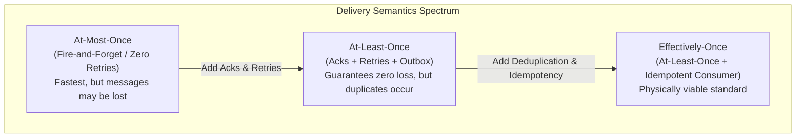

# Messaging & Queueing Requirements

> "Requirements in messaging are not functional checklists; they are mathematical boundaries on throughput, latency, loss tolerance, and ordering."

---

## 1. Non-Functional SLAs & Constraints

```text
┌─────────────────────────┬─────────────────────────────┬──────────────────────────┐
│ Dimension               │ Production SLA Ceiling      │ Degradation Threshold    │
├─────────────────────────┼─────────────────────────────┼──────────────────────────┤
│ Peak Ingestion Rate     │ 50,000 msgs / second        │ 100,000 msgs / second    │
│ End-to-End Latency      │ p50 < 15ms, p99 < 120ms     │ p99 > 500ms (Trigger SLA)│
│ Data Loss Tolerance     │ 0.000% (Strict Zero-Loss)   │ Any dropped message = SEV1│
│ In-Flight Queue Depth   │ < 10,000 messages           │ > 100,000 (Auto-scale)   │
│ Consumer Processing CPU │ < 60% across cluster        │ > 85% (Worker Starvation)│
└─────────────────────────┴─────────────────────────────┴──────────────────────────┘
```

---

## 2. The Four Pillars of Message Delivery Guarantees



### The "Exactly-Once" Fallacy
In an asynchronous distributed network with unreliable links (the Two Generals' Problem), **true physical Exactly-Once delivery is impossible**. 
A message can be sent, processed, and when the consumer sends the ACK back, the network connection drops. The broker, never having received the ACK, re-delivers the message.

Therefore, an enterprise system achieves **Effectively-Once Processing** by pairing:
$$	ext{Effectively-Once} = 	ext{At-Least-Once Delivery} + 	ext{Idempotent Consumer Processing}$$

---

## 3. Durability vs. Ephemeral Latency Trade-Offs

```text
Trade-off Matrix: Storage Engine Configuration
1. Transient / Memory-Only Queues (e.g., Redis Pub/Sub, RabbitMQ transient queues):
   • Throughput: > 500,000 msgs/sec
   • Latency: < 1ms
   • Risk: Node restart = 100% in-flight message loss.
   • Allowed for: Live telemetry metrics, non-critical notification broadcasts.

2. Persistent / Disk-Backed Queues (e.g., Azure Service Bus Premium, RabbitMQ Quorum Queues, Kafka):
   • Throughput: 20,000 - 80,000 msgs/sec per partition
   • Latency: 5ms - 25ms (requires fsync / Raft consensus)
   • Risk: Zero data loss during broker crashes.
   • Mandatory for: Orders, financial transactions, user security state changes.
```

---

## 4. Formal & Verified References

* [RFC 2119: Key words for use in RFCs to Indicate Requirement Levels](https://www.ietf.org/rfc/rfc2119.txt)
* [Martin Kleppmann: You Cannot Have Exactly-Once Delivery](https://martin.kleppmann.com/2018/03/22/is-exactly-once-delivery-possible.html)
* [Azure Service Bus: Reliability and Fault Tolerance Guidelines](https://learn.microsoft.com/en-us/azure/service-bus-messaging/service-bus-performance-improvements)
