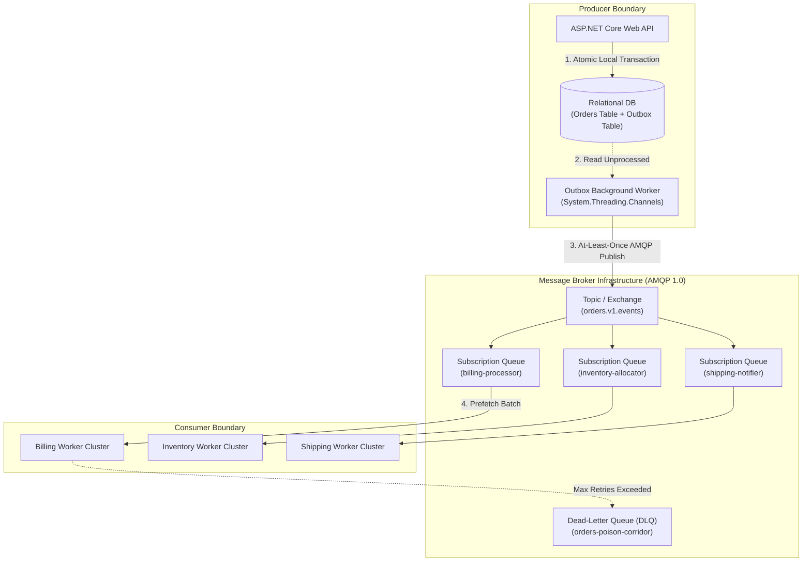

# Asynchronous & Event-Driven Architecture Blueprint

> "Coupling in distributed systems is like gravity: without deliberate architectural boundaries, every service pulls every other service down during an outage."

---

## 1. Enterprise Messaging Topology Blueprint

---

## 2. Architectural Patterns Catalog

The architecture synthesizes five critical enterprise messaging patterns:

1. **Publish-Subscribe (Pub/Sub)**:
   * Decouples event producers from consumers. The ordering service does not know how many services care that an order was placed.
2. **Competing Consumers**:
   * Multiple instances of `Billing Worker` pull from the single `Q_Billing` queue. The broker distributes messages across workers to scale horizontally without duplicate work.
3. **Pipes and Filters**:
   * Incoming messages pass through discrete pipeline filters: Decompression → Signature Verification → Validation → Execution → Telemetry Logging.
4. **Dead-Letter Corridor**:
   * Malformed or unprocessable payloads (poison pills) are isolated immediately to prevent blocking the queue head.
5. **Transactional Outbox**:
   * Ensures database state changes and outbound event emissions succeed or fail as an indivisible unit.

---

## 3. Formal & Verified References

* [Enterprise Integration Patterns: Publish-Subscribe Channel](https://www.enterpriseintegrationpatterns.com/patterns/messaging/PublishSubscribeChannel.html)
* [Enterprise Integration Patterns: Competing Consumers](https://www.enterpriseintegrationpatterns.com/patterns/messaging/CompetingConsumers.html)
* [Microsoft Cloud Design Patterns: Asynchronous Request-Reply Pattern](https://learn.microsoft.com/en-us/azure/architecture/patterns/async-request-reply)
