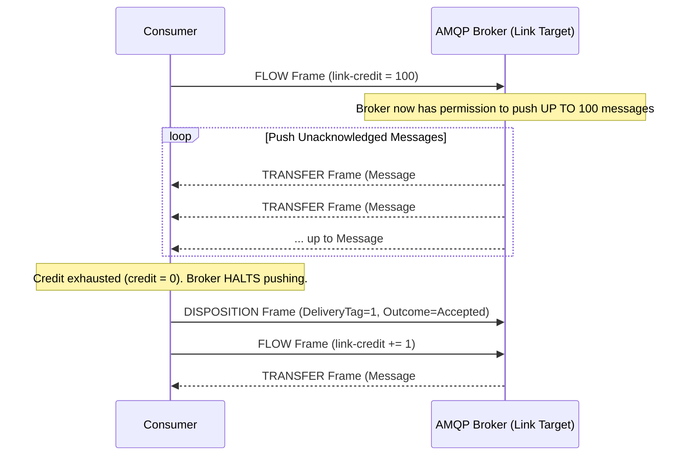

# Inside Broker Internals: Prefetch Count, Credit Flow & ACK Mechanics

> "Misconfiguring prefetch count is the single most common cause of memory exhaustion and false consumer starvation in enterprise messaging."

---

## 1. AMQP 1.0 Credit-Based Flow Control

In AMQP 1.0, a consumer does not pull messages blindly, nor does the broker flood the consumer. Delivery is governed by **Credits**:



---

## 2. Prefetch Count: Sizing for Maximum Throughput

The **Prefetch Count** determines how many messages the broker buffers in the consumer's client memory ahead of time.

```text
┌────────────────────────────────────────────────────────────────────────┐
│                       PREFETCH COUNT DILEMMA                           │
├────────────────────────────────────────────────────────────────────────┤
│ Setting Prefetch = 1                                                   │
│ • Pros: Perfect load balancing; zero idle messages in client RAM.      │
│ • Cons: Network Round-Trip Tax. Throughput drops by up to 90% because  │
│   the consumer waits for ACK round-trip before receiving the next item.│
├────────────────────────────────────────────────────────────────────────┤
│ Setting Prefetch = 5,000                                               │
│ • Pros: High throughput (network pipeline is saturated).               │
│ • Cons: Memory bloat. If processing takes 2 seconds per message, one   │
│   worker locks 5,000 messages (10,000 seconds of work!), starving      │
│   other available workers and causing message lease expirations.       │
└────────────────────────────────────────────────────────────────────────┘
```

### The Principal Sizing Formula
$$	ext{Prefetch Count} pprox rac{	ext{Target Concurrency} 	imes (	ext{Network RoundTrip Time} + 	ext{Processing Time})}{	ext{Processing Time}}$$

* **Fast tasks (< 10ms)**: Set Prefetch = $100 - 300$.
* **Slow tasks (> 500ms, external APIs, DB writes)**: Set Prefetch = $5 - 20$.
* **Heavy memory tasks (Video processing, PDF generation)**: Set Prefetch = $1 - 2$.

---

## 3. Acknowledgement States: Complete vs Abandon vs DeadLetter

```csharp
// .NET 9 Azure Service Bus Processing Semantics
public async Task ProcessMessageAsync(ProcessMessageEventArgs args)
{
    try
    {
        await ProcessPayloadAsync(args.Message.Body);
        
        // 1. ACCEPT / COMPLETE: Message deleted permanently from broker
        await args.CompleteMessageAsync(args.Message);
    }
    catch (TransientExternalServiceException ex)
    {
        // 2. ABANDON / NACK: Releases message lease immediately for redelivery
        // Does NOT count as a poison failure if handled gracefully
        await args.AbandonMessageAsync(args.Message);
    }
    catch (MalformedPayloadException ex)
    {
        // 3. DEAD-LETTER: Quarantines unprocessable poison message immediately
        await args.DeadLetterMessageAsync(
            args.Message, 
            deadLetterReason: "SchemaValidationFailure", 
            deadLetterErrorDescription: ex.Message);
    }
}
```

---

## 4. Formal & Verified References

* [OASIS: AMQP 1.0 Part 2: Transport & Flow Control](http://docs.oasis-open.org/amqp/core/v1.0/os/amqp-core-transport-v1.0-os.html)
* [MassTransit: Prefetch Count & Concurrency Tuning](https://masstransit.io/documentation/configuration/transports)
* [Microsoft Learn: Best Practices for Performance Improvements Using Service Bus](https://learn.microsoft.com/en-us/azure/service-bus-messaging/service-bus-performance-improvements)
