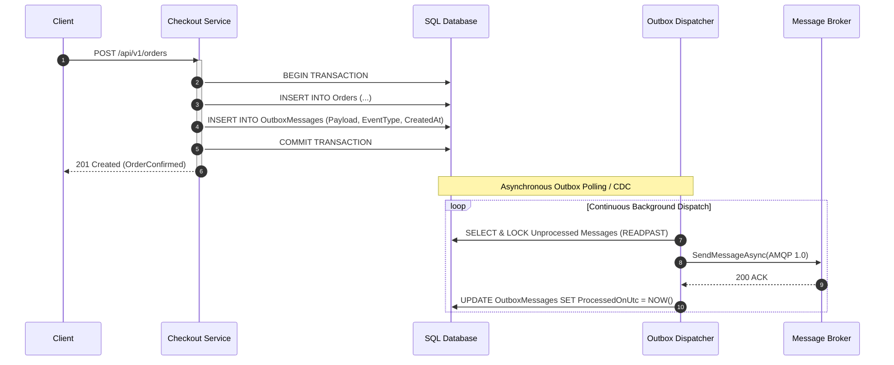

# The Transactional Outbox Pattern: Dual-Write Resolution

> "The only way to guarantee that an event is published if and only if a database state change succeeds, is to make the outbound event part of the database state change."

---

## 1. The Dual-Write Architectural Dilemma

When an application modifies a database and publishes an event, there are only two naive ways to order the operations:

```text
Sequence A: Publish First, then Commit DB
  1. Broker.Publish(OrderPlaced) -> SUCCEEDS
  2. Database.Commit()           -> FAILS (Deadlock / Crash)
  Result: Downstream services process phantom order that doesn't exist in SQL!

Sequence B: Commit DB First, then Publish
  1. Database.Commit()           -> SUCCEEDS
  2. Broker.Publish(OrderPlaced) -> FAILS (Network partition / Broker timeout)
  Result: Customer was charged in SQL, but warehouse never ships the product!
```

Neither sequence is atomic across distributed boundaries.

---

## 2. The Solution: Transactional Outbox Pattern

Instead of publishing to the remote broker across the network, the application writes the event into an **Outbox Table** inside the **same local ACID database transaction**:



---

## 3. Production Outbox Schema (.NET 9 & EF Core)

```csharp
public sealed class OutboxMessage
{
    public Guid Id { get; set; } = Guid.NewGuid();
    public string EventType { get; set; } = default!;
    public string Payload { get; set; } = default!;
    public DateTime CreatedOnUtc { get; set; } = DateTime.UtcNow;
    public DateTime? ProcessedOnUtc { get; set; }
    public string? Error { get; set; }
    public int RetryCount { get; set; }
}

// EF Core Configuration
public class OutboxMessageConfiguration : IEntityTypeConfiguration<OutboxMessage>
{
    public void Configure(EntityTypeBuilder<OutboxMessage> builder)
    {
        builder.ToTable("OutboxMessages");
        builder.HasKey(x => x.Id);
        
        // Composite index optimized for the polling query
        builder.HasIndex(x => new { x.ProcessedOnUtc, x.CreatedOnUtc })
               .HasFilter("[ProcessedOnUtc] IS NULL");
    }
}
```

---

## 4. Formal & Verified References

* [Microservices.io: Transactional Outbox Pattern (Chris Richardson)](https://microservices.io/patterns/data/transactional-outbox.html)
* [Martin Kleppmann: Designing Data-Intensive Applications (Chapter 11: Stream Processing)](https://dataintensive.net/)
* [Azure Architecture Center: Outbox Pattern Implementation](https://learn.microsoft.com/en-us/azure/architecture/best-practices/transactional-outbox)
