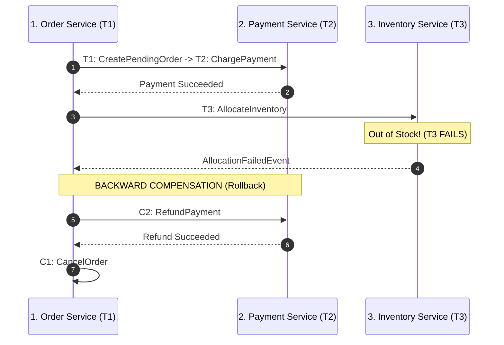

# The Distributed Saga Pattern: Orchestration vs Choreography

> "In microservices, you cannot hold an atomic database lock across multiple HTTP boundaries. A Saga is a sequence of local transactions coordinated by events and compensating actions."

---

## 1. The Core Mechanics: Forward vs. Backward Recovery

A Saga breaks a distributed transaction into discrete local transactions ($T_1, T_2, \dots, T_n$).
For every forward action ($T_i$), an architect must define a compensating action ($C_i$) that semantically undoes its effects if a downstream step fails:



---

## 2. Orchestration vs. Choreography Comparison

```text
┌───────────────────────────┬─────────────────────────────┬───────────────────────────┐
│ Dimension                 │ Choreography (Event-Driven) │ Orchestration (Central)   │
├───────────────────────────┼─────────────────────────────┼───────────────────────────┤
│ Coordination Model        │ Decentralized. Services     │ Centralized Orchestrator  │
│                           │ publish and listen to events│ (State Machine) sends     │
│                           │ reactively.                 │ commands to participants. │
│ Coupling                  │ Very Low (Services only know│ Moderate (Orchestrator    │
│                           │ domain events).             │ coordinates participants).│
│ Visibility & Debugging    │ Hard. Distributed trace     │ Excellent. Single state   │
│                           │ graph across 10+ services.  │ record in database.       │
│ Cyclical Dependencies     │ High risk as system grows.  │ Non-existent.             │
│ Best For                  │ Simple 2-3 step workflows.  │ Complex multi-step business│
│                           │                             │ transactions (e-commerce).│
└───────────────────────────┴─────────────────────────────┴───────────────────────────┘
```

---

## 3. Handling the Semantic Anomalies of Sagas

Because Sagas do not hold isolation locks (lacking the "I" in ACID), they are subject to distributed concurrency anomalies:
1. **Lost Updates**: Another transaction modifies the same entity before the saga compensates.
2. **Dirty Reads**: A consumer reads uncommitted state from step $T_2$ before step $T_3$ fails and triggers compensation $C_2$.

### The Principal Countermeasure: Semantic Locking
Always mark resources as `Pending` or `Reserved` during execution. Other transactions read the pending status and wait or fail gracefully rather than operating on unstable state.

---

## 4. Formal & Verified References

* [Hector Garcia-Molina & Kenneth Salem (1987): Sagas (Original ACM Paper)](https://www.cs.cornell.edu/andru/cs711/2002fa/reading/sagas.pdf)
* [Chris Richardson: Microservices Patterns (Chapter 4: Managing Transactions with Sagas)](https://microservices.io/book)
* [Microsoft Cloud Design Patterns: Saga Distributed Transactions](https://learn.microsoft.com/en-us/azure/architecture/reference-architectures/saga/saga)
