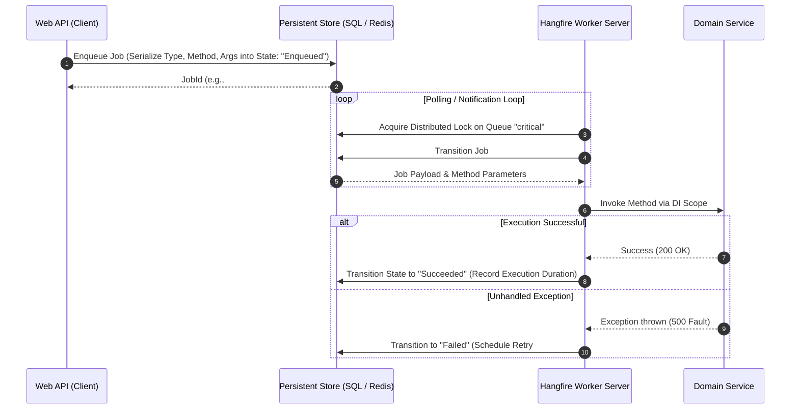

# 10A - Background Jobs & Distributed Schedulers: Hangfire, Quartz.NET & Spring Batch

> "An in-memory `BackgroundService` is adequate only until your container restarts, your queue exhausts RAM, or your application scales to multiple instances and runs the same payroll job ten times.
>
> Distributed job schedulers replace volatile in-process loops with persistent state machines, clustered distributed locks, and isolated queue topologies."

---

# 1. Architectural Taxonomy: In-Process Workers vs Distributed Schedulers

Every enterprise system must delineate where work is queued and persisted:

```text
┌────────────────────────────────────────────────────────────────────────────────────────┐
│ IN-PROCESS BACKGROUND SERVICE (IHostedService / BackgroundService)                      │
│ 1. Volatile memory: If the pod restarts or crashes, all pending jobs are lost.          │
│ 2. Clustered Multi-Instance Conflict: 5 replica pods = 5 simultaneous cron executions! │
│ 3. Zero operational observability: No failure audit trail, no manual replay button.    │
│ 4. Ideal for: Local cache eviction, heartbeat pinging, consumption of internal Channels│
└────────────────────────────────────────────────────────────────────────────────────────┘

┌────────────────────────────────────────────────────────────────────────────────────────┐
│ DISTRIBUTED PERSISTENT SCHEDULER (Hangfire, Quartz.NET, Spring Batch)                  │
│ 1. Persistent State Machine: Jobs serialized to RDBMS/Redis before execution begins.   │
│ 2. Clustered Distributed Coordination: Only one node fires the scheduled trigger.       │
│ 3. Queue Partitioning: Separate worker pools for critical vs bulk batch jobs.          │
│ 4. Automatic Resiliency: Failed jobs retry with exponential backoff and dead-lettering.│
│ 5. Full Operational Dashboard: Real-time UI for monitoring, metrics, and manual re-run.│
└────────────────────────────────────────────────────────────────────────────────────────┘
```

### Feature Comparison Matrix

| Capability | ASP.NET Core `BackgroundService` | Hangfire | Quartz.NET | Spring Batch |
|---|---|---|---|---|
| **State Persistence** | Volatile RAM only | SQL Server / PostgreSQL / Redis | RDBMS (`JobStoreTX`) / RAM | RDBMS (`JobRepository`) |
| **Cluster Safe (Multi-Pod)** | ❌ No (Requires manual distributed lock) | ✅ Native clustered leader/worker | ✅ Native clustering with DB check-ins | ✅ Chunk-based step partitioning |
| **Queue Isolation** | Single local queue | ✅ Named queues (`[Queue("critical")]`) | Manual thread pool configuration | Step partitioning / multi-threading |
| **Cron Scheduling** | Custom `PeriodicTimer` math | ✅ `RecurringJob.AddOrUpdate(...)` | ✅ Enterprise Cron Triggers | ✅ Spring TaskScheduler integration |
| **Retry State Machine** | Must write manual `try/catch/retry` | ✅ State machine with backoff & history | ✅ `IJobExecutionContext` refire flags | ✅ Fault tolerance with retry/skip limits |
| **Operational UI** | None (stdout logs only) | ✅ Built-in Web Dashboard | Third-party / API only | Spring Cloud Data Flow UI |

---

# 2. Hangfire Engine Architecture & Queue Isolation

Hangfire's execution model relies on expression tree serialization and state machine persistence:



### Queue Partitioning: Preventing Bulk Job Starvation
A common production failure occurs when 10,000 slow PDF report jobs fill the queue, blocking time-sensitive transactional emails (password reset, order confirmation). 

Hangfire solves this via **Named Queue Isolation**:

```csharp
// Program.cs: Configure Hangfire Server with Dedicated Queue Priorities
builder.Services.AddHangfireServer(options =>
{
    // Worker processes queues in strict left-to-right priority order
    options.Queues = new[] { "critical", "default", "bulk-reports" };
    options.WorkerCount = Environment.ProcessorCount * 4;
});

// Enqueue jobs to dedicated queues:
public sealed class BillingNotificationService
{
    [Queue("critical")]
    [AutomaticRetry(Attempts = 5, OnAttemptsExceeded = AttemptsExceededAction.Fail)]
    public async Task SendInstantInvoiceEmailAsync(Guid invoiceId)
    {
        // Executed immediately by dedicated high-priority workers
    }

    [Queue("bulk-reports")]
    [AutomaticRetry(Attempts = 3)]
    public async Task GenerateQuarterlyTaxArchiveAsync(int taxYear)
    {
        // Long-running batch job that cannot starve "critical" workers
    }
}
```

---

# 3. Quartz.NET: Clustering & Non-Concurrent Execution

Quartz.NET is the enterprise standard for complex calendar-based recurrence rules (e.g., "Run every business day at 17:00 excluding federal holidays"):

### The Cron Overlap Trap & `[DisallowConcurrentExecution]`
If a recurring job is scheduled to run every 1 minute (`0 * * ? * *`), but on Black Friday the job takes 3 minutes to finish:
- Without protection, Quartz triggers a **second and third concurrent instance of the same job**.
- Both instances query the same pending database records, triggering **deadlocks or duplicate billing**.

```csharp
using Quartz;

[DisallowConcurrentExecution] // Invariant: Blocks next execution until current completes
public sealed class InventoryReconciliationJob : IJob
{
    private readonly ILogger<InventoryReconciliationJob> _logger;
    private readonly IInventoryService _inventoryService;

    public InventoryReconciliationJob(
        ILogger<InventoryReconciliationJob> logger, 
        IInventoryService inventoryService)
    {
        _logger = logger;
        _inventoryService = inventoryService;
    }

    public async Task Execute(IJobExecutionContext context)
    {
        _logger.LogInformation("Starting inventory reconciliation at {Time}", DateTimeOffset.UtcNow);
        
        // If this method takes 5 minutes, Quartz delays the next scheduled execution 
        // until this task completely releases the job key lock in the database.
        await _inventoryService.ReconcileWarehouseStockAsync(context.CancellationToken);
    }
}
```

### Quartz.NET Database Clustering Configuration:
To prevent duplicate execution across multiple Kubernetes pods, Quartz uses database row-level locking via `JobStoreTX`:

```csharp
builder.Services.AddQuartz(q =>
{
    q.UsePersistentStore(s =>
    {
        s.UseProperties = true;
        s.UseSqlServer("Server=db;Database=QuartzCluster;Integrated Security=true;");
        s.UseClustering(c =>
        {
            c.CheckinInterval = TimeSpan.FromSeconds(15);
            c.CheckinMisfireThreshold = TimeSpan.FromSeconds(60);
        });
    });
});
```

---

# 4. Spring Batch Architecture (Multi-Stack Comparison)

In enterprise Java environments (Spring Boot), large-scale offline batch processing uses **Spring Batch**:

```text
┌────────────────────────────────────────────────────────────────────────────────────────┐
│ SPRING BATCH CHUNK-ORIENTED PROCESSING ARCHITECTURE                                    │
│                                                                                        │
│  ┌───────────────────────┐                                                             │
│  │      JobLauncher      │───▶ JobRepository (PostgreSQL / Oracle)                     │
│  └───────────┬───────────┘                                                             │
│              ▼                                                                         │
│  ┌───────────────────────┐                                                             │
│  │          Job          │                                                             │
│  └───────────┬───────────┘                                                             │
│              ▼                                                                         │
│  ┌───────────────────────┐                                                             │
│  │         Step          │ (Chunk Size = 1000)                                         │
│  └───────────┬───────────┘                                                             │
│              │                                                                         │
│     ┌────────┴────────┬───────────────────┐                                            │
│     ▼                 ▼                   ▼                                            │
│ ItemReader       ItemProcessor       ItemWriter                                        │
│ (Reads 1000      (Enriches/Validates (Writes 1000 in a single                          │
│  rows via cursor) 1 item at a time)   atomic batch transaction)                        │
└────────────────────────────────────────────────────────────────────────────────────────┘
```

*Key Differences from Task Schedulers:*
1. **Chunk-Oriented Transactions**: Processes 1,000 items in memory, commits the transaction, and updates the step execution context with the last processed ID. If a crash occurs at item 52,000 of 1,000,000, it **resumes immediately from item 52,001** without restarting the entire batch.
2. **Skip and Retry Policies**: Automatically skips malformed records (`FlatFileParseException`) up to a configurable threshold while logging failed row numbers.

---

# 5. Production Incident: The Unbounded Cron Overlap Avalanche

### The Incident:
An e-commerce company scheduled an automated order fulfillment task using an in-memory `BackgroundService` with `PeriodicTimer(TimeSpan.FromMinutes(5))`.

### What Went Wrong:
1. During a flash sale, the number of pending orders jumped from 200 to 45,000.
2. The 5-minute batch job took **18 minutes** to process the orders.
3. The cluster autoscaled from **2 pods to 8 pods**.
4. Each of the 8 pods started running its own fulfillment loop every 5 minutes.
5. **Simultaneously, 24 fulfillment instances were querying `SELECT * FROM Orders WHERE Status = 'Pending'`**:
   - Multiple pods fetched the exact same order IDs.
   - Dual shipments were dispatched, double-charging customers and causing **$320,000 in inventory discrepancies**.
   - Database CPU pegged at 100% due to lock escalation on the `Orders` table.

### The Architectural Fix:
1. Replaced the in-memory timer with **Hangfire backed by Redis distributed locking**.
2. Applied **Job Idempotency**: Each job checks an optimistic concurrency version token or uses a Transactional Inbox pattern.
3. Configured **Queue Isolation**: Placed fulfillment in a dedicated queue throttled to max 2 concurrent workers across the entire cluster.

---

# 6. Principal Architectural Defense Questions

### Question 1: How do you guarantee idempotency in distributed background jobs?
> **Principal Answer**: You must assume background jobs can and will execute more than once due to network partitions, database connection drops during commit, or pod evictions. To guarantee idempotency:
> 1. Pass a unique deterministic **Idempotency Key** (e.g. `PaymentId` or `JobKey = "invoice_monthly_2026_03_cust_42"`) in the job arguments.
> 2. The job handler executes an atomic conditional write or `INSERT` into an `ExecutedJobs` deduplication table inside the same transaction as the business operation.
> 3. If a duplicate job executes, the unique constraint violates or the status check reports `AlreadyProcessed`, causing the job to exit gracefully with success.

### Question 2: Why choose Hangfire over Quartz.NET, or vice versa?
> **Principal Answer**: 
> - **Hangfire** is ideal for **ad-hoc fire-and-forget, delayed, and continuation jobs** (`BackgroundJob.Enqueue(() => ...)`). It provides exceptional developer ergonomics in .NET, native expression serialization, queue routing, and an out-of-the-box operational dashboard.
> - **Quartz.NET** is superior when the primary requirement is **complex calendar-based recurring scheduling** (e.g., cron triggers with holiday exclusions, misfire instruction policies, and heterogeneous Java/C# scheduler coordination via standardized database tables).

---

# 7. Summary & Invariant Laws

1. **Law of Cluster Safety**: Never run state-modifying recurring tasks inside an uncoordinated `IHostedService`; in a multi-pod cluster, all recurring tasks must use persistent distributed schedulers with distributed locks.
2. **Law of Queue Segregation**: Never mix real-time transactional background tasks with bulk analytical jobs on the same worker queue; always partition worker thread pools by latency SLA.
3. **Law of Mandatory Idempotency**: In a distributed scheduler, at-least-once execution is the only physical guarantee; your background handlers must be mathematically idempotent.
