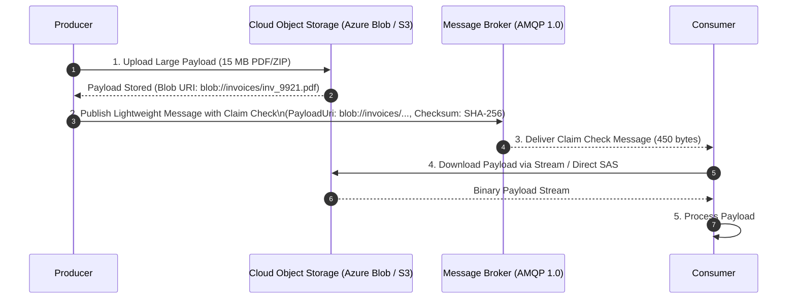

# The Claim Check Pattern: Large Message Offloading

> "Message brokers are designed for high-frequency lightweight coordination signals, not multi-megabyte binary dumps."

---

## 1. The Physics of Broker Payload Limits

| Broker | Standard Tier Message Limit | Cost of Exceeding Limits |
|---|---|---|
| **Azure Service Bus** | 256 KB (Standard) / 100 MB (Premium) | Massive memory footprint, thread pool serialization lockups. |
| **RabbitMQ** | 128 MB maximum (Recommended: < 1 MB) | High GC pressure, rapid disk swapping, node thrashing. |
| **Apache Kafka** | 1 MB default (Max: 20 MB) | Log segment fragmentation, consumer lag spikes. |

When payload sizes exceed 256 KB (e.g., high-resolution medical images, bulk catalog syncs, generated PDF invoices), sending the raw binary through the broker is an anti-pattern.

---

## 2. Claim Check Pattern Topology



---

## 3. Production Implementation (.NET 9 C# 13)

```csharp
public sealed record ClaimCheckMessage(
    Guid MessageId, 
    string EventType, 
    Uri PayloadUri, 
    string Sha256Checksum, 
    DateTime CreatedOnUtc);

public sealed class ClaimCheckProducer
{
    private readonly BlobContainerClient _blobContainer;
    private readonly ServiceBusSender _busSender;

    public ClaimCheckProducer(BlobContainerClient blobContainer, ServiceBusSender busSender)
    {
        _blobContainer = blobContainer;
        _busSender = busSender;
    }

    public async Task SendLargeMessageAsync<T>(string eventType, T largePayload, CancellationToken ct)
    {
        var messageId = Guid.NewGuid();
        var blobClient = _blobContainer.GetBlobClient($"{eventType}/{messageId:N}.json");

        // 1. Serialize and stream directly to Azure Blob Storage
        await using var memoryStream = new MemoryStream();
        await JsonSerializer.SerializeAsync(memoryStream, largePayload, cancellationToken: ct);
        memoryStream.Position = 0;
        
        var checksum = Convert.ToHexString(SHA256.HashData(memoryStream.ToArray()));
        memoryStream.Position = 0;

        await blobClient.UploadAsync(memoryStream, overwrite: true, cancellationToken: ct);

        // 2. Publish lightweight claim check token to message broker
        var claimCheck = new ClaimCheckMessage(messageId, eventType, blobClient.Uri, checksum, DateTime.UtcNow);
        var busMessage = new ServiceBusMessage(JsonSerializer.Serialize(claimCheck))
        {
            MessageId = messageId.ToString(),
            Subject = eventType
        };

        await _busSender.SendMessageAsync(busMessage, ct);
    }
}
```

---

## 4. Formal & Verified References

* [Enterprise Integration Patterns: Claim Check](https://www.enterpriseintegrationpatterns.com/patterns/messaging/StoreInLibrary.html)
* [Azure Architecture Center: Claim-Check Pattern](https://learn.microsoft.com/en-us/azure/architecture/patterns/claim-check)
* [MassTransit Documentation: Large Message Offloading (Claim Check)](https://masstransit.io/documentation/configuration/middleware/claim-check)
