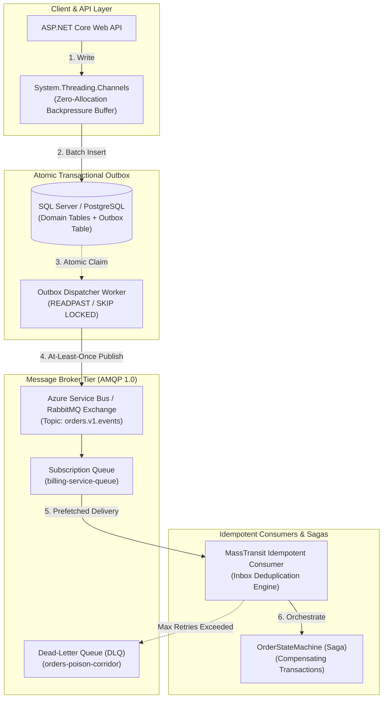

# Sprint 06: Messaging & Background Processing Architecture

> "Coupling in distributed systems is like gravity: without deliberate architectural boundaries, every service pulls every other service down during an outage."

---

## 🎯 Sprint Overview

Sprint 06 guides you through designing, implementing, and defending mission-critical asynchronous messaging and background processing systems. You will eliminate the Distributed Dual-Write trap using the Transactional Outbox pattern, build idempotent consumer pipelines, orchestrate distributed sagas with compensating rollbacks, isolate poison pills with Dead-Letter Queues, and master high-performance in-memory streaming with `System.Threading.Channels`.

---

## 🗺️ Visual Architecture Topology

---

## 📚 Chapter Navigation Matrix

| # | Chapter Title | Core Focus & Architecture Patterns |
|---|---|---|
| **01** | **[The Distributed Double-Billing Meltdown](01-Story.md)** | Production SEV-1 incident: Network timeouts, ghost orders, and dual-write chaos. |
| **02** | **[Learning Objectives & Messaging Competencies](02-Learning-Objectives.md)** | Bloom's taxonomy: junior vs senior vs principal messaging evaluation rubric. |
| **03** | **[Messaging & Queueing Requirements](03-Messaging-Requirements.md)** | SLAs: throughput, latency, zero data loss, and the "Exactly-Once" physical fallacy. |
| **04** | **[Asynchronous & Event-Driven Architecture Blueprint](04-Messaging-Architecture.md)** | Enterprise topology: Pub/Sub, Competing Consumers, Pipes & Filters, DLQ corridor. |
| **05** | **[Broker Protocols & Architecture](05-Broker-Protocols-And-Architecture.md)** | AMQP 1.0 vs MQTT 5.0 vs Kafka log: Azure Service Bus vs RabbitMQ vs Kafka. |
| **05A**| **[Inside Broker Internals: Prefetch & Credit Flow](05A-Inside-Broker-Internals.md)** | AMQP 1.0 credit-based flow control, prefetch count sizing, and ACK states. |
| **06** | **[The Transactional Outbox Pattern](06-Transactional-Outbox-Pattern.md)** | Dual-write resolution: schema, local ACID invariants, and at-least-once delivery. |
| **06A**| **[Inside Outbox Publisher Internals](06A-Inside-Outbox-Publisher-Internals.md)** | Polling vs CDC (Debezium), `UPDLOCK, READPAST`, and `SKIP LOCKED` lock contention. |
| **07** | **[The Idempotent Consumer Pattern](07-Idempotent-Consumer-Pattern.md)** | De-duplication strategies: Inbox table unique constraints and Redis sliding-window locks. |
| **08** | **[Dead-Letter Queues & Retry Storms](08-Dead-Letter-Queues-And-Retry-Storms.md)** | Transient vs terminal errors, poison pills, decorrelated jitter, and DLQ redrive. |
| **09** | **[The Distributed Saga Pattern](09-Distributed-Saga-Pattern.md)** | Distributed transactions without 2PC: Orchestration vs Choreography, compensation. |
| **09A**| **[Inside Saga State Machine Internals](09A-Inside-Saga-StateMachine-Internals.md)** | MassTransit Automatonymous state machine, correlation IDs, and optimistic locking. |
| **10** | **[In-Memory Message Pipelines with Channels](10-InMemory-Channels-Processing.md)** | `System.Threading.Channels` as a local backpressure buffer with bounded capacity. |
| **11** | **[Competing Consumers & FIFO Ordering](11-Competing-Consumers-And-FIFO-Ordering.md)** | Ordering vs horizontal scale: partition keys, session locks, and sharded workers. |
| **12** | **[The Claim Check Pattern](12-Claim-Check-Pattern.md)** | Offloading multi-megabyte payloads to Azure Blob Storage; lightweight token delivery. |
| **13** | **[Principal Messaging Release Checklist](13-Principal-Messaging-Checklist.md)** | Production sign-off: delivery invariants, prefetch calibration, DLQ readiness. |
| **14** | **[Hands-On Messaging Architecture Labs](14-Hands-On-Messaging-Labs.md)** | 5 production-grade labs: Outbox, Idempotent Consumer, Channels, Saga, DLQ. |
| **15** | **[Production Incident Post-Mortem](15-Production-Incident-Post-Mortem.md)** | SEV-1 post-mortem: The 5-million message retry storm and Service Bus throttling. |
| **16** | **[Principal Messaging Defense Questions](16-Principal-Messaging-Defense-Questions.md)** | 15 architectural defense scenarios for CTO and Architecture Review Board. |
| **17** | **[Principal Technical Interview Scenarios](17-Principal-Messaging-Interview-Scenarios.md)** | High-stakes interview challenges: payment ingestion and diagnosing lag. |
| **18** | **[Sprint 06 Executive Summary](18-Summary.md)** | Executive synthesis and master key principles. |
| **19** | **[Curated Messaging Learning Resources](19-Resources.md)** | OASIS AMQP 1.0 specs, CloudEvents, Hohpe EIP, and Azure Architecture Center. |
