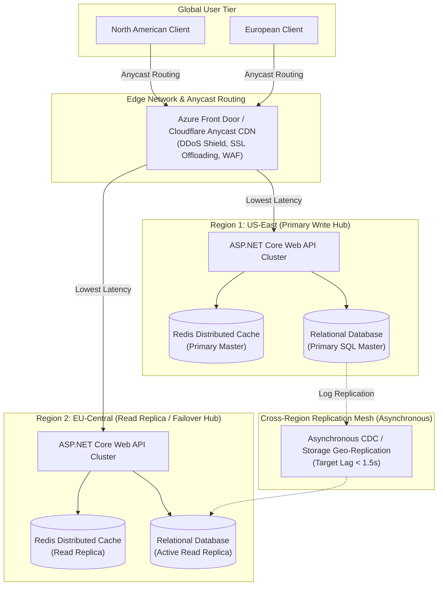

# Distributed Systems Architecture Blueprint

> "A well-architected distributed system does not try to hide the network; it makes network boundaries explicit, isolates failure domains, and protects the core from cascading collapse."

---

## 1. Global Multi-Region Topology Blueprint

---

## 2. Distributed Boundary Segregation

To prevent cross-region network storms, an enterprise architecture segregates workloads into three distinct operational tiers:

1. **Edge Tier (Static & Cached Content)**:
   * Terminated at Anycast edge nodes (< 20ms from user).
   * Caches static assets, public product catalogs, and read-only pricing matrices via CDN.
2. **Local Regional Tier (High-Throughput Reads & Ephemeral State)**:
   * Operates completely independently inside each region.
   * Serves user shopping carts, search queries, session state, and localized product availability from local Redis instances.
3. **Global Core Tier (Strict Financial & Inventory Mutexes)**:
   * Routes authoritative writes (credit card charges, stock reservations) to the designated Region Primary.
   * Enforces consistency using monotonic versioning and optimistic concurrency control.

---

## 3. Formal & Verified References

* [Azure Architecture Center: Multi-Region Web App for High Availability](https://learn.microsoft.com/en-us/azure/architecture/reference-architectures/app-service-web-app/multi-region)
* [Werner Vogels (CTO Amazon): A Decade of Dynamo (ACM Queue)](https://queue.acm.org/detail.cfm?id=3149412)
* [Google Cloud Architecture: Global vs Regional Service Topologies](https://cloud.google.com/architecture/best-practices-for-enterprise-organizations)
