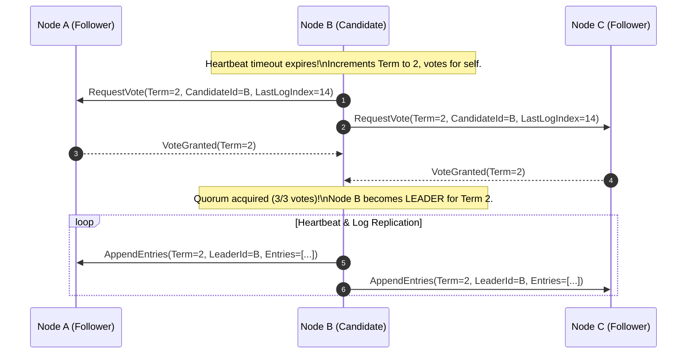

# Inside Consensus Internals: Paxos, Raft & Quorum Mathematics

> "A cluster of 5 nodes can survive 2 simultaneous node failures. A cluster of 6 nodes can also survive only 2 node failures. A Principal Architect knows why adding the 6th node was a waste of money that increased latency."

---

## 1. The Quorum Equation: $Q = \lfloor N / 2 
floor + 1$

In any distributed consensus algorithm (Raft, Multi-Paxos, Zab):
* A decision (leader election or log commit) is valid **if and only if an absolute majority (Quorum) agrees**.
* For a cluster of $N$ nodes, Quorum size is:
$$Q = \left\lfloor rac{N}{2} 
ight
floor + 1$$
* **Fault Tolerance ($F$)**: The number of simultaneous node failures a cluster can tolerate without losing consensus:
$$F = \left\lfloor rac{N - 1}{2} 
ight
floor$$

```text
┌──────────────┬──────────────┬──────────────────┬─────────────────────────────┐
│ Total Nodes  │ Quorum Size  │ Max Failures (F) │ Efficiency Assessment       │
├──────────────┼──────────────┼──────────────────┼─────────────────────────────┤
│ 1            │ 1            │ 0                │ Zero redundancy.            │
│ 3            │ 2            │ 1                │ Standard small cluster.     │
│ 5            │ 3            │ 2                │ Enterprise standard.        │
│ 6            │ 4            │ 2                │ ANTI-PATTERN! Extra latency,│
│              │              │                  │ zero extra fault tolerance! │
│ 7            │ 4            │ 3                │ High-resilience cluster.    │
└──────────────┴──────────────┴──────────────────┴─────────────────────────────┘
```

---

## 2. Raft Consensus Protocol Mechanics

Raft decomposes distributed consensus into two clean, deterministic sub-problems:



### The Log Matching Invariant
If two logs contain an entry with the same index and term:
1. They store the same command.
2. The logs are identical in all preceding entries.

---

## 3. Split-Brain Resolution: Term Numbers & Pre-Vote

When a network partition splits a 5-node cluster into 2 nodes ($A, B$) and 3 nodes ($C, D, E$):
* Nodes $A, B$ can never reach a quorum of 3. They cannot elect a leader or commit writes.
* Nodes $C, D, E$ have a majority ($3 \ge 3$). They elect a leader and proceed normally.
* **Pre-Vote Optimization**: Before incrementing its Term counter, a candidate asks peers if they would vote for it. This prevents an isolated partitioned node from continuously incrementing its Term and disrupting the healthy cluster upon reconnection.

---

## 4. Formal & Verified References

* [Diego Ongaro and John Ousterhout: In Search of an Understandable Consensus Algorithm (Raft - USENIX ATC 2014)](https://raft.github.io/raft.pdf)
* [Leslie Lamport: Paxos Made Simple (ACM SIGACT News 2001)](https://lamport.azurewebsites.net/pubs/paxos-simple.pdf)
* [Heidi Howard et al.: Flexible Paxos: Quorum Intersection Revisited](https://arxiv.org/abs/1608.06696)
