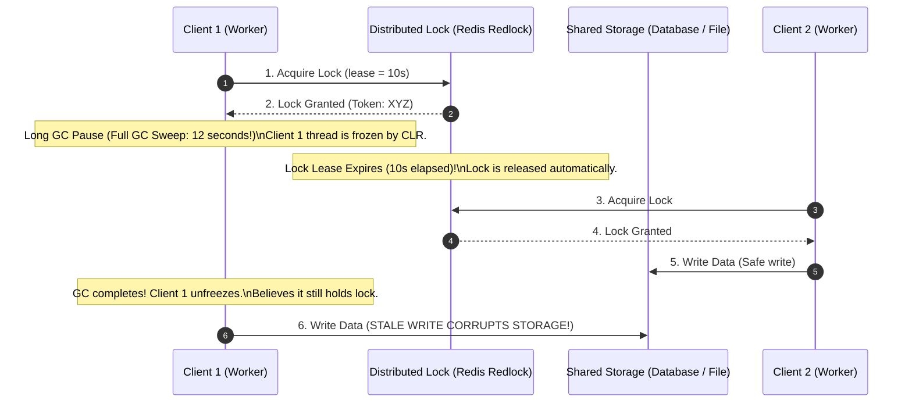

# Distributed Locking & Redlock: Fencing Tokens vs Clock Drift

> "A distributed lock based purely on timeouts cannot guarantee mutual exclusion in an asynchronous network where garbage collection pauses and hypervisor stalls exist."
> — Martin Kleppmann

---

## 1. The Kleppmann vs. Antirez Debate (2016)

In 2016, distributed systems researcher Martin Kleppmann published a landmark critique of Salvatore Sanfilippo's (Antirez) **Redlock algorithm**.

The debate centered on a fundamental physical scenario:



### The Inescapable Conclusion
Even with 5 independent Redis nodes (Redlock), **if a client freezes due to GC, swap, or network lag, its lock lease can expire without its knowledge**. When it wakes up, it acts as a **zombie client**, corrupting shared storage.

---

## 2. The Solution: Monotonically Increasing Fencing Tokens

To make distributed locks safe against zombie clients, the lock service must issue a strictly monotonically increasing integer (**Fencing Token**) with every lock grant:

```text
┌────────────────────────────────────────────────────────────────────────┐
│                        FENCING TOKEN INVARIANT                         │
├────────────────────────────────────────────────────────────────────────┤
│ 1. Client 1 acquires lock -> Receives Fencing Token #33.               │
│ 2. Client 1 enters 15-second GC pause. Lock lease expires.             │
│ 3. Client 2 acquires lock -> Receives Fencing Token #34.               │
│ 4. Client 2 writes to Storage with Token #34.                          │
│    Storage records: `HighestTokenSeen = 34`. Write accepted!           │
│ 5. Client 1 wakes up, attempts to write to Storage with Token #33.     │
│    Storage checks: `33 < HighestTokenSeen (34)`.                       │
│    Storage REJECTS write! Storage state remains 100% pristine!         │
└────────────────────────────────────────────────────────────────────────┘
```

---

## 3. High-Performance C# .NET 9 Redlock Implementation

```csharp
public sealed class DistributedLockManager
{
    private readonly IConnectionMultiplexer _redis;
    private const string ReleaseLockScript = @"
        if redis.call('get', KEYS[1]) == ARGV[1] then
            return redis.call('del', KEYS[1])
        else
            return 0
        end";

    public DistributedLockManager(IConnectionMultiplexer redis)
    {
        _redis = redis;
    }

    public async Task<LockHandle?> TryAcquireLockAsync(string resourceKey, TimeSpan ttl)
    {
        var db = _redis.GetDatabase();
        var lockId = Guid.NewGuid().ToString();

        // 1. Atomic SET resource lockId NX PX ttl
        var acquired = await db.StringSetAsync(
            resourceKey, 
            lockId, 
            ttl, 
            When.NotExists);

        if (!acquired) return null;

        // 2. Increment global monotonic fencing token counter
        var fencingToken = await db.StringIncrementAsync("fencing:token:counter");

        return new LockHandle(resourceKey, lockId, fencingToken, db);
    }
}

public sealed class LockHandle : IAsyncDisposable
{
    public string ResourceKey { get; }
    public string LockId { get; }
    public long FencingToken { get; }
    private readonly IDatabase _db;

    public LockHandle(string resourceKey, string lockId, long fencingToken, IDatabase db)
    {
        ResourceKey = resourceKey;
        LockId = lockId;
        FencingToken = fencingToken;
        _db = db;
    }

    public async ValueTask DisposeAsync()
    {
        // Safe atomic release via Lua
        await _db.ScriptEvaluateAsync(
            "if redis.call('get', KEYS[1]) == ARGV[1] then return redis.call('del', KEYS[1]) else return 0 end",
            [ResourceKey],
            [LockId]);
    }
}
```

---

## 4. Formal & Verified References

* [Martin Kleppmann (2016): How to do Distributed Locking](https://martin.kleppmann.com/2016/02/08/how-to-do-distributed-locking.html)
* [Salvatore Sanfilippo (Antirez): Is Redlock Safe?](http://antirez.com/news/101)
* [Redis Official Documentation: Distributed Locks with Redis (Redlock)](https://redis.io/docs/latest/develop/use/patterns/distributed-locks/)
