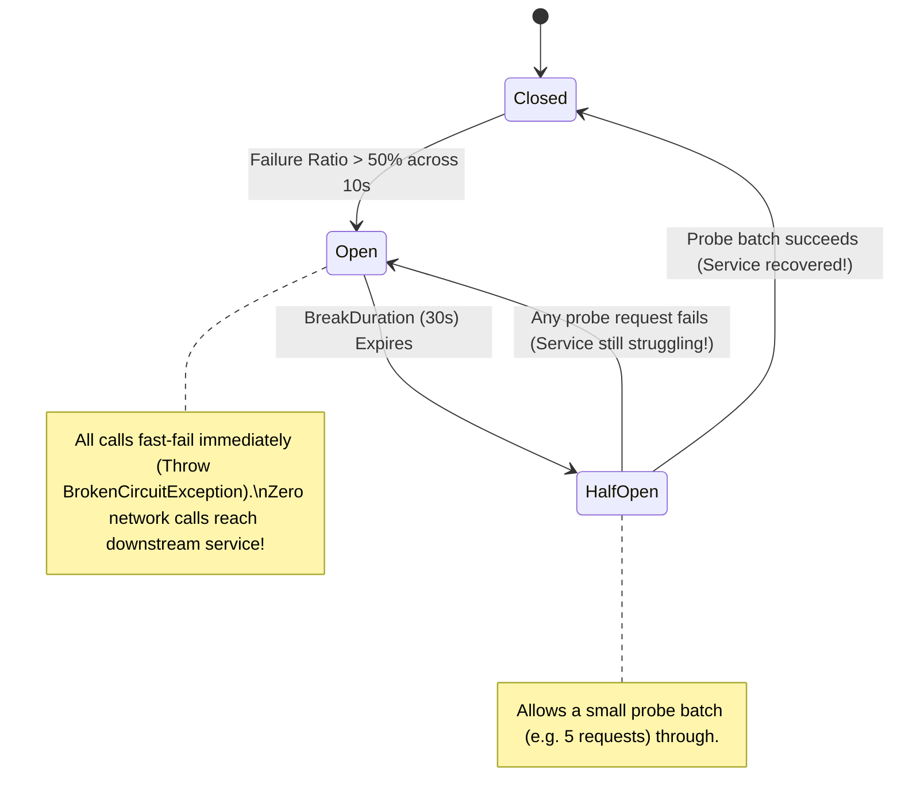

# Resilience Patterns: Polly v8 Circuit Breakers & Bulkhead Isolation

> "A circuit breaker is not for the client's benefit; it is an act of mercy towards a dying downstream service, giving it room to recover before it collapses completely."

---

## 1. The Circuit Breaker Finite State Machine



---

## 2. Bulkhead Isolation: Ship Compartments

In shipbuilding, a **bulkhead** divides the hull into watertight compartments so that a leak in one area does not sink the entire vessel.

In software architecture, a Bulkhead isolates resources (threads, memory, connections):
* **Thread Pool Bulkhead**: Allocates a dedicated thread pool or semaphore to each downstream dependency.
* If Third-Party Payment Gateway hangs, it consumes only its allocated 20 threads. The remaining 980 threads continue serving product catalog and login requests!

---

## 3. Zero-Allocation Polly v8 Pipeline (.NET 9 C# 13)

```csharp
public static class ResilienceConfig
{
    public static ResiliencePipeline CreateDefaultPipeline()
    {
        return new ResiliencePipelineBuilder()
            // 1. Rate Limiter (Token Bucket)
            .AddRateLimiter(new SlidingWindowRateLimiterOptions
            {
                PermitLimit = 100,
                Window = TimeSpan.FromSeconds(1),
                SegmentsPerWindow = 4
            })
            // 2. Timeout (Per Attempt)
            .AddTimeout(TimeSpan.FromSeconds(2))
            // 3. Retry with Exponential Backoff + Jitter
            .AddRetry(new RetryStrategyOptions
            {
                MaxRetryAttempts = 3,
                BackoffType = DelayBackoffType.Exponential,
                UseJitter = true,
                Delay = TimeSpan.FromMilliseconds(200)
            })
            // 4. Circuit Breaker
            .AddCircuitBreaker(new CircuitBreakerStrategyOptions
            {
                FailureRatio = 0.5,
                SamplingDuration = TimeSpan.FromSeconds(10),
                MinimumThroughput = 20,
                BreakDuration = TimeSpan.FromSeconds(30)
            })
            .Build();
    }
}
```

---

## 4. Formal & Verified References

* [Michael Nygard: Release It! Design and Deploy Production-Ready Software (Circuit Breaker & Bulkhead)](https://pragprog.com/titles/mnee2/release-it-second-edition/)
* [Polly v8 Documentation: Resilience Pipelines](https://www.pollydocs.org/)
* [Microsoft Learn: Build Resilient HTTP Apps with Microsoft.Extensions.Resilience](https://learn.microsoft.com/en-us/dotnet/core/resilience/http-resilience)
