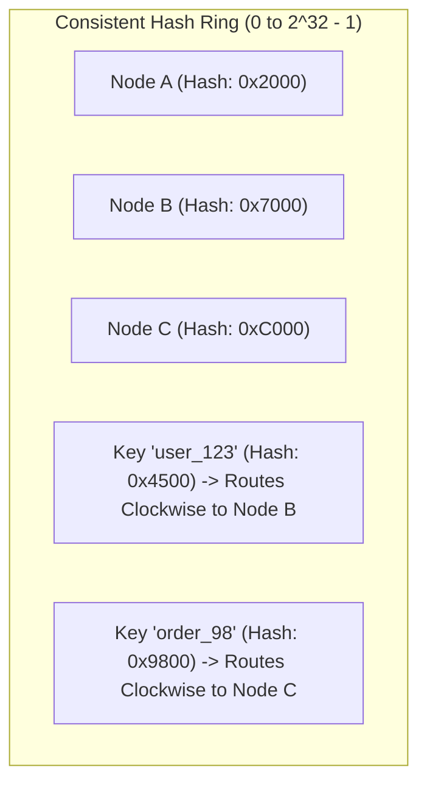

# Distributed Data Partitioning: Consistent Hashing & Virtual Nodes

> "Naive modulo hashing ($hash(key) \pmod N$) guarantees that adding a single server invalidates $100\%$ of your cached keys, triggering an instant database meltdown."

---

## 1. The Modulo Hashing Disaster

Suppose you distribute keys across 4 Redis cache nodes using:

$$	ext{Node} = 	ext{Hash}(key) \pmod 4$$

When load increases and you add a 5th node ($\pmod 5$):
* Almost every key rehashes to a different node!
* **Over $80\%$ of all cached entries become instant cache misses.**
* Database traffic increases by $500\%$, triggering an immediate cascaded outage.

---

## 2. Consistent Hashing (Karger et al. - MIT 1997)

Consistent Hashing maps both **nodes** and **keys** to a circular $360^\circ$ hash ring ($[0, 2^{32} - 1]$):

### The Invariant
When a new node is added:
* **Only $K/N$ keys must be relocated** (where $K$ is total keys, $N$ is total nodes).
* All other keys remain on their existing servers!

---

## 3. Mitigating Non-Uniform Load with Virtual Nodes (V-Nodes)

If physical nodes are placed randomly on the ring, partitions will be unevenly sized, creating hot-spots.
* **Solution**: Assign $100 - 300$ **Virtual Nodes** to each physical machine:
  * `NodeA#1`, `NodeA#2`, `...`, `NodeA#200`
* Virtual nodes interleave evenly around the ring, guaranteeing standard deviation of load $< 3\%$.

---

## 4. Formal & Verified References

* [David Karger et al. (1997): Consistent Hashing and Random Trees (MIT / ACM STOC)](https://www.cs.princeton.edu/courses/archive/fall09/cos518/papers/chash.pdf)
* [Amazon Dynamo: Consistent Hashing with Virtual Nodes](https://www.allthingsdistributed.com/files/amazon-dynamo-sosp2007.pdf)
* [Martin Kleppmann: Designing Data-Intensive Applications (Chapter 6: Partitioning)](https://dataintensive.net/)
