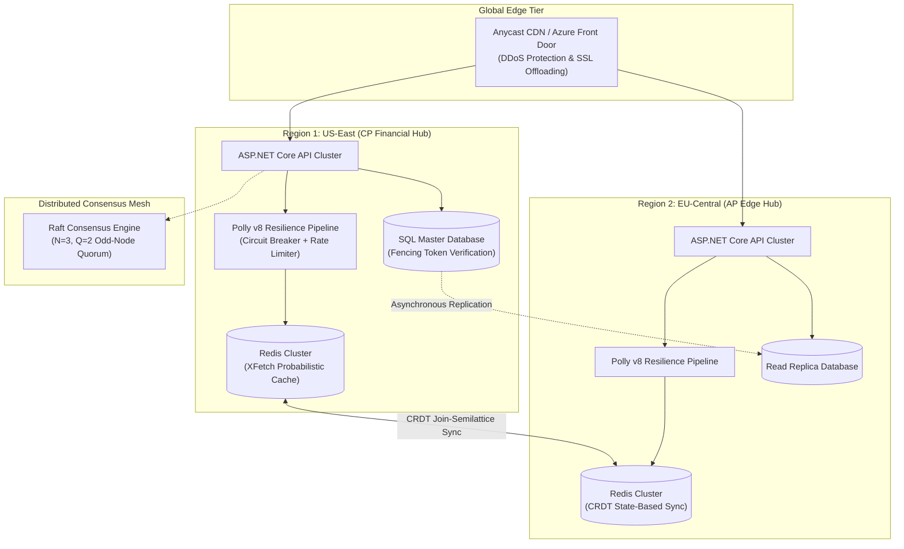

# Sprint 07: Distributed Systems Architecture

> "A distributed system is one in which the failure of a computer you didn't even know existed can render your own computer unusable."
> — Leslie Lamport

---

## 🎯 Sprint Overview

Sprint 07 explores the hard physical and mathematical limits of modern distributed systems. You will master Brewer's CAP Theorem and Abadi's PACELC, dive deep into Raft and Paxos consensus engines, eradicate Cache Stampedes using the probabilistic XFetch algorithm, analyze the Redlock distributed locking controversy and defend against zombie clients with monotonic Fencing Tokens, synchronize multi-region state without locks using CRDTs, and engineer zero-allocation resilience pipelines with Polly v8.

---

## 🗺️ Visual Architecture Topology

---

## 📚 Chapter Navigation Matrix

| # | Chapter Title | Core Architectural Focus & Theorems |
|---|---|---|
| **01** | **[The Split-Brain Partition & The Phantom Balance](01-Story.md)** | SEV-1 production incident: Multi-region partition, LWW data loss, and double-spending. |
| **02** | **[Learning Objectives & Distributed Competencies](02-Learning-Objectives.md)** | Bloom's taxonomy: junior vs senior vs principal distributed systems rubric. |
| **03** | **[Distributed Requirements & Physical Boundaries](03-Distributed-Requirements.md)** | Physical laws: speed of light in fiber, RTT latency ceilings, and the 8 fallacies. |
| **04** | **[Distributed Systems Architecture Blueprint](04-Distributed-Architecture.md)** | Multi-region tier segregation: Edge, local ephemeral cache, and global core. |
| **05** | **[The CAP Theorem & PACELC](05-CAP-Theorem-And-PACELC.md)** | Gilbert & Lynch proof, Abadi's PACELC, and Cosmos DB 5 consistency levels. |
| **05A**| **[Inside Consensus Internals: Paxos & Raft](05A-Inside-Consensus-Internals.md)** | Consensus mechanics: quorum math ($Q=\lfloor N/2 
floor + 1$), term epochs, pre-vote. |
| **06** | **[Distributed Caching Strategies](06-Distributed-Caching-Patterns.md)** | Cache-Aside, Write-Behind, and the concurrency race of update vs evict. |
| **06A**| **[Inside Redis Engine Internals](06A-Inside-Redis-Engine-Internals.md)** | Single-threaded reactor (`ae.c`), memory eviction policies, and 16,384 hash slots. |
| **07** | **[Cache Stampede & The XFetch Algorithm](07-Cache-Stampede-And-Thundering-Herd.md)** | Thundering herd mitigation via Vattani's probabilistic early expiration formula. |
| **08** | **[Distributed Locking & Redlock](08-Distributed-Locking-And-Redlock.md)** | Kleppmann vs Antirez debate, GC pauses, clock drift, and monotonic Fencing Tokens. |
| **09** | **[Eventual Consistency & Conflict Resolution](09-Eventual-Consistency-And-Conflict-Resolution.md)** | Why LWW fails, Lamport logical timestamps, and Vector Clock causality detection. |
| **09A**| **[Inside CRDT Internals](09A-Inside-CRDT-Internals.md)** | Join-Semilattices (Commutative, Associative, Idempotent), PN-Counters, and ORSets. |
| **10** | **[Resilience Patterns: Circuit Breakers & Bulkheads](10-Resilience-Patterns-Circuit-Breaker-Bulkhead.md)** | Polly v8 pipelines, state machines, and thread-pool compartment isolation. |
| **11** | **[Distributed Rate Limiting & Traffic Shaping](11-Distributed-Rate-Limiting.md)** | Token Bucket, Leaky Bucket, Sliding Window Log via atomic Redis Lua scripts. |
| **12** | **[Distributed Data Partitioning](12-Distributed-Data-Partitioning.md)** | Consistent Hashing (Ketama ring), virtual nodes, and rebalancing without stampedes. |
| **13** | **[Principal Distributed Systems Checklist](13-Principal-Distributed-Checklist.md)** | Pre-production sign-off: quorum verification, split-brain immunity, and PACELC audit. |
| **14** | **[Hands-On Distributed Systems Labs](14-Hands-On-Distributed-Labs.md)** | 5 production labs: XFetch, Redlock, CRDT PN-Counter, Polly v8, Redis Lua rate limiter. |
| **15** | **[Production Incident Post-Mortem](15-Production-Incident-Post-Mortem.md)** | SEV-1 post-mortem: The 2-node cluster split-brain and financial wallet desync. |
| **16** | **[Principal Distributed Defense Questions](16-Principal-Distributed-Defense-Questions.md)** | 15 architectural defense scenarios for CTO and Architecture Review Board. |
| **17** | **[Principal Technical Interview Scenarios](17-Principal-Distributed-Interview-Scenarios.md)** | Staff/Principal interview challenges: global cart CRDT and connection pool exhaustion. |
| **18** | **[Sprint 07 Executive Summary](18-Summary.md)** | Executive synthesis and master architectural takeaways. |
| **19** | **[Curated Distributed Learning Resources](19-Resources.md)** | Primary research papers: Brewer, Gilbert & Lynch, Abadi, Lamport, Kleppmann, Shapiro. |
