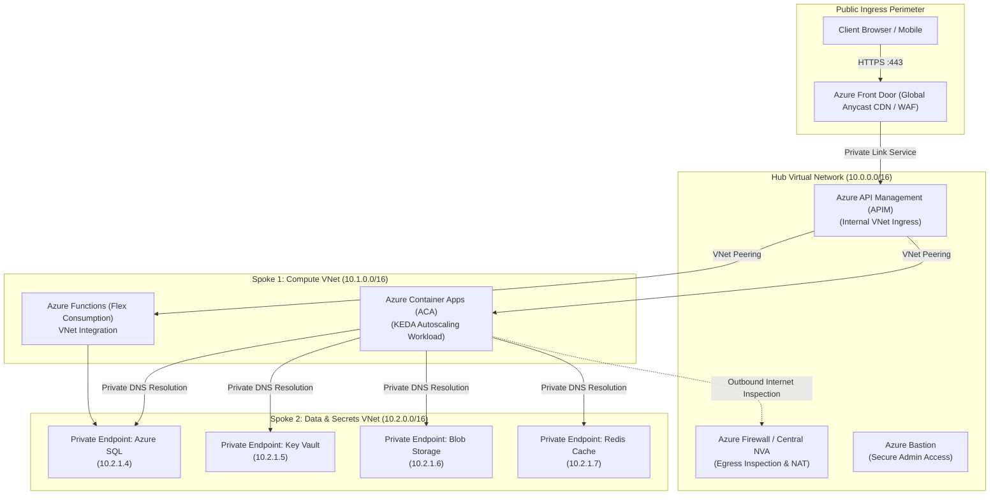

# Cloud Native Architecture Blueprint: Hub-and-Spoke Zero-Trust Topology

> "Exposing a managed database to the public internet with an IP whitelist is not a security architecture; it is an open invitation for credential stuffing. Enterprise cloud architecture terminates all traffic inside private virtual networks."

---

## 1. Enterprise Hub-and-Spoke Topology

---

## 2. The 4 Network Invariants of Zero-Trust Cloud Architecture

1. **Zero Public IPs on Data Stores**:
   * Azure SQL, Key Vault, Storage, and Redis have `publicNetworkAccess: 'Disabled'`.
   * They can only be reached via internal IP addresses allocated from the `SpokeData` subnet.
2. **Private DNS Zone Auto-Registration**:
   * Internal DNS zones (e.g., `privatelink.database.windows.net`) resolve the database hostname to `10.2.1.4` inside the VNet, while public DNS returns non-routable responses.
3. **VNet Peering Mesh**:
   * Spokes do not peer with each other directly; they peer with the Central Hub. Routing tables (`UDR - User Defined Routes`) force all outbound internet traffic through Azure Firewall.
4. **Network Security Groups (NSGs) as Micro-Perimeters**:
   * Subnet-level NSGs enforce least privilege: `SpokeCompute` is permitted to talk to `SpokeData` on port 1433 (SQL) and 6379 (Redis), but port 22 (SSH) and 3389 (RDP) are permanently blocked.

---

## 3. Formal & Verified References

* [Microsoft Learn: Hub-Spoke Network Topology in Azure](https://learn.microsoft.com/en-us/azure/architecture/reference-architectures/hybrid-networking/hub-spoke)
* [Microsoft Learn: Azure Private Link Architecture](https://learn.microsoft.com/en-us/azure/private-link/private-link-overview)
* [NIST SP 800-207: Zero Trust Architecture](https://csrc.nist.gov/publications/detail/sp/800-207/final)
