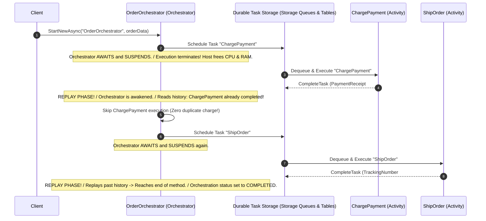

# Inside Durable Functions Internals: The Durable Task Framework

> "A Durable Orchestrator does not sleep in memory while waiting for an external task. It saves its execution history to an append-only event log, unloads itself from RAM, and replays its history to reconstruct state when awakened."

---

## 1. The Durable Task Framework (DTFx) Mechanics

Azure Durable Functions is built on the open-source **Durable Task Framework (DTFx)**. It turns code into an event-sourced finite state machine:



---

## 2. The 5 Cardinal Rules of Orchestrator Determinism

Because orchestrator functions replay their code from the beginning every time an asynchronous activity finishes, **orchestrator code must be 100% deterministic**:

```text
┌────────────────────────────────────────────────────────────────────────┐
│                   ORCHESTRATOR DETERMINISM CODE LAWS                   │
├────────────────────────────────────────────────────────────────────────┤
│ 1. NEVER use `DateTime.UtcNow` or `DateTime.Now`                       │
│    -> Use `context.CurrentUtcDateTime` (replayed deterministically).   │
│ 2. NEVER use `Guid.NewGuid()`                                          │
│    -> Use `context.NewGuid()` (deterministic pseudo-random seed).      │
│ 3. NEVER make direct I/O, database, or HTTP calls in an Orchestrator   │
│    -> Offload all I/O to [Function] Activity Functions!                │
│ 4. NEVER use `Task.Delay(5000)` or `Thread.Sleep`                      │
│    -> Use `await context.CreateTimer(fireAt, cancellationToken)`!      │
│ 5. NEVER introduce non-deterministic threading (Task.Run / Background) │
│    -> Orchestrators must execute strictly single-threaded on replay.   │
└────────────────────────────────────────────────────────────────────────┘
```

---

## 3. Production C# .NET 9 Durable Saga Orchestrator

```csharp
public sealed class OrderFulfillmentSaga
{
    [Function(nameof(RunOrderOrchestrator))]
    public async Task<OrderFulfillmentResult> RunOrderOrchestrator(
        [OrchestrationTrigger] TaskOrchestrationContext context)
    {
        var order = context.GetInput<OrderDto>() ?? throw new ArgumentNullException();
        var logger = context.CreateReplaySafeLogger(nameof(OrderFulfillmentSaga));

        // 1. Activity: Authorize Payment
        PaymentResult payment;
        try
        {
            payment = await context.CallActivityAsync<PaymentResult>(
                nameof(ChargePaymentActivity), 
                new PaymentRequest(order.Id, order.Amount));
        }
        catch (Exception ex)
        {
            logger.LogError(ex, "Payment failed. Terminating saga.");
            return OrderFulfillmentResult.Failed("PaymentFailed");
        }

        // 2. Activity: Reserve Inventory
        InventoryResult inventory;
        try
        {
            inventory = await context.CallActivityAsync<InventoryResult>(
                nameof(ReserveInventoryActivity), 
                order.Items);
        }
        catch (Exception ex)
        {
            // BACKWARD COMPENSATION (Rollback)
            logger.LogWarning(ex, "Inventory out of stock! Compensating payment...");
            await context.CallActivityAsync(
                nameof(RefundPaymentActivity), 
                payment.TransactionId);

            return OrderFulfillmentResult.Failed("InventoryUnavailable");
        }

        // 3. Human-in-the-Loop or External Event Approval
        // Orchestrator can suspend execution for up to 7 days waiting for warehouse webhook!
        var approvalEvent = context.WaitForExternalEvent<bool>("WarehouseApprovalEvent");
        var timeoutTimer = context.CreateTimer(context.CurrentUtcDateTime.AddDays(3), CancellationToken.None);

        var winner = await Task.WhenAny(approvalEvent, timeoutTimer);
        if (winner == approvalEvent && await approvalEvent)
        {
            await context.CallActivityAsync(nameof(DispatchShippingActivity), order.Id);
            return OrderFulfillmentResult.Completed(order.Id);
        }

        // Expired -> Compensate
        await context.CallActivityAsync(nameof(RefundPaymentActivity), payment.TransactionId);
        return OrderFulfillmentResult.Failed("ApprovalTimedOut");
    }
}
```

---

## 4. Formal & Verified References

* [Microsoft Learn: What Are Durable Functions?](https://learn.microsoft.com/en-us/azure/azure-functions/durable/durable-functions-overview)
* [Microsoft Learn: Durable Functions Code Constraints & Determinism](https://learn.microsoft.com/en-us/azure/azure-functions/durable/durable-functions-code-constraints)
* [GitHub: Durable Task Framework Engine Source Code (Azure/durabletask)](https://github.com/Azure/durabletask)
