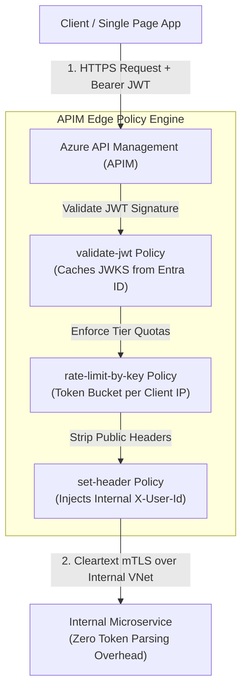

# API Gateway Architecture: Azure API Management (APIM)

> "An API Gateway is not a glorified reverse proxy. It is an edge policy enforcement point that protects internal microservices from authorization, rate limiting, and transport protocol burdens."

---

## 1. The Gateway Offloading Pattern



By offloading JWT verification, rate limiting, and SSL decryption to APIM:
* Backend microservices do not waste CPU cycles validating cryptographic RSA-256 signatures on every HTTP request.
* Malicious requests and DDoS floods are dropped at the gateway edge before reaching application worker pods.

---

## 2. Production APIM Policy (.XML with C# Expressions)

```xml
<policies>
    <inbound>
        <base />
        <!-- 1. Global Cross-Origin Resource Sharing (CORS) -->
        <cors allow-credentials="true">
            <allowed-origins>
                <origin>https://novacommerce.com</origin>
            </allowed-origins>
            <allowed-methods preflight-result-max-age="300">
                <method>GET</method>
                <method>POST</method>
                <method>PUT</method>
                <method>DELETE</method>
            </allowed-methods>
            <allowed-headers>
                <header>Authorization</header>
                <header>Content-Type</header>
                <header>X-Correlation-ID</header>
            </allowed-headers>
        </cors>

        <!-- 2. Edge JWT Validation -->
        <validate-jwt header-name="Authorization" failed-validation-httpcode="401" failed-validation-error-message="Unauthorized">
            <openid-config url="https://login.microsoftonline.com/tenant-id/v2.0/.well-known/openid-configuration" />
            <required-claims>
                <claim name="aud" match="any">
                    <value>api://novacommerce-core</value>
                </claim>
            </required-claims>
        </validate-jwt>

        <!-- 3. Dynamic Distributed Rate Limiting (100 calls / 60s per IP) -->
        <rate-limit-by-key calls="100" renewal-period="60" counter-key="@(context.Request.IpAddress)" />

        <!-- 4. Inject Verified Identity Headers for Downstream Microservices -->
        <set-header name="X-Authenticated-User-Id" exists-action="override">
            <value>@(context.Request.Headers.GetValueOrDefault("Authorization","").AsJwt()?.Subject)</value>
        </set-header>
    </inbound>
    <backend>
        <base />
    </backend>
    <outbound>
        <base />
        <!-- Strip internal implementation headers to prevent reconnaissance -->
        <set-header name="X-Powered-By" exists-action="delete" />
        <set-header name="Server" exists-action="delete" />
    </outbound>
    <on-error>
        <base />
    </on-error>
</policies>
```

---

## 3. APIM SKU Selection Matrix

```text
┌───────────────────────────┬─────────────────────┬──────────────────────┬──────────────────────┐
│ Dimension                 │ Consumption         │ Developer / Basic    │ Premium              │
├───────────────────────────┼─────────────────────┼──────────────────────┼──────────────────────┤
│ Monthly Cost              │ Pay per million reqs│ ~$50 - $150 / month  │ ~$2,800+ / month     │
│ VNet Integration          │ None (Public only)  │ None (Developer only)│ Full Internal / Ext  │
│ Multi-Region Deployment   │ No                  │ No                   │ Yes (Active-Active)  │
│ Built-in Cache            │ No                  │ Yes                  │ Yes (Multi-region)   │
│ SLA                       │ 99.95%              │ None (Dev) / 99.9%   │ 99.99% (Zone-Redund) │
│ Best For                  │ Low-frequency APIs  │ Non-prod development │ Enterprise Zero-Trust│
│                           │ and prototypes      │ environments         │ banking & production │
└───────────────────────────┴─────────────────────┴──────────────────────┴──────────────────────┘
```

---

## 4. Formal & Verified References

* [Microsoft Learn: Azure API Management Overview](https://learn.microsoft.com/en-us/azure/api-management/api-management-key-concepts)
* [Microsoft Learn: API Management Policy Reference](https://learn.microsoft.com/en-us/azure/api-management/api-management-policies)
* [Microsoft Cloud Design Patterns: Gateway Offloading Pattern](https://learn.microsoft.com/en-us/azure/architecture/patterns/gateway-offloading)
