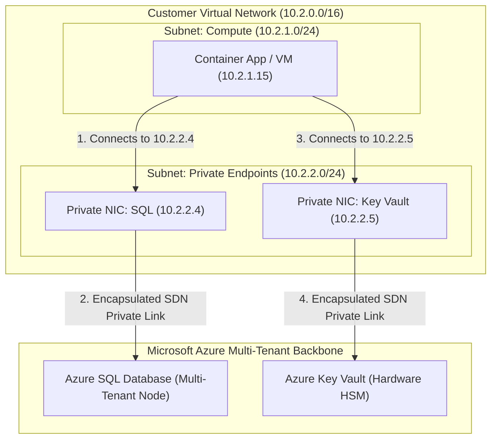

# Zero-Trust Networking: Virtual Networks & Azure Private Link

> "A firewall rule that allows 0.0.0.0/0 with a password is not a security architecture. In a Zero-Trust enterprise, managed database and storage services do not possess public IP addresses."

---

## 1. How Azure Private Link Operates

Historically, PaaS services (Azure SQL, Blob Storage, Key Vault) lived on public IPs with multi-tenant firewall filters.
**Azure Private Link** projects a private Network Interface (NIC) directly into your private Virtual Network subnet:



* Traffic between `10.2.1.15` and `10.2.2.4` never traverses the public internet.
* It travels entirely within Microsoft's software-defined network (SDN) substrate.
* **Public internet access to the database is disabled permanently.**

---

## 2. Private DNS Zone Split-Brain Resolution

When your C# application connects to `sql-novacommerce.database.windows.net`, it must resolve to `10.2.2.4` (Internal), NOT the public IP:

```text
┌────────────────────────────────────────────────────────────────────────┐
│                        PRIVATE DNS RESOLUTION                          │
├────────────────────────────────────────────────────────────────────────┤
│ Public Resolution (Outside VNet):                                      │
│ nslookup sql-novacommerce.database.windows.net                         │
│ -> 20.42.112.55 (Blocked by firewall: Connection Refused)              │
├────────────────────────────────────────────────────────────────────────┤
│ Private Resolution (Inside VNet with Private DNS Zone linked):         │
│ Zone: privatelink.database.windows.net                                 │
│ A-Record: sql-novacommerce -> 10.2.2.4                                 │
│ -> 10.2.2.4 (Encrypted TLS connection succeeds instantly!)             │
└────────────────────────────────────────────────────────────────────────┘
```

---

## 3. Network Security Groups (NSGs) vs. Application Security Groups (ASGs)

* **Network Security Groups (NSGs)**: 5-tuple stateful firewall rules applied at the Subnet or NIC level (`Source IP`, `Source Port`, `Destination IP`, `Destination Port`, `Protocol`).
* **Application Security Groups (ASGs)**: Logical labels that group VMs or containers regardless of their IP address:
  * Rule: Allow traffic from `ASG_WebTier` to `ASG_DatabaseTier` on port 1433.
  * When a new Web container launches, assigning it to `ASG_WebTier` automatically applies all security rules without updating IP lists!

---

## 4. Formal & Verified References

* [Microsoft Learn: What is Azure Private Link?](https://learn.microsoft.com/en-us/azure/private-link/private-link-overview)
* [Microsoft Learn: Azure Private Endpoint DNS Configuration](https://learn.microsoft.com/en-us/azure/private-link/private-endpoint-dns)
* [NIST SP 800-207: Zero Trust Architecture Network Segmentation](https://csrc.nist.gov/publications/detail/sp/800-207/final)
