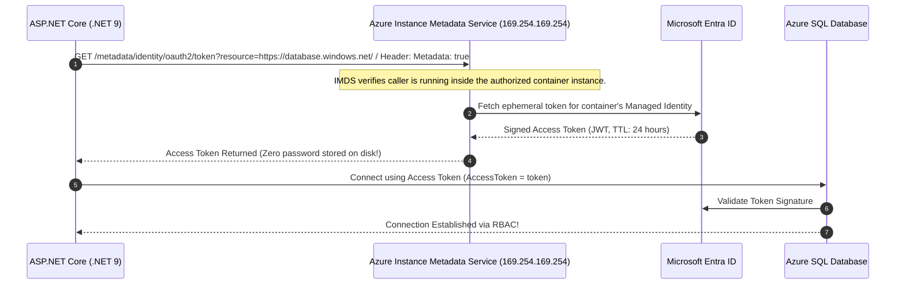

# Secrets & Identity: Azure Key Vault & Managed Identities

> "The most secure secret is the secret that was never created. If a developer knows the database password, your security architecture has already failed."

---

## 1. Eliminating Credentials with Managed Identities

In traditional cloud systems, applications used connection strings containing passwords:
`Server=tcp:sql.db;Database=orders;User Id=dbadmin;Password=P@ssw0rd123;`

These passwords leaked into git repos, Docker images, and CI logs.
With **Microsoft Entra ID Managed Identities**, Azure injects a local cryptographic identity directly into the compute instance:



---

## 2. System-Assigned vs. User-Assigned Managed Identity

```text
┌───────────────────────────┬─────────────────────────────┬───────────────────────────┐
│ Characteristic            │ System-Assigned             │ User-Assigned             │
├───────────────────────────┼─────────────────────────────┼───────────────────────────┤
│ Lifecycle                 │ Tied 1:1 to single resource.│ Independent Azure resource│
│                           │ Deleted when resource dies. │ shared across containers. │
│ Sharing                   │ Cannot be shared.           │ Can be assigned to 100+   │
│                           │                             │ microservice instances.   │
│ Pre-Provisioning RBAC     │ Harder. Resource must exist │ Easy. Provision Identity  │
│                           │ before granting RBAC roles. │ in Bicep, grant RBAC, then│
│                           │                             │ attach to Container Apps. │
│ Best For                  │ Single monolithic VMs or    │ Multi-container clusters, │
│                           │ isolated batch jobs         │ microservices, CI runners │
└───────────────────────────┴─────────────────────────────┴───────────────────────────┘
```

---

## 3. Production C# .NET 9 Azure Identity Integration

```csharp
using Azure.Identity;
using Microsoft.Data.SqlClient;

public static class DatabaseConfiguration
{
    public static void ConfigureSqlWithManagedIdentity(IServiceCollection services, IConfiguration config)
    {
        var connectionString = config.GetConnectionString("SqlOrdersDb");

        services.AddDbContext<OrderDbContext>(options =>
        {
            var sqlConnection = new SqlConnection(connectionString)
            {
                // DefaultAzureCredential automatically probes:
                // 1. EnvironmentVariables (CI)
                // 2. ManagedIdentity (Production Container)
                // 3. AzureCliCredential / VisualStudio (Local Dev)
                AccessToken = new DefaultAzureCredential()
                    .GetToken(new Azure.Core.TokenRequestContext(["https://database.windows.net/.default"]))
                    .Token
            };
            options.UseSqlServer(sqlConnection);
        });
    }
}
```

---

## 4. Formal & Verified References

* [Microsoft Learn: What are Managed Identities for Azure Resources?](https://learn.microsoft.com/en-us/entra/identity/managed-identities-azure-resources/overview)
* [Azure SDK for .NET: DefaultAzureCredential Architecture](https://learn.microsoft.com/en-us/dotnet/api/azure.identity.defaultazurecredential)
* [Microsoft Learn: Azure Key Vault Security & HSM Standards](https://learn.microsoft.com/en-us/azure/key-vault/general/security-features)
