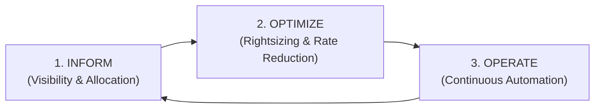

# FinOps & Cloud Cost Engineering: Unit Economics & Anomaly Governance

> "Anyone can build a fast, available distributed system in the cloud with unlimited money. A Principal Architect builds a fast, resilient system that costs 80% less by mastering cloud unit economics."

---

## 1. The 3 Phases of the FinOps Lifecycle



1. **Inform**: Tag every resource with `CostCenter`, `Environment`, `Owner`, and `Service`. Calculate **Unit Economics**:
$$	ext{Cloud Unit Metric} = rac{	ext{Total Cloud Monthly Spend}}{	ext{Total Monthly Checkout Transactions}} = rac{\$18,000}{3,600,000} = \$0.005	ext{ per checkout}$$
2. **Optimize**:
   * Eliminate idle over-provisioned vCPUs.
   * Shift predictable baseline load to **1-Year or 3-Year Reserved Instances (RI)** or **Savings Plans** (saving up to $72\%$).
   * Use Spot instances for stateless batch processing (saving up to $90\%$).
3. **Operate**: Deploy automated spending anomaly detectors via Azure Cost Management alerts.

---

## 2. Cloud Cost Trap Comparison

```text
┌───────────────────────────┬────────────────────────────────────────────────────────┐
│ Cloud Anti-Pattern        │ Principal Architecture Remediation                     │
├───────────────────────────┼────────────────────────────────────────────────────────┤
│ 1. Premium SSD V2 Disk    │ Over-provisioned IOPS & throughput left running 24/7.  │
│    Over-provisioning      │ Profile actual IOPS with Azure Monitor; rightsize.     │
├───────────────────────────┼────────────────────────────────────────────────────────┤
│ 2. Uncompressed WAN Egress│ Sending raw uncompressed JSON across regions/internet. │
│                           │ Enable Gzip/Brotli on APIM and Front Door; saves 80%!  │
├───────────────────────────┼────────────────────────────────────────────────────────┤
│ 3. Unbounded Consumption  │ Runaway infinite loops draining budget at $20k/hour.   │
│    Serverless Functions   │ Configure hard daily spending limits & KEDA maxReplicas│
├───────────────────────────┼────────────────────────────────────────────────────────┤
│ 4. Orphaned Disks and IPs │ Disks and public IPs left running after VMs deleted.   │
│                           │ Enforce Azure Deployment Stacks (`actionOnUnmanage`).  │
└───────────────────────────┴────────────────────────────────────────────────────────┘
```

---

## 3. Formal & Verified References

* [FinOps Foundation: The FinOps Framework](https://www.finops.org/framework/)
* [Microsoft Learn: Cost Optimization Pillar - Microsoft Well-Architected Framework](https://learn.microsoft.com/en-us/azure/well-architected/cost-optimization/)
* [J.R. Storment & Mike Fuller: Cloud FinOps: Collaborative, Real-Time Cloud Value Decision Making (O'Reilly)](https://www.oreilly.com/library/view/cloud-finops/9781492054610/)
