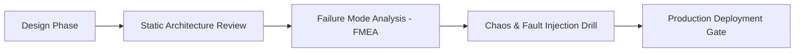
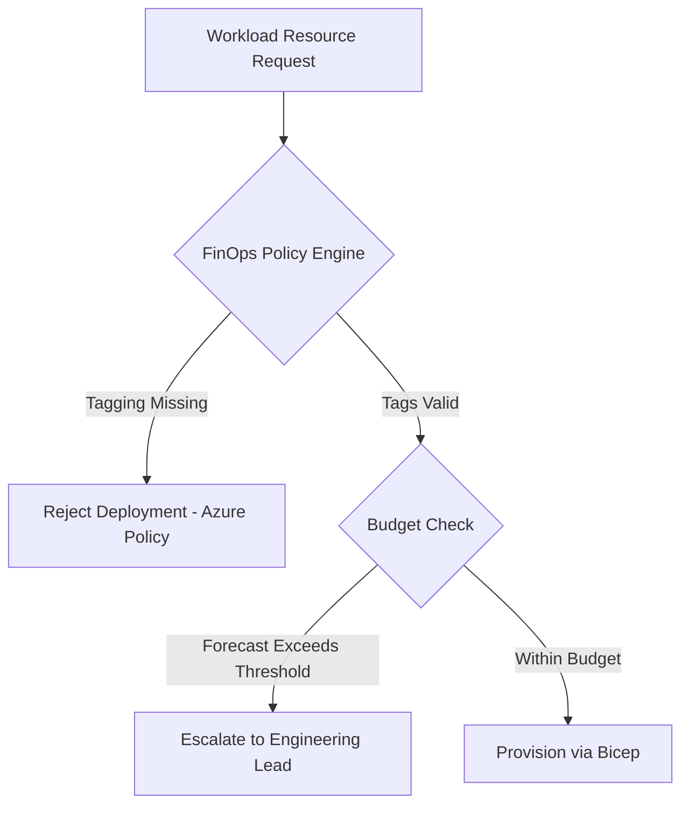

# Principal Cloud Readiness & Governance Checklist

This checklist provides a rigorous, production-grade readiness and governance framework for enterprise Azure deployments. Aligned with the Microsoft Well-Architected Framework (WAF), NIST SP 800-207 Zero Trust, and the FinOps Foundation lifecycle, it serves as the definitive gate before approving production workloads.

---

## 1. Reliability & Resilience Gate

### High Availability & Topology
- [ ] **Multi-Availability Zone (AZ) Deployment**: All compute (ACA, AKS, App Service, Functions) and data stores (Cosmos DB, Azure SQL, Redis) are configured across at least 3 Availability Zones.
- [ ] **Composite SLA Calculation**: The end-to-end composite availability $\text{SLA}_{\text{total}} = \prod_{i=1}^N \text{SLA}_i$ meets or exceeds customer contractual commitments. Dependencies are paired with graceful degradation.
- [ ] **Regional Pairing & Disaster Recovery**: Workloads have an explicit DR target region adhering to Azure paired regions or sovereign data-residency boundaries.
- [ ] **RPO and RTO Validated**: Recovery Point Objective (RPO) and Recovery Time Objective (RTO) have been verified via automated failover drills in staging/pre-prod.
- [ ] **No Single Point of Failure (SPOF)**: Network gateways, DNS resolvers, API gateways, and secret vaults have redundant, zonal, or globally distributed configurations.

### Transient Fault Handling & Health Probes
- [ ] **Polly / Built-in Retries**: All external calls implement exponential backoff with decorrelated jitter to prevent thundering herd problems.
- [ ] **Circuit Breakers**: Remote dependencies (HTTP, gRPC, databases) are wrapped in circuit breakers with appropriate break durations and failure rate thresholds.
- [ ] **Tri-Partite Health Probes**:
  - *Liveness Probe*: Verifies the process is alive without querying external dependencies.
  - *Readiness Probe*: Verifies the container can accept inbound traffic (validates internal caches, warm-up state).
  - *Startup Probe*: Protects slow-starting applications (.NET JIT compilation, large memory allocations) from premature termination.

---

## 2. Security & Zero Trust Gate

### Network Perimeter Isolation
- [ ] **Zero Public Ingress**: Backend microservices, databases, caches, and storage accounts have `publicNetworkAccess: "Disabled"`.
- [ ] **Private Link & Private Endpoints**: All PaaS services communicate exclusively over Azure Private Endpoints with dedicated `/28` or `/27` subnets.
- [ ] **Split-Horizon DNS Sanitation**: Private DNS Zones (`privatelink.*.azure.com`) are linked to all spoke VNets and Hub VNets, preventing public DNS leakage.
- [ ] **Egress Lockdown via Firewall/NVA**: Spoke subnets have User Defined Routes (`0.0.0.0/0`) forcing all outbound traffic through Azure Firewall or an NVA for inspection.
- [ ] **Microsegmentation (NSG / ASG)**: Network Security Groups (NSGs) enforce explicit ingress/egress rules using Application Security Groups (ASGs). Blanket `AllowVNetInBound` rules are overridden.

### Identity, Access & Cryptography
- [ ] **Managed Identities Everywhere**: No service account passwords, API keys, or connection strings are stored in code, configuration files, or environment variables. System-Assigned or User-Assigned Managed Identities are used exclusively.
- [ ] **Azure RBAC Principle of Least Privilege**: Roles are scoped to resource groups or individual resources. Broad assignments like `Owner` or `Contributor` on subscriptions are strictly prohibited.
- [ ] **Key Vault MHSM / Zero-Standing Access**: Customer-Managed Keys (CMK) are stored in Azure Key Vault Premium or Managed HSM with Purge Protection and Soft-Delete enabled.
- [ ] **mTLS Enforcement**: Interservice communications within container environments (ACA/AKS via Envoy/Dapr/Istio) enforce mutual TLS with ephemeral, automated certificate rotation.
- [ ] **Supply Chain Security**: Container images are scanned during CI/CD (Trivy, Defender for Cloud) and signed using Cosign/Notary before being pushed to Azure Container Registry (ACR). ACR Tasks enforce quarantine on unverified images.

---

## 3. Cost Optimization & FinOps Gate

### Mandatory Cost Governance
- [ ] **Strict Tagging Governance**: Azure Policy enforces mandatory tags at resource creation:
  - `CostCenter`
  - `Environment` (`prod`, `stage`, `dev`)
  - `Owner` (valid team email/DL)
  - `Workload`
  - `DataClassification` (`restricted`, `confidential`, `public`)
- [ ] **Budget Alerts & Webhooks**: Subscription and Resource Group budgets are configured at 50%, 75%, 90%, and 100% of monthly forecast, connected to automated Teams/Slack alerting and runbooks.
- [ ] **Compute Right-Sizing & Limits**:
  - Memory and CPU limits are explicitly configured on all container specifications.
  - Development environments enforce automated off-hours shutdown (scale-to-zero or stop schedules).
- [ ] **Commitment Discounts**: Steady-state baseline compute is covered by 1-Year or 3-Year Azure Savings Plans or Reserved Instances (RIs), achieving 30% to 65% cost reduction.
- [ ] **Egress Traffic Auditing**: Inter-zone and inter-region data flows are mapped. High-bandwidth pipelines utilize collocated compute and storage within the same zone/region.

---

## 4. Operational Excellence Gate

### Observability & Telemetry
- [ ] **OpenTelemetry (OTel) Standardization**: Applications emit standardized OTel distributed traces, metrics, and logs with baggage propagation (W3C `traceparent` and `tracestate`).
- [ ] **Structured Logging & High-Cardinality Control**: Logs are formatted as JSON. High-cardinality attributes (e.g., individual UUIDs) are logged in trace spans rather than indexed log fields.
- [ ] **Actionable Alerts**: Alerts are based on customer-impacting Service Level Indicators (SLIs):
  - Request Latency (p95, p99)
  - HTTP 5xx Error Rate (> 0.5% over 5-minute rolling window)
  - Queue Age / Dead-Letter Queue (DLQ) depth (> 0 messages)
  - CPU/Memory Throttling Events
- [ ] **No PII in Logs**: Data scrubbers and masking interceptors verify that credit cards, tokens, SSNs, and passwords never reach Azure Monitor or Log Analytics.

### CI/CD & Deployment Strategy
- [ ] **Zero-Downtime Releases**: Blue-Green or Progressive Canary deployments are configured via ACA traffic splitting or deployment slots.
- [ ] **Infrastructure as Code (IaC) Rigor**: 100% of resources are managed in Git via Bicep or Terraform. Manual Azure Portal modifications ("ClickOps") are disabled via RBAC deny assignments.
- [ ] **Automated Rollback Criteria**: Deployments monitor APIM and App Insights error rates for 15 minutes post-rollout; anomalies trigger automated rollback to the previous active revision.

---

## 5. Performance Efficiency Gate

- [ ] **KEDA Scaling Tuning**: Scalers use appropriate polling intervals (15s to 30s) and cooldown periods (300s) to prevent oscillation and thrashing.
- [ ] **Database Connection Pooling**: Applications reuse `HttpClient` via `IHttpClientFactory` and manage database connections with connection pooling (e.g., `NpgsqlDataSource` or ADO.NET connection pooling).
- [ ] **Response Caching & CDN Offload**: Static assets and cacheable GET requests are offloaded to Azure Front Door with optimized Cache-Control headers.
- [ ] **Asynchronous Decoupling**: High-latency transactions are decoupled using Azure Service Bus queues and topics, ensuring HTTP frontends return within 250ms.
