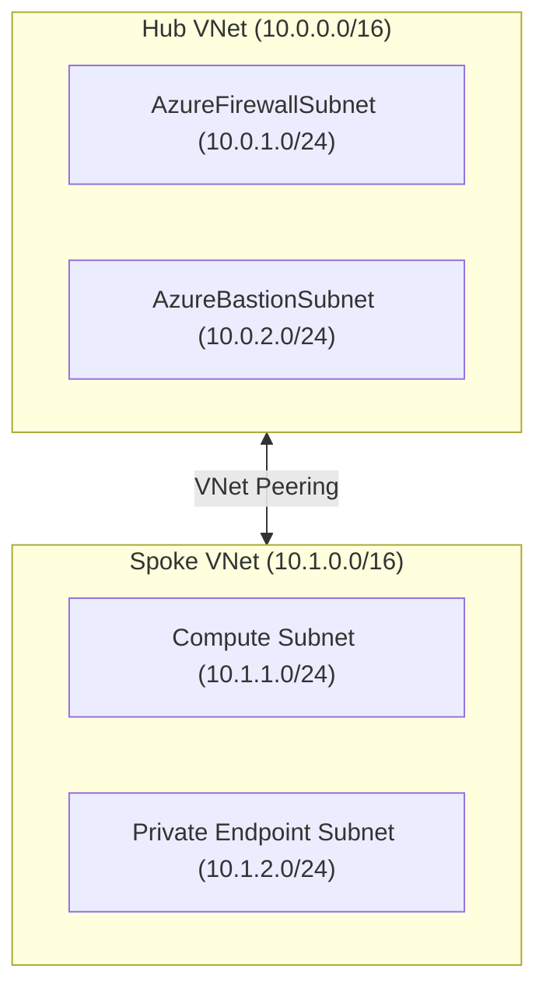
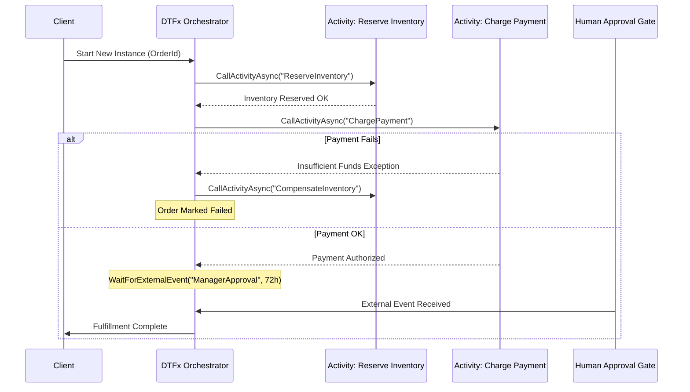

# Production Hands-On Cloud Labs

This guide provides 5 enterprise-grade, step-by-step technical labs for building, deploying, and hardening cloud-native systems on Azure.

---

## Lab 1: Automated Enterprise Hub-Spoke VNet & Private DNS Zone

### Objective
Deploy an enterprise Hub-Spoke network topology with full network isolation, Azure Firewall, and Private DNS Zones using Azure CLI and Bicep.



### Step 1: Author the Bicep Template (`network.bicep`)
```bicep
@description('Primary location for all networking resources')
param location string = resourceGroup().location

// Hub Virtual Network
resource hubVnet 'Microsoft.Network/virtualNetworks@2023-09-01' = {
  name: 'vnet-hub-prod'
  location: location
  properties: {
    addressSpace: {
      addressPrefixes: ['10.0.0.0/16']
    }
    subnets: [
      {
        name: 'AzureFirewallSubnet'
        properties: {
          addressPrefix: '10.0.1.0/24'
        }
      }
      {
        name: 'AzureBastionSubnet'
        properties: {
          addressPrefix: '10.0.2.0/24'
        }
      }
    ]
  }
}

// Spoke Virtual Network
resource spokeVnet 'Microsoft.Network/virtualNetworks@2023-09-01' = {
  name: 'vnet-spoke-workloads'
  location: location
  properties: {
    addressSpace: {
      addressPrefixes: ['10.1.0.0/16']
    }
    subnets: [
      {
        name: 'snet-compute'
        properties: {
          addressPrefix: '10.1.1.0/24'
          delegations: [
            {
              name: 'appEnvDelegation'
              properties: {
                serviceName: 'Microsoft.App/environments'
              }
            }
          ]
        }
      }
      {
        name: 'snet-private-endpoints'
        properties: {
          addressPrefix: '10.1.2.0/24'
          privateEndpointNetworkPolicies: 'Disabled'
        }
      }
    ]
  }
}

// Bi-directional VNet Peering
resource hubToSpoke 'Microsoft.Network/virtualNetworks/virtualNetworkPeerings@2023-09-01' = {
  parent: hubVnet
  name: 'hub-to-spoke'
  properties: {
    remoteVirtualNetwork: { id: spokeVnet.id }
    allowVirtualNetworkAccess: true
    allowForwardedTraffic: true
  }
}

resource spokeToHub 'Microsoft.Network/virtualNetworks/virtualNetworkPeerings@2023-09-01' = {
  parent: spokeVnet
  name: 'spoke-to-hub'
  properties: {
    remoteVirtualNetwork: { id: hubVnet.id }
    allowVirtualNetworkAccess: true
    allowForwardedTraffic: true
  }
}

// Private DNS Zone for Key Vault
resource privateDnsKeyVault 'Microsoft.Network/privateDnsZones@2020-06-01' = {
  name: 'privatelink.vaultcore.azure.net'
  location: 'global'
}

resource dnsLinkHub 'Microsoft.Network/privateDnsZones/virtualNetworkLinks@2020-06-01' = {
  parent: privateDnsKeyVault
  name: 'link-hub'
  location: 'global'
  properties: {
    virtualNetwork: { id: hubVnet.id }
    registrationEnabled: false
  }
}

resource dnsLinkSpoke 'Microsoft.Network/privateDnsZones/virtualNetworkLinks@2020-06-01' = {
  parent: privateDnsKeyVault
  name: 'link-spoke'
  location: 'global'
  properties: {
    virtualNetwork: { id: spokeVnet.id }
    registrationEnabled: false
  }
}
```

### Step 2: Deployment and Validation via Azure CLI
```bash
# Create Resource Group
az group create --name rg-enterprise-network-prod --location eastus2

# Deploy Bicep template
az deployment group create   --resource-group rg-enterprise-network-prod   --template-file network.bicep

# Verify peering state
az network vnet peering show   --resource-group rg-enterprise-network-prod   --vnet-name vnet-spoke-workloads   --name spoke-to-hub   --query "peeringState" -o tsv
# Output must be: Connected
```

---

## Lab 2: Zero-Scale Event-Driven Microservice on Azure Container Apps (ACA)

### Objective
Deploy a containerized worker on Azure Container Apps that scales from 0 to 50 replicas based on Azure Service Bus Queue message depth using KEDA, running inside a private subnet.

```mermaid
sequenceDiagram
    participant P as Producer
    participant SB as Service Bus (orders-queue)
    participant K as KEDA Controller
    participant ACA as Container App Replicas (0 to 50)

    P->>SB: Enqueue 500 messages
    K->>SB: Poll message count (e.g. 500)
    Note over K: 500 msgs / target 10 = 50 replicas
    K->>ACA: Scale from 0 to 50 replicas
    ACA->>SB: Pull and process messages concurrently
    Note over ACA,SB: Queue drops to 0
    K->>ACA: Cooldown period passes -> Scale to 0
```



### Step 1: Create Service Bus & Managed Identity
```bash
RG="rg-enterprise-network-prod"
LOCATION="eastus2"

# 1. Create Azure Service Bus Namespace (Standard or Premium)
az servicebus namespace create   --resource-group $RG   --name sb-orderprocessing-prod   --location $LOCATION   --sku Standard

# 2. Create target queue
az servicebus queue create   --resource-group $RG   --namespace-name sb-orderprocessing-prod   --name orders-incoming

# 3. Create User-Assigned Managed Identity for KEDA & Worker
az identity create --name id-order-worker-prod --resource-group $RG
IDENTITY_ID=$(az identity show --name id-order-worker-prod --resource-group $RG --query id -o tsv)
CLIENT_ID=$(az identity show --name id-order-worker-prod --resource-group $RG --query clientId -o tsv)

# 4. Grant Azure Service Bus Data Receiver role
SB_ID=$(az servicebus namespace show --name sb-orderprocessing-prod --resource-group $RG --query id -o tsv)
az role assignment create   --assignee $CLIENT_ID   --role "Azure Service Bus Data Receiver"   --scope $SB_ID
```

### Step 2: Deploy Container App with KEDA Scaler via Bicep (`order-processor.bicep`)
```bicep
param environmentId string
param userAssignedIdentityId string
param clientId string
param serviceBusNamespaceName string

resource orderProcessorApp 'Microsoft.App/containerApps@2024-03-01' = {
  name: 'app-order-processor'
  location: resourceGroup().location
  identity: {
    type: 'UserAssigned'
    userAssignedIdentities: {
      '${userAssignedIdentityId}': {}
    }
  }
  properties: {
    managedEnvironmentId: environmentId
    configuration: {
      activeRevisionsMode: 'Single'
    }
    template: {
      containers: [
        {
          name: 'worker'
          image: 'mcr.microsoft.com/azure-cli:latest'
          command: ['sh', '-c', 'while true; do echo "Processing message..."; sleep 5; done']
          resources: {
            cpu: json('0.5')
            memory: '1.0Gi'
          }
          env: [
            { name: 'AZURE_CLIENT_ID', value: clientId }
            { name: 'SB_NAMESPACE', value: serviceBusNamespaceName }
          ]
        }
      ]
      scale: {
        minReplicas: 0
        maxReplicas: 50
        rules: [
          {
            name: 'queue-depth-rule'
            custom: {
              type: 'azure-servicebus'
              metadata: {
                queueName: 'orders-incoming'
                namespace: serviceBusNamespaceName
                messageCount: '10'
              }
              auth: [
                {
                  secretRef: ''
                  triggerParameter: ''
                }
              ]
            }
            identity: userAssignedIdentityId
          }
        ]
      }
    }
  }
}
```

### Step 3: Verification
Verify that the replica count drops to zero when the queue is empty, and verify scale-out when 100 messages are injected:
```bash
# Check replica count (should be 0)
az containerapp replica list   --name app-order-processor   --resource-group $RG   --output table
```

---

## Lab 3: High-Throughput Azure Functions v4 Isolated Worker (.NET 9 C# 13)

### Objective
Build a production Azure Function in the Isolated Worker model using .NET 9 and C# 13, configured with Flex Consumption, VNet integration, and Key Vault reference resolution.

### Code: `OrderIngestionFunction.cs`
```csharp
using System.Net;
using System.Text.Json;
using Microsoft.Azure.Functions.Worker;
using Microsoft.Azure.Functions.Worker.Http;
using Microsoft.Extensions.Logging;

namespace Enterprise.CloudNative.Functions;

public record OrderRequest(string OrderId, string CustomerId, decimal Amount);
public record OrderResponse(string OrderId, string Status, DateTime ProcessedAtUtc);

public class OrderIngestionFunction
{
    private readonly ILogger<OrderIngestionFunction> _logger;

    public OrderIngestionFunction(ILogger<OrderIngestionFunction> logger)
    {
        _logger = logger;
    }

    [Function("IngestOrder")]
    public async Task<HttpResponseData> Run(
        [HttpTrigger(AuthorizationLevel.Anonymous, "post", Route = "v1/orders")] HttpRequestData req)
    {
        _logger.LogInformation("Processing incoming order ingestion request.");

        var order = await JsonSerializer.DeserializeAsync<OrderRequest>(
            req.Body,
            new JsonSerializerOptions { PropertyNameCaseInsensitive = true });

        if (order is null || string.IsNullOrWhiteSpace(order.OrderId))
        {
            var badResponse = req.CreateResponse(HttpStatusCode.BadRequest);
            await badResponse.WriteStringAsync("Invalid order payload.");
            return badResponse;
        }

        var response = req.CreateResponse(HttpStatusCode.Accepted);
        response.Headers.Add("Content-Type", "application/json");

        var result = new OrderResponse(order.OrderId, "Enqueued", DateTime.UtcNow);
        await response.WriteStringAsync(JsonSerializer.Serialize(result));

        return response;
    }
}
```

### Code: `Program.cs` (.NET 9 Isolated Worker Host)
```csharp
using Microsoft.Azure.Functions.Worker;
using Microsoft.Extensions.DependencyInjection;
using Microsoft.Extensions.Hosting;
using Microsoft.Extensions.Logging;

var host = new HostBuilder()
    .ConfigureFunctionsWebApplication()
    .ConfigureServices(services =>
    {
        services.AddApplicationInsightsTelemetryWorkerService();
        services.ConfigureFunctionsApplicationInsights();
    })
    .ConfigureLogging(logging =>
    {
        logging.Services.Configure<LoggerFilterOptions>(options =>
        {
            LoggerFilterRule defaultRule = options.Rules.FirstOrDefault(rule => 
                rule.ProviderName == "Microsoft.Extensions.Logging.ApplicationInsightsLoggerProvider");
            if (defaultRule is not null)
            {
                options.Rules.Remove(defaultRule);
            }
        });
    })
    .Build();

await host.RunAsync();
```

---

## Lab 4: Durable Functions v2 / DTFx Long-Running Order Fulfillment

### Objective
Implement a stateful, deterministic order fulfillment workflow using Azure Durable Functions with compensation patterns and human-in-the-loop approval.



### Code: `OrderFulfillmentOrchestrator.cs`
```csharp
using Microsoft.Azure.Functions.Worker;
using Microsoft.DurableTask;
using Microsoft.Extensions.Logging;

namespace Enterprise.CloudNative.Durable;

public static class OrderFulfillmentOrchestration
{
    [Function(nameof(OrderOrchestrator))]
    public static async Task<string> OrderOrchestrator(
        [OrchestrationTrigger] TaskOrchestrationContext context)
    {
        ILogger logger = context.CreateReplaySafeLogger(nameof(OrderOrchestrator));
        var orderId = context.GetInput<string>() ?? "unknown";

        logger.LogInformation("Starting deterministic orchestration for Order: {OrderId}", orderId);

        // Step 1: Reserve Inventory
        bool inventoryReserved = await context.CallActivityAsync<bool>(nameof(ReserveInventory), orderId);
        if (!inventoryReserved)
        {
            logger.LogWarning("Inventory allocation failed for Order: {OrderId}", orderId);
            return "Failed: Inventory Unavailable";
        }

        // Step 2: Charge Payment with Saga Compensation
        bool paymentSuccess = false;
        try
        {
            paymentSuccess = await context.CallActivityAsync<bool>(nameof(ChargeCustomer), orderId);
        }
        catch (Exception ex)
        {
            logger.LogError(ex, "Payment execution failed. Executing compensation.");
            await context.CallActivityAsync(nameof(CompensateInventory), orderId);
            return "Failed: Payment Rejected";
        }

        // Step 3: Human-in-the-loop Approval with Timeout
        var approvalTimeout = TimeSpan.FromHours(48);
        using var cts = new CancellationTokenSource();
        Task timeoutTask = context.CreateTimer(approvalTimeout, cts.Token);
        Task<bool> approvalTask = context.WaitForExternalEvent<bool>("ManagerApproval");

        Task winner = await Task.WhenAny(approvalTask, timeoutTask);
        if (winner == approvalTask)
        {
            cts.Cancel(); // Cancel timer
            bool approved = await approvalTask;
            if (approved)
            {
                await context.CallActivityAsync(nameof(DispatchOrder), orderId);
                return "Success: Order Dispatched";
            }
        }

        // Handle rejection or timeout
        await context.CallActivityAsync(nameof(CompensateInventory), orderId);
        await context.CallActivityAsync(nameof(RefundPayment), orderId);
        return "Failed: Approval Timed Out or Rejected";
    }

    [Function(nameof(ReserveInventory))]
    public static bool ReserveInventory([ActivityTrigger] string orderId, FunctionContext executionContext)
    {
        var logger = executionContext.GetLogger(nameof(ReserveInventory));
        logger.LogInformation("Reserving inventory for {OrderId}", orderId);
        return true;
    }

    [Function(nameof(ChargeCustomer))]
    public static bool ChargeCustomer([ActivityTrigger] string orderId, FunctionContext executionContext)
    {
        var logger = executionContext.GetLogger(nameof(ChargeCustomer));
        logger.LogInformation("Charging credit card for {OrderId}", orderId);
        return true;
    }

    [Function(nameof(CompensateInventory))]
    public static void CompensateInventory([ActivityTrigger] string orderId, FunctionContext executionContext)
    {
        var logger = executionContext.GetLogger(nameof(CompensateInventory));
        logger.LogWarning("Rolling back inventory reservation for {OrderId}", orderId);
    }

    [Function(nameof(RefundPayment))]
    public static void RefundPayment([ActivityTrigger] string orderId, FunctionContext executionContext)
    {
        var logger = executionContext.GetLogger(nameof(RefundPayment));
        logger.LogWarning("Refunding customer payment for {OrderId}", orderId);
    }

    [Function(nameof(DispatchOrder))]
    public static void DispatchOrder([ActivityTrigger] string orderId, FunctionContext executionContext)
    {
        var logger = executionContext.GetLogger(nameof(DispatchOrder));
        logger.LogInformation("Dispatching warehouse order package for {OrderId}", orderId);
    }
}
```

---

## Lab 5: Enterprise API Management (APIM) with Rate Limiting & Private Link

### Objective
Secure an internal microservice by exposing it through Azure API Management (APIM), enforcing JWT tenant extraction, sliding-window rate limiting, and mTLS verification.

### Policy Configuration: `apim-policy.xml`
```xml
<policies>
    <inbound>
        <base />
        <!-- 1. Enforce Client Certificate Authentication (mTLS) -->
        <choose>
            <when condition="@(context.Request.Certificate == null || context.Request.Certificate.Thumbprint != &quot;A8F4C2D90184E3478B0234EF8921BCDA325410FF&quot;)">
                <return-response>
                    <set-status code="403" reason="Forbidden: Invalid or Missing Client Certificate" />
                    <set-body>{"error": "mTLS handshake failed or untrusted certificate."}</set-body>
                </return-response>
            </when>
        </choose>

        <!-- 2. Validate JWT Token from Entra ID -->
        <validate-jwt header-name="Authorization" failed-validation-httpcode="401" failed-validation-error-message="Unauthorized: Token expired or invalid">
            <openid-config url="https://login.microsoftonline.com/{tenant-id}/v2.0/.well-known/openid-configuration" />
            <required-claims>
                <claim name="aud" match="all">
                    <value>https://api.enterprise.contoso.com</value>
                </claim>
            </required-claims>
        </validate-jwt>

        <!-- 3. Extract Tenant ID and Apply Sliding Window Rate Limiting -->
        <set-variable name="tenantId" value="@(context.Request.Headers.GetValueOrDefault(&quot;Authorization&quot;,&quot;&quot;).AsJwt()?.Claims.GetValueOrDefault(&quot;tid&quot;,&quot;anonymous&quot;))" />
        <rate-limit-by-key calls="100" renewal-period="60" counter-key="@((string)context.Variables[&quot;tenantId&quot;])" increment-condition="@(context.Response.StatusCode >= 200 &amp;&amp; context.Response.StatusCode &lt; 400)" />

        <!-- 4. Strip internal headers before forwarding -->
        <headers>
            <header name="X-Forwarded-For" exists-action="delete" />
            <header name="X-Internal-Secret" exists-action="delete" />
        </headers>
    </inbound>
    <backend>
        <base />
    </backend>
    <outbound>
        <base />
        <!-- Security Headers -->
        <set-header name="Strict-Transport-Security" exists-action="override">
            <value>max-age=31536000; includeSubDomains; preload</value>
        </set-header>
        <set-header name="X-Content-Type-Options" exists-action="override">
            <value>nosniff</value>
        </set-header>
        <set-header name="X-Frame-Options" exists-action="override">
            <value>DENY</value>
        </set-header>
    </outbound>
    <on-error>
        <base />
    </on-error>
</policies>
```
