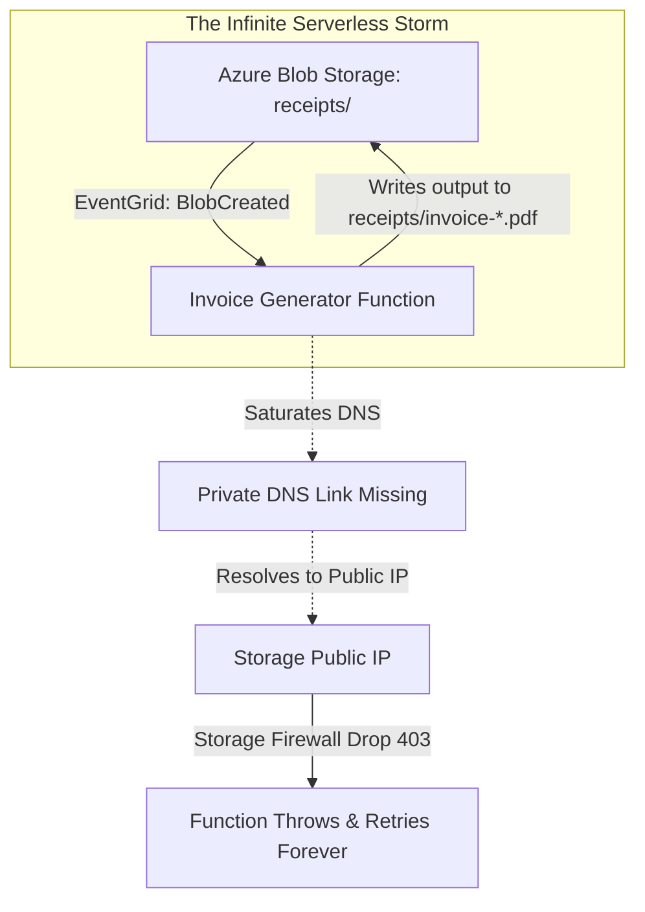
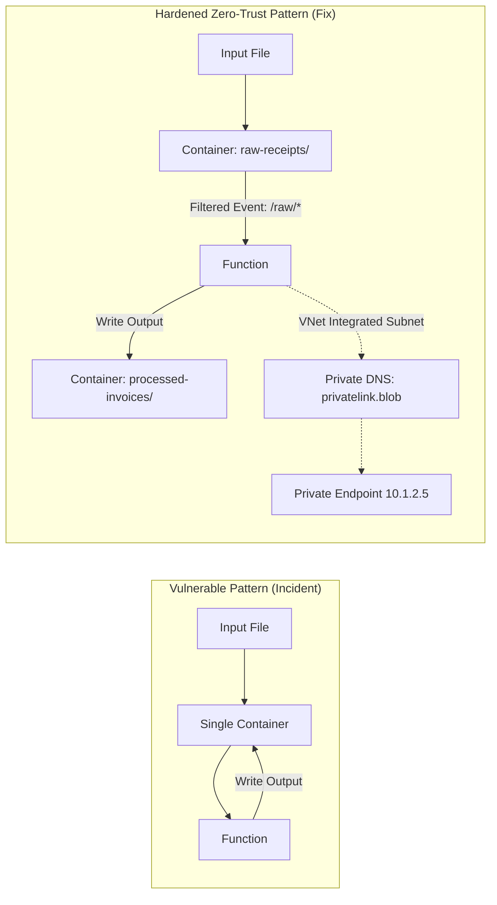

# SEV-1 Post-Mortem: The $140,000 Serverless Recursive Loop & Split-Brain Outage

| Incident Detail | Value |
|---|---|
| **Incident ID** | INC-2026-0814-SEV1 |
| **Severity** | SEV-1 (Critical Revenue & Operational Impact) |
| **Date & Time** | 2026-08-14 02:15 UTC to 07:45 UTC (Duration: 5h 30m) |
| **Direct Financial Impact** | $142,860 unplanned Azure egress & serverless execution charges |
| **Customer Impact** | 4,200,000 incoming orders dropped or queued; 100% API downtime for 3h 12m |
| **Root Causes** | 1. Event Grid circular triggering on Azure Blob Storage with missing subject filter / 2. Split-horizon DNS misconfiguration causing Private Endpoint fallback to public IPs |

---

## 1. Executive Summary

On August 14, 2026, at 02:15 UTC, the Order Processing platform suffered a catastrophic cascading failure. A newly deployed Azure Function meant to generate PDF invoices from uploaded receipt metadata began an uncontrolled recursive execution loop. Each invocation wrote an updated invoice back to the same Azure Blob Storage container without a prefix/suffix filter, triggering another Event Grid event.

Simultaneously, the high execution volume saturated the spoke VNet DNS forwarders. Because the Azure Private DNS Zone link was missing on an auto-scaled secondary subnet, the functions fell back to public Azure recursive resolvers (`168.63.129.16`), resolving the storage account to its public IP. Because the storage account firewall strictly disallowed public IPs, 100% of outbound storage calls failed with `403 Forbidden`, causing unhandled exceptions, continuous dead-letter re-triggering, and a massive egress billing spike.

---

## 2. Detailed Incident Timeline

- **02:10 UTC**: Release `v2.14.0` deployed via Azure DevOps pipeline, introducing `InvoiceGenerationFunction`.
- **02:15 UTC**: A batch of 500 orders is submitted by an automated overnight ERP sync job.
- **02:16 UTC**: Function processes the 500 receipts and writes `receipt-inv-*.pdf` into the root container `receipts/`.
- **02:17 UTC**: Event Grid detects new blobs and fires 500 events back to the Function.
- **02:22 UTC**: Exponential expansion begins. Function instances scale from 5 to maximum quota (200 instances on Consumption plan). Over 450,000 events/minute are queued.
- **02:45 UTC**: Function invocations hit 1.8M/min. Azure Storage metrics report 100% `ClientOtherError` (HTTP 403).
- **03:10 UTC**: Engineering on-call paged for APIM 504 Gateway Timeouts; APIM backend pools are saturated due to DNS resolver timeouts.
- **03:35 UTC**: Incident commander declares SEV-1. War room initiated.
- **04:15 UTC**: Engineers observe the storage bill for the subscription has increased by $85,000 within 2 hours due to 120 TB of cross-region egress and hundreds of millions of operations.
- **05:00 UTC**: Root cause identified: Recursive event trigger on the `receipts` container + Private DNS resolution failure.
- **05:15 UTC**: Action taken: Event Grid subscription deleted via Azure CLI. Function App stopped.
- **06:00 UTC**: Private DNS Zone virtual network links verified and repaired.
- **07:00 UTC**: Function redeployed with subject filtering (`/blobs/input/`) and output path segregation (`/blobs/output/`).
- **07:45 UTC**: Backlogged queues drained. Latency and error rates return to nominal baseline. Incident closed.

---

## 3. Root Cause Analysis (The 5 Whys)

1. **Why did the system crash and generate an exorbitant cloud bill?**  
   The Function App scaled to maximum instances and processed over 250 million redundant executions in under 4 hours.
2. **Why did it execute 250 million times?**  
   It was caught in an infinite circular feedback loop: writing an output file generated an event that triggered the same function.
3. **Why did the function write to a location that triggered itself?**  
   The Event Grid subscription lacked a subject filter (e.g., `subjectBeginsWith: "/blobServices/default/containers/receipts/blobs/raw/"`), and the code wrote back into the same container without path separation.
4. **Why did the storage calls start throwing 403 Forbidden?**  
   The function hosts lost access to the Private Endpoint IP because the auto-scaled subnet was missing the Virtual Network Link to `privatelink.blob.core.windows.net`, causing queries to resolve to the storage account's public IP which was blocked by firewall rules.
5. **Why was this not caught in pre-production?**  
   Staging environments used a low-tier service plan with a maximum instance cap of 1, and the test suite used mock storage accounts rather than real Event Grid storage integrations over Private Link.

---

## 4. Architectural Vulnerabilities & Fixes

### Remediation Action Items

| ID | Action Item | Owner | Target Date | Status |
|---|---|---|---|---|
| **ACT-01** | Segregate blob storage containers into dedicated `inbound-raw/` and `outbound-processed/` containers with separate RBAC permissions. | Cloud Arch | 2026-08-16 | Completed |
| **ACT-02** | Update Event Grid subscriptions in Bicep to mandate subject filtering on all storage triggers. | DevOps | 2026-08-17 | Completed |
| **ACT-03** | Implement Azure Policy to audit and enforce Private DNS Zone links on every subnet in spoke VNets. | Security | 2026-08-18 | Completed |
| **ACT-04** | Configure FinOps spending anomaly alerts in Azure Cost Management to trigger automated Function App suspension if spending spikes > $5,000/hr. | FinOps | 2026-08-19 | Completed |
| **ACT-05** | Mandate full integration testing of Event Grid and Private Endpoints in Staging environments before PR merge. | QA Lead | 2026-08-20 | Completed |
