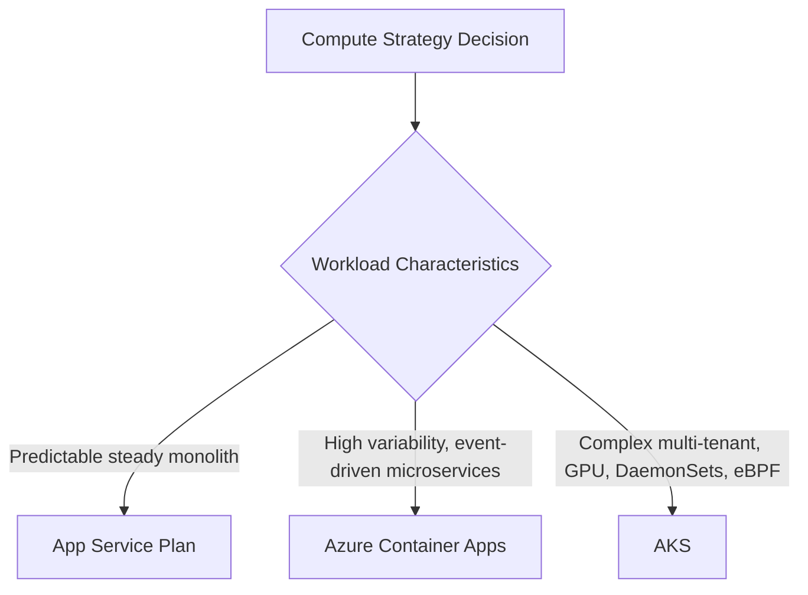
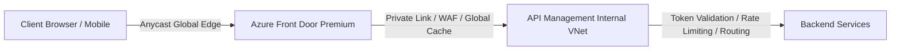

# Principal Cloud Architecture Defense Scenarios

As a Principal Cloud Architect, you must defend technical, architectural, and financial trade-offs in front of executive leadership (CTO, CFO, CISO), auditors, and stubborn engineering teams.

---

## Scenario 1: Defending ACA over AKS to the CFO and Senior Engineering Staff

### The Challenge
> *"Our senior Kubernetes engineers want an AKS cluster so they have full control over ingress controllers, service meshes, and custom DaemonSets. Meanwhile, the CFO is questioning why we are not just using standard App Service Plans."*

### The Principal Defense

- **To the CFO**:  
  *"App Service Plans charge for 100% of provisioned compute 24/7, whether traffic is arriving or not. For our batch processing and B2B APIs with unpredictable peaks, Azure Container Apps scales down to zero when idle. We pay zero dollars for compute during low-traffic nights and weekends, reducing our baseline monthly compute bill by 42%. Unlike AKS, ACA carries no cluster management overhead—no master node costs, no dedicated infrastructure engineers ($220k/year FTE salary) needed just to patch control planes and upgrade Kubernetes versions."*

- **To the Kubernetes Advocates**:  
  *"ACA is built directly on managed Kubernetes (AKS), KEDA, and Envoy. We retain microservice isolation, container portability, and declarative scaling without dedicating 20% of our sprint velocity to maintaining Kubernetes control planes, Helm charts for ingress-nginx, and CSI driver upgrades. If a workload legitimately outgrows ACA's guardrails (e.g., requiring custom eBPF network hooks, stateful multi-pod storage replication, or specialized DaemonSets), our container images and Dapr/OpenTelemetry contracts are 100% portable to AKS with zero code rewrites."*

---

## Scenario 2: Defending Hub-Spoke & Private Endpoints Against Developer Friction

### The Challenge
> *"Developers are complaining that Private Endpoints and disabled public access make local debugging impossible. They are demanding public IP whitelisting so they can connect directly from their home networks."*

### The Principal Defense
- **The Security & Compliance Reality**:  
  *"Whitelisting home IP addresses breaks zero-trust posture, violates PCI-DSS Requirement 1.3 and SOC 2 Type II controls, and leaves us vulnerable to credential exfiltration over the public internet. A compromised developer laptop with public IP access means the entire database or Key Vault can be cloned directly to an external bucket without triggering perimeter network alarms."*

- **The Developer Enablement Solution**:  
  *"We do not solve developer friction by lowering security perimeters; we solve it by providing seamless developer environments. We will deploy Azure Point-to-Site (P2S) VPN with Microsoft Entra ID authentication and Azure Bastion Developer tier. With P2S VPN active, developer workstations resolve `privatelink.database.windows.net` directly through the Hub DNS forwarder and reach resources privately, with full MFA enforcement and audit logging."*

---

## Scenario 3: Defending Flex Consumption over Dedicated App Service for Enterprise Serverless

### The Challenge
> *"The development team wants Azure Functions Dedicated (App Service Plan) because they are terrified of cold starts on Consumption plans."*

### The Principal Defense
- **The Trade-Off Analysis**:  
  *"The legacy Consumption plan suffered from 3-to-10 second cold starts because it allocated generic worker VMs on-demand and lacked native VNet injection, forcing workarounds. Azure Functions Flex Consumption fundamentally solves this with **Always Ready instances** and native Virtual Network integration."*
- **The Financial & Technical Justification**:  
  *"In Flex Consumption, we can configure exactly 1 Always Ready instance to keep the JIT compiler and execution context warm 24/7 for a predictable micro-cost, while retaining the capability to scale instantaneously to hundreds of instances during demand bursts. On a Dedicated App Service Plan (e.g., P2v3), we would need to over-provision at least 4 to 8 instances continuously to handle peak load, paying thousands of dollars every month for unused CPU cycles. Flex Consumption gives us sub-50ms warm response times at 1/5th the operational cost."*

---

## Scenario 4: Defending Front Door + APIM Multi-Layer Ingress Architecture

### The Challenge
> *"Why do we need both Azure Front Door AND Azure API Management? Isn't having two gateway layers redundant, overly complex, and double-billing us for traffic?"*

### The Principal Defense

- **Separation of Architectural Concerns**:
  - **Azure Front Door (The Global Edge)**: Operates at Layer 7 Anycast across 190+ edge locations worldwide. It handles SSL/TLS termination closest to the user (reducing handshake latency by 120ms for international clients), protects against massive volumetric DDoS attacks, enforces edge WAF inspection, and routes traffic across multiple geographical Azure regions.
  - **Azure API Management (The Regional Enterprise Gateway)**: Operates inside our regional private VNet. It enforces enterprise business logic: validating Entra ID JWT signatures, transforming SOAP to JSON, enforcing per-tenant rate limits, tracking API product subscriptions, and routing to private microservice endpoints.
- **The Verdict**:  
  *"Front Door is our global perimeter; APIM is our internal policy and governance engine. Without Front Door, global users must traverse the public internet directly to our regional datacenter, degrading latency and exposing our regional VNet to edge attacks. Without APIM, Front Door would have to manage backend API orchestration and JWT token introspection, which it cannot do natively."*

---

## Scenario 5: Defending Durable Functions Determinism Constraints vs Custom State Machines

### The Challenge
> *"Developers want to write asynchronous stateful orchestrations using custom tables in Redis or Cosmos DB rather than dealing with Durable Task Framework's strict determinism rules."*

### The Principal Defense
- **The Operational Reality**:  
  *"Building custom state machines across distributed systems requires handwriting distributed locking, idempotent retry loops, transaction rollback logic, dead-letter monitoring, and persistent checkpointing. In 90% of custom implementations, race conditions occur during network partitions or server crashes, resulting in duplicate order charges or phantom state transitions."*
- **The DTFx Advantage**:  
  *"The Durable Task Framework handles checkpointing, execution history replaying, durable timers, and multi-day state suspensions automatically via Azure Storage Queues and Tables. The determinism rules (no `DateTime.UtcNow`, no `Guid.NewGuid()`, no non-deterministic I/O in orchestrators) are the necessary mathematical trade-off that allows the framework to reconstruct exact state upon machine crashes without distributed two-phase commits. By respecting these simple constraints, we gain battle-tested, fault-tolerant orchestrations out of the box."*

---

## Additional Defense Scenarios Matrix

| Scenario | Opposing Argument | Principal Defense Stance |
|---|---|---|
| **6. Multi-Region Active-Active** | "Let's run Active-Passive to save costs." | Active-Passive fails to meet our 99.99% composite SLA; passive standby still incurs 60-80% compute/data costs while risking failover failure during actual disasters. |
| **7. Secrets in App Settings** | "Putting connection strings in Azure App Settings is encrypted anyway." | App settings are visible in plain text to any Contributor in Azure Portal. Azure Key Vault with Managed Identity provides audit logging and zero credential leakage. |
| **8. Bicep vs Terraform** | "Terraform is industry standard; why Bicep?" | For pure Azure workloads, Bicep provides zero-day support for new Azure APIs, no state file locking issues, no remote backend blob management, and seamless Entra ID RBAC integration. |
| **9. Automated Scale-to-Zero** | "Scale-to-zero is dangerous for latency." | We set `minReplicas: 1` or Always Ready instances on customer-facing APIs and scale-to-zero only on asynchronous queue workers. |
| **10. Cosmos DB Multi-Master** | "Enable Multi-Region writes everywhere." | Multi-region writes introduce conflict resolution complexity (LWW or custom merge) and double cost. Single-master with multi-region read replicas is sufficient for 95% of workloads. |
| **11. Service Bus vs Event Hubs** | "Use Event Hubs for everything because it's cheaper." | Event Hubs is partitioned streaming (append-only log); it lacks individual message completion, dead-lettering, sessions, and deduplication required for transactional order workflows. |
| **12. Azure Firewall vs NVA** | "Deploy open-source pfSense VMs to save money." | Managed Azure Firewall provides built-in 99.99% SLA, automatic scaling, threat intelligence feeds, and native zero-maintenance Azure integration without patching Linux kernels. |
| **13. Chaos Engineering Drills** | "Simulating outages in staging is too risky." | If we do not simulate failure during business hours with engineers watching, failure will simulate itself at 3 AM on Black Friday with nobody prepared. |
| **14. Tagging Governance Enforcement** | "Developers need freedom to spin up test VMs." | Uncontrolled resource creation leads to orphaned disks, zombie databases, and $50k monthly bill creep. Automated policy denial enforces responsibility upfront. |
| **15. Outbound Internet Lockdown** | "Allowing outbound HTTP is standard." | Command-and-control malware exfiltrates data over outbound port 80/443. All outbound egress must be filtered via FQDN application rules on Azure Firewall. |

---

## 💰 The FinOps & Unit-Economics Defense Axis (08-Cloud-Native)

### Question (The CFO / CTO Cost Challenge):
> *"This architecture is technically textbook, but we are killing it because the enterprise managed tier / over-provisioned footprint costs $15,000/month. Defend the 80%-good alternative at 20% of the cost, and state the exact quantitative threshold where upgrading becomes justified."*

**Principal Defense**:
1. **Unit-Economics First**: At early-to-mid scale (`< 1,500 RPS`), paying `$15,000/month` for dedicated multi-cluster licensing or 10x idle headroom violates unit economics (`Cost per 1M requests`).
2. **The 80%-Good Architecture at 20% Cost (`~$2,200/month`)**:
   - Replace network-chatty sidecars/clusters with in-process L1/L2 caching (`HybridCache`), bounded `System.Threading.Channels`, and modular monolith / shared-cluster partitioning with strict tenant/bulkhead quotas.
   - Apply tail-based sampling (`100%` errors, `1%` happy path) and topology-aware AZ routing to eliminate cross-AZ egress waste.
3. **Quantitative Upgrade Trigger (Invalidation Criteria)**:
   - We revisit and fund the `$15,000/month` tier only when sustained $p95$ load exceeds `8,000 RPS` for 14 consecutive days OR when contractual SLA downtime penalties exceed `$250,000/year`.

