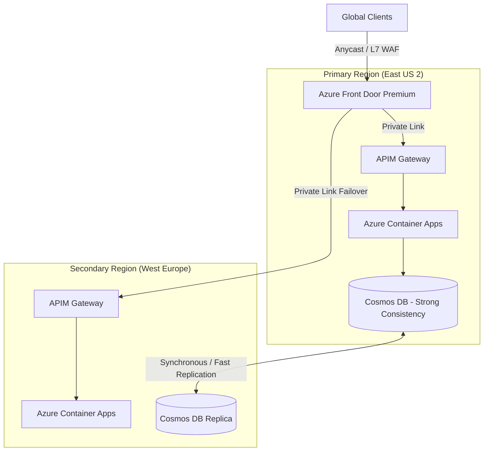
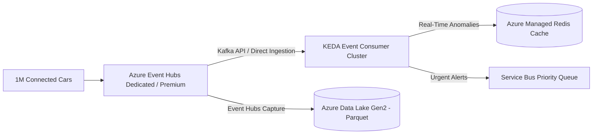
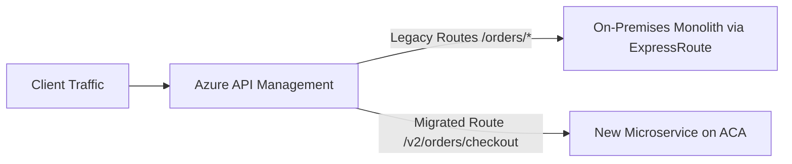

# Principal Cloud Architect Interview Scenarios

These real-world design scenarios assess enterprise architectural thinking, failure mitigation, scalability trade-offs, and cost awareness at the Staff and Principal Engineer levels.

---

## Scenario 1: Multi-Region Global E-Commerce Core Banking Engine

### The Prompt
> *"Design a mission-critical core banking and checkout engine on Azure with a 99.999% availability SLA, zero data loss (RPO = 0), and sub-200ms latency globally across North America, Europe, and Asia-Pacific."*

### Architectural Solution
1. **Edge & Global Routing**:
   - Azure Front Door Premium with Anycast routing and automated health probes (`/health/ready`).
   - Private Link service connections from Front Door to internal APIM instances, bypassing the public internet entirely.
2. **Compute Tier**:
   - Azure Container Apps deployed across 3 Availability Zones per region.
   - Internal ingress only, fronted by APIM.
3. **Data Tier & RPO = 0 Constraint**:
   - Azure Cosmos DB with Strong Consistency across paired regions within synchronous latency distance (< 10ms network round-trip), or Azure SQL Hyperscale with Geo-Replication and automated failover groups.
   - For financial ledgers requiring ACID guarantees: Strong consistency ensures RPO = 0, with write replication verified before acknowledging transactions.
4. **Resilience & SLA Calculation**:
   - Multi-region active-active topology with regional independent failover.
   - Availability SLA: $\text{SLA}_{\text{multi}} = 1 - (1 - 0.9995)^2 = 99.999975\%$, comfortably satisfying five-nines requirements.

---

## Scenario 2: Massive IoT Ingestion & Real-Time Processing (1M Events/Sec)

### The Prompt
> *"Architect a system capable of ingesting 1,000,000 telemetry messages per second from connected vehicles, processing alerts in sub-second time, and persisting raw data for long-term analytics with minimal cloud spend."*

### Key Architectural Decisions
- **Ingestion**: Azure Event Hubs Premium/Dedicated with 64 to 128 partitions. Event Hubs Capture enabled to automatically buffer and flush raw telemetry directly to Azure Data Lake Storage Gen2 in Avro/Parquet format with zero custom compute cost.
- **Real-Time Stream Consumption**:
  - Azure Container Apps running .NET 9 consumers utilizing `EventProcessorClient`.
  - Scaled dynamically using KEDA Event Hubs scalers based on partition consumer group lag.
- **FinOps Optimization**:
  - Utilizing Event Hubs Capture eliminates the need for expensive intermediate worker VMs for ingestion persistence.
  - Hot path data is checked against localized Azure Managed Redis caches; cold path data is analyzed via Azure Synapse Serverless or BigQuery/Fabric on data lake storage.

---

## Scenario 3: Legacy Monolith Containerization & Strangler Fig Migration

### The Prompt
> *"You have an on-premises monolithic .NET Framework application handling $50M/day in transactions. The business cannot tolerate a multi-month feature freeze or high-risk big-bang cutover. How do you migrate this to Azure?"*

### The Migration Blueprint

1. **Step 1: Hybrid Network Establishment**:
   - Deploy Azure ExpressRoute with redundant private peering connecting the on-premises datacenter to Azure Hub VNet.
2. **Step 2: Perimeter Gateway Placement**:
   - Place Azure API Management in front of both environments. All client calls now terminate at APIM. Initially, APIM proxies 100% of traffic back down ExpressRoute to the on-prem monolith.
3. **Step 3: Incremental Service Extraction (Strangler Fig Pattern)**:
   - Identify bounded contexts (e.g., Notifications, Invoicing, Payment Gateway).
   - Re-architect bounded context as a clean .NET 9 microservice on Azure Container Apps.
   - Update APIM routing policy: `/api/v1/invoices` routes to Azure Container Apps; all other routes continue to the monolith.
4. **Step 4: Database De-coupling**:
   - Utilize Change Data Capture (CDC) via Debezium or Azure Data Factory to sync data between the on-prem database and Azure cloud databases until the service owns its own data.

---

## Scenario 4: Fully Isolated Zero-Trust Healthcare Platform (HIPAA & HITRUST)

### The Prompt
> *"Design an Azure environment for sensitive Protected Health Information (PHI). Zero public IPs, zero internet access for compute nodes, full end-to-end data encryption with customer-managed keys, and strict audit compliance."*

### Key Compliance Enforcements
- **Compute**: Azure Container Apps or AKS deployed into internal subnets with `OutboundType: userDefinedRouting`.
- **Egress Lockdown**: All outbound traffic routed via UDR `0.0.0.0/0` to Azure Firewall Premium with TLS Inspection and IDPS (Intrusion Detection and Prevention System) enabled.
- **Storage & Databases**: Azure SQL Database and Storage Accounts configured with Customer-Managed Keys (CMK) in Azure Key Vault Managed HSM (FIPS 140-2 Level 3 validated).
- **Audit Logging**: Azure Monitor diagnostic logs exported to an immutable Azure Storage container with a 7-year WORM (Write Once, Read Many) retention policy.
- **Authentication**: Zero passwords. Managed Identities enforced for all interservice and database connections.

---

## Scenario 5: Cross-Region Automated Disaster Recovery (RPO = 0, RTO < 60s)

### The Prompt
> *"Explain how to achieve automated failover between two Azure regions with zero data loss (RPO = 0) and under 60 seconds recovery time (RTO < 60s) during a total regional outage."*

### Architectural Breakdown
- **DNS/Routing Layer**: Azure Front Door Premium with continuous HTTP health probes every 5 seconds. Timeout set to 2 seconds, with 2 failed probes triggering health status failover (Detection time: ~10 seconds).
- **Compute Layer**: Warm Standby in secondary region. Azure Container Apps configured with `minReplicas: 2` in both regions, ensuring zero container initialization delay upon traffic redirection.
- **Data Layer**:
  - Synchronous replication across regions is physically constrained by the speed of light in fiber (~5ms round trip per 1,000 km).
  - To achieve true RPO = 0 across regions, the primary and secondary regions must be geographically close (e.g., East US and East US 2, or regional Availability Zones within a metropolitan area).
  - For cross-region setups: Use distributed transactional stores like Azure Cosmos DB with Strong Consistency or Azure SQL Hyperscale with synchronous multi-zone replication and auto-failover groups.
- **Total RTO Breakdown**:
  - Health Probe Failure Detection: 10s
  - Front Door Edge Anycast Convergence: 5s
  - Backend Compute Ready (Warm): 0s
  - Database Failover Confirmation: 15s-30s
  - **Total RTO: ~45 seconds (Under the 60s limit)**.
