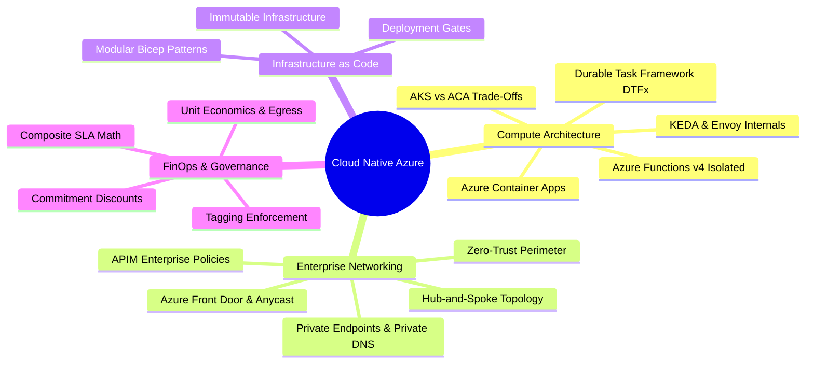
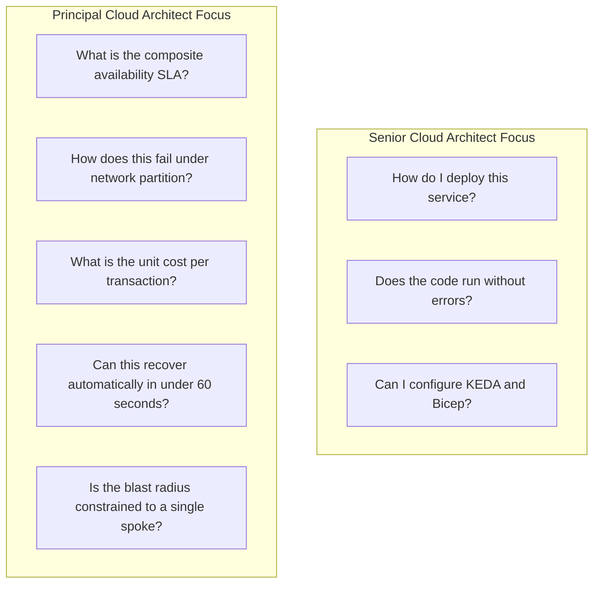

# Sprint 08 Summary: Cloud Native Azure Architecture

Sprint 08 represents the master-level culmination of enterprise cloud architecture on Microsoft Azure. It bridges the gap between infrastructure deployment and resilient application design, codifying the principles required of a Staff and Principal Cloud Architect.

---

## Core Architectural Pillars Covered

---

## Architectural Decision Cheat Sheet

| Architecture Decision | Choose This | Avoid This | Rationale |
|---|---|---|---|
| **Microservice Compute** | Azure Container Apps (ACA) | Over-engineered AKS clusters | ACA eliminates K8s control plane maintenance while retaining KEDA event scaling and Envoy mTLS. |
| **Serverless Ingestion** | Functions v4 Isolated Worker (.NET 9) | Legacy In-Process model | Isolated worker decouples runtime dependencies, fully supports modern C# 13, and enables Flex Consumption. |
| **Stateful Workflows** | Durable Functions (DTFx) | Custom database state polling | DTFx guarantees replay-driven recovery, durable timers, and saga compensation out of the box. |
| **Network Perimeter** | Hub-and-Spoke with Private Endpoints | Public IP whitelisting | Zero public ingress protects backend data stores from credential exfiltration and unauthorized internet access. |
| **Global Edge Routing** | Azure Front Door Premium | Raw Public Load Balancers | Anycast edge terminates TLS closer to users, enforces global WAF, and provides instant regional failover. |
| **Secret Management** | Managed Identities + Key Vault | Connection strings in app settings | Eliminates static credentials; access is authenticated via Entra ID short-lived tokens and fully audited. |
| **Infrastructure Definition** | Modular Bicep | ClickOps / Manual Portal configuration | Bicep provides type-safe, declarative, zero-day Azure API support without external state file drift. |
| **Cost Governance** | Tagging Policy + Anomaly Alerts | Reactive end-of-month bill review | Catch recursive loops and runaway scaling before financial damage occurs. |

---

## What Distinguishes a Senior from a Principal Architect

A Senior Architect builds systems that work under ideal conditions.  
A **Principal Architect** designs systems that survive catastrophic partial failures, prevent organizational bankruptcies through automated FinOps guardrails, and empower engineering teams through frictionless zero-trust platforms.
