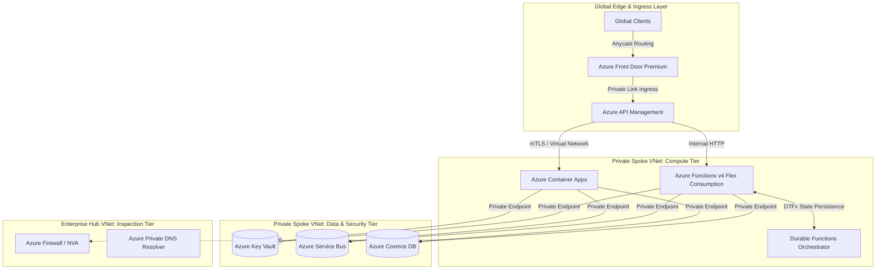

# Sprint 08: Cloud Native Azure Architecture

Welcome to **Sprint 08** of the Principal Engineer Journey. This module is an authoritative, production-grade guide to designing, deploying, and governing mission-critical, cloud-native systems on Microsoft Azure.

---

## Chapter Directory

| # | Chapter Document | Core Themes & Technologies |
|---|---|---|
| **01** | [`01-Story.md`](01-Story.md) | SEV-1 Incident: The Cloud Bill Avalanche & The Public Ingress Breach |
| **02** | [`02-Learning-Objectives.md`](02-Learning-Objectives.md) | Bloom's Taxonomy & Principal Competencies across WAF Pillars |
| **03** | [`03-Cloud-Requirements.md`](03-Cloud-Requirements.md) | Composite SLA Calculations ($\prod \text{SLA}_i$), RTO/RPO, FinOps Limits |
| **04** | [`04-Cloud-Native-Architecture.md`](04-Cloud-Native-Architecture.md) | Enterprise Hub-and-Spoke VNet Topology & Zero-Trust Ingress |
| **05** | [`05-Compute-Architecture-ACA-vs-AKS.md`](05-Compute-Architecture-ACA-vs-AKS.md) | Azure Container Apps vs AKS vs App Service, cgroup v2 Throttling |
| **05A**| [`05A-Inside-KEDA-And-Envoy-Internals.md`](05A-Inside-KEDA-And-Envoy-Internals.md) | KEDA Control Loops, Envoy Sidecar mTLS, Zero-Scale Cold Starts |
| **06** | [`06-Serverless-Compute-Azure-Functions.md`](06-Serverless-Compute-Azure-Functions.md) | Azure Functions v4 Isolated Worker (.NET 9 C# 13), Flex Consumption |
| **06A**| [`06A-Inside-Durable-Functions-Internals.md`](06A-Inside-Durable-Functions-Internals.md) | Durable Task Framework (DTFx), Replay Rules, Saga Pattern |
| **07** | [`07-API-Gateway-Architecture-APIM.md`](07-API-Gateway-Architecture-APIM.md) | APIM Policies, mTLS, JWT Validation, Token-Bucket Rate Limiting |
| **08** | [`08-Edge-Routing-And-Global-CDN-FrontDoor.md`](08-Edge-Routing-And-Global-CDN-FrontDoor.md) | Azure Front Door Premium, Anycast Routing, Global WAF Rules |
| **09** | [`09-Zero-Trust-Networking-Private-Endpoints.md`](09-Zero-Trust-Networking-Private-Endpoints.md) | Private Endpoints, Private DNS Zones, Split-Horizon DNS |
| **10** | [`10-Secrets-And-Identity-KeyVault-ManagedIdentity.md`](10-Secrets-And-Identity-KeyVault-ManagedIdentity.md) | Managed Identities, Azure Key Vault MHSM, Secret Rotation |
| **11** | [`11-Infrastructure-As-Code-Bicep.md`](11-Infrastructure-As-Code-Bicep.md) | Enterprise Modular Bicep, Type Safety, Tenant Scopes, CI/CD |
| **12** | [`12-FinOps-And-Cloud-Cost-Engineering.md`](12-FinOps-And-Cloud-Cost-Engineering.md) | FinOps Framework, Egress Unit Economics, Savings Plans vs RIs |
| **13** | [`13-Principal-Cloud-Checklist.md`](13-Principal-Cloud-Checklist.md) | Comprehensive WAF Production Readiness Review & Governance Gate |
| **14** | [`14-Hands-On-Cloud-Labs.md`](14-Hands-On-Cloud-Labs.md) | 5 Production Labs: Bicep, ACA, Functions v4, Durable Functions, APIM |
| **15** | [`15-Production-Incident-Post-Mortem.md`](15-Production-Incident-Post-Mortem.md) | SEV-1 Post-Mortem: $140,000 Recursive Billing Storm & Outage |
| **16** | [`16-Principal-Cloud-Defense-Questions.md`](16-Principal-Cloud-Defense-Questions.md) | 15 Deep Defense Scenarios for CTO, CFO, CISO, and Review Boards |
| **17** | [`17-Principal-Cloud-Interview-Scenarios.md`](17-Principal-Cloud-Interview-Scenarios.md) | 5 Staff/Principal Cloud Architect Design Case Studies |
| **18** | [`18-Summary.md`](18-Summary.md) | Synthesis, Architectural Decision Matrix, Senior vs Principal |
| **19** | [`19-Resources.md`](19-Resources.md) | Curated Official References, Standards, and Specifications |

---

## Key Architectural Principles

1. **Zero Public Ingress**: Backend microservices, databases, storage accounts, and secret stores never expose public IP addresses. All ingress is mediated via Private Endpoints.
2. **Identity as the Perimeter**: Eliminate static credentials, API keys, and connection strings. Enforce Azure Entra ID Managed Identities and fine-grained Azure RBAC.
3. **Decoupled Scale**: Match the compute model to workload characteristics—serverless scale-to-zero for unpredictable spikes; steady-state reservations for predictable core processing.
4. **Resilience by Design**: Architect for partial failures using retry storms mitigation (jittered backoff), circuit breakers, multi-zone redundancy, and deterministic state orchestration.
5. **Continuous FinOps Governance**: Guardrails and budget policies enforced in code; real-time anomaly detection preventing unbounded financial blast radius.
