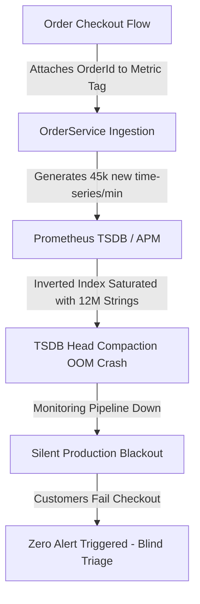
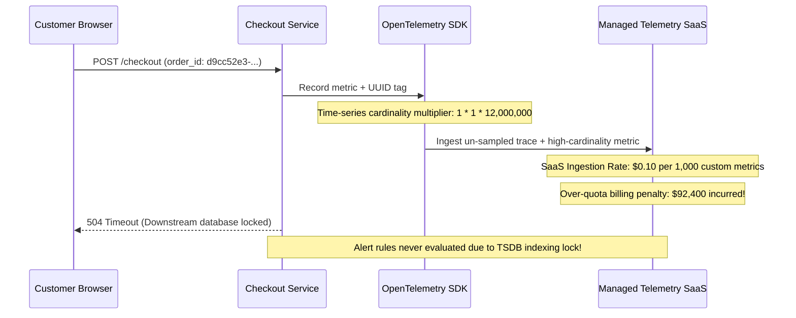

# The Incident: The $90,000 High-Cardinality Telemetry Crash & The Silent Outage

The date was November 27, 2026—Black Friday. At 10:14 AM UTC, the core payment processing platform for Global Retail Corp handled over 45,000 checkouts per minute across Europe and North America.

Then, the monitoring dashboards went completely blank.

---

## 1. The Catastrophe Unfolds

It started not with an application crash, but with silence. In the central Operations Center, the wall of Grafana dashboards displaying request throughput, error rates, and p99 checkout latencies suddenly froze. Panels displayed empty grey boxes with red error badges:

```text
504 Gateway Timeout: Query execution exceeded 60000ms
Prometheus TSDB Out of Memory: panic: runtime error: out of memory allocating 4GB chunk
```

Simultaneously, customer support lines lit up. VIP corporate buyers attempting multi-million dollar purchases received blank screens or HTTP 500 errors. However, no alerts fired in PagerDuty. The automated alert rules—designed to trigger when error rates exceeded 1%—could not run because the underlying telemetry database had collapsed under an unprecedented cardinality explosion.



---

## 2. The $90,000 Cloud Bill Avalanche

As the on-call engineers scrambled in the dark, the secondary telemetry fallback—a managed cloud Application Performance Monitoring (APM) and logging vendor—was still receiving raw data from auto-scaled container pods.

Two days prior, an engineering team had deployed what seemed like an innocent performance debugging enhancement to `CheckoutProcessor.cs`:

```csharp
// The fatal line: High-cardinality label injection
_checkoutCounter.Add(1, 
    new KeyValuePair<string, object?>("status", "success"),
    new KeyValuePair<string, object?>("tenant_id", tenantId),
    new KeyValuePair<string, object?>("order_id", order.Id)); // UUID with infinite cardinality!
```

By attaching a unique `order.Id` (UUID) to every recorded metric event, every single transaction generated a brand-new time-series dimension in the metrics database. Over a 4-hour peak window, 12 million unique metric series were created.

1. The self-hosted Prometheus/Thanos cluster consumed 128 GB of RAM in minutes trying to maintain the inverted index strings in memory, entered an unrecoverable kernel Out-Of-Memory (OOM) panic loop, and died.
2. The cloud APM vendor's agent ingested every single span and uncompressed trace across 250 microservice instances. Because trace sampling had been disabled ("to ensure we catch every bug during Black Friday"), 40 Terabytes of telemetry were shipped across cloud regions.
3. When the automated monthly billing alert triggered 6 hours later, the cloud observability bill had spiked by **$92,400 in unbudgeted ingestion fees**.

---

## 3. The Anatomy of Telemetry Failure



The team spent 3 hours triaging the failure blind. They had to SSH directly into individual production nodes, dump thread stacks via `dotnet-dump`, and parse raw console streams through grep.

The real failure was not a bug in the payment gateway. The database had encountered a 5-second transient lock escalation, which could have been recovered in seconds. But because the observability architecture lacked **cardinality governance, trace sampling pipelines, and decoupled out-of-band telemetry buffers**, the monitoring system itself amplified the incident into a multi-hour corporate disaster.

---

## 4. The Principal Architect's Mandate

Observability is not about emitting as much data as possible; it is the mathematical art of inferring the internal states of a complex distributed system from its external outputs **without degrading performance, violating privacy, or exhausting budgets**.

A Principal Engineer understands:
- The fundamental difference between **Telemetry** (data collection) and **Observability** (state inference).
- Why metric dimensions must remain strictly bounded ($O(1)$ cardinality) and how to protect TSDB inverted indices.
- How the .NET CLR implements zero-allocation telemetry through `System.Diagnostics.DiagnosticSource`, `ActivitySource`, and `System.Diagnostics.Metrics`.
- The exact mechanics of W3C TraceContext context injection and extraction across network boundaries.
- How to architect OpenTelemetry Collector clusters with tail-based sampling and memory limiters.
- How to mathematically formulate Google SRE Service Level Objectives (SLOs) and Multi-Window Multi-Burn-Rate alerting rules that eliminate alert fatigue while catching catastrophic failures in minutes.
