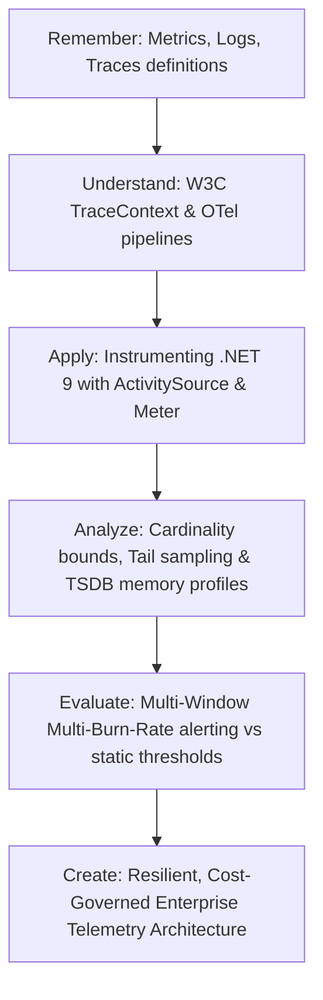

# Learning Objectives & Principal Observability Competencies

As systems scale from isolated monoliths to asynchronous, multi-region distributed topologies, traditional server monitoring (CPU percentage, disk space, ping checks) becomes dangerously inadequate. A Principal Engineer designs observability systems that provide high-fidelity causal reasoning during complex cascading outages.

---

## 1. Bloom's Taxonomy: Observability Competency Progression

### Level 1: Remember & Recall
- Identify the three pillars of telemetry: Structured Logs, Metrics, and Distributed Traces, along with Continuous Profiling and Core Dumps.
- Memorize the W3C TraceContext headers (`traceparent`, `tracestate`) and their 4-part hexadecimal structure.
- State the 4 Golden Signals of Google SRE: Latency, Traffic, Errors, and Saturation.

### Level 2: Understand & Explain
- Explain how OpenTelemetry decouples the API (instrumentation contract) from the SDK (pipeline implementation).
- Contrast Head-based sampling (decision at trace origin) with Tail-based sampling (decision after trace completion based on errors and latency).
- Articulate why high-cardinality tags (e.g., user IDs, order IDs, timestamps) destroy Prometheus/TSDB inverted index memory.

### Level 3: Apply & Implement
- Instrument high-throughput .NET 9 services using `System.Diagnostics.ActivitySource` and `System.Diagnostics.Metrics` with zero allocations on the hot path.
- Configure OpenTelemetry Collector pipelines with `memory_limiter`, `batch`, `tail_sampling`, and `filter` processors.
- Implement high-performance structured logging using C# compile-time `[LoggerMessage]` source generators.

### Level 4: Analyze & Diagnose
- Dissect the CLR internals of `DiagnosticSource`, `ActivityListener`, and `AsyncLocal<T>` context flow across asynchronous execution chains.
- Analyze TSDB chunk memory growth, inverted index posting lists, and write-ahead log (WAL) churn under high load.
- Formulate mathematical SLI formulas: $\text{SLI} = \frac{\sum \text{Good Events}}{\sum \text{Valid Events}} \times 100\%$.

### Level 5: Evaluate & Justify
- Defend the adoption of Multi-Window Multi-Burn-Rate alerting (14.4x 1h/5m, 6x 6h/30m) over arbitrary CPU/memory alert thresholds.
- Evaluate telemetry cost trade-offs: full ingestion vs. edge filtering vs. adaptive probabilistic sampling.
- Justify zero-standing access and automated PII redaction interceptors within telemetry streams.

### Level 6: Create & Govern
- Architect an enterprise-wide telemetry platform capable of ingesting billions of spans and metrics daily with bounded latency and spend.
- Design an automated SRE Error Budget policy that pauses feature deployments when critical SLOs are breached.
- Establish an Observability Production Readiness Review (PRR) gate for all microservice releases.

---

## 2. The Principal Engineer's Observability Mindset

| Dimension | Senior Engineer Mindset | Principal Architect Mindset |
|---|---|---|
| **Goal** | "Make sure we have dashboards for CPU, memory, and HTTP 500s." | "Enable any engineer to debug an unknown-unknown state without deploying new code." |
| **Telemetry Ingestion** | "Log everything; storage is cheap; we'll figure it out in Splunk." | "Every byte emitted carries an operational cost, network tax, and privacy risk. Telemetry must be budgeted, sampled, and governed." |
| **Alerting Discipline** | "Set alerts at 85% CPU and 1% error rate on a 1-minute window." | "Eliminate alert fatigue completely. Alert exclusively on customer-facing SLO Burn Rates that threaten the quarterly error budget." |
| **Tracing Strategy** | "Install an APM agent and let it auto-instrument everything." | "Standardize on vendor-neutral OpenTelemetry APIs, inject domain context via W3C TraceContext, and govern tail sampling at collector gateways." |
| **Incident Response** | "Look at graphs until a spike is spotted; guess the root cause." | "Formulate hypotheses based on high-cardinality dimension correlation, navigate from exemplar metric points directly to traces, and inspect thread dumps." |
