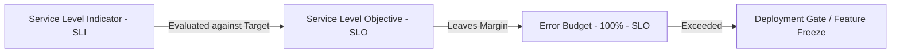
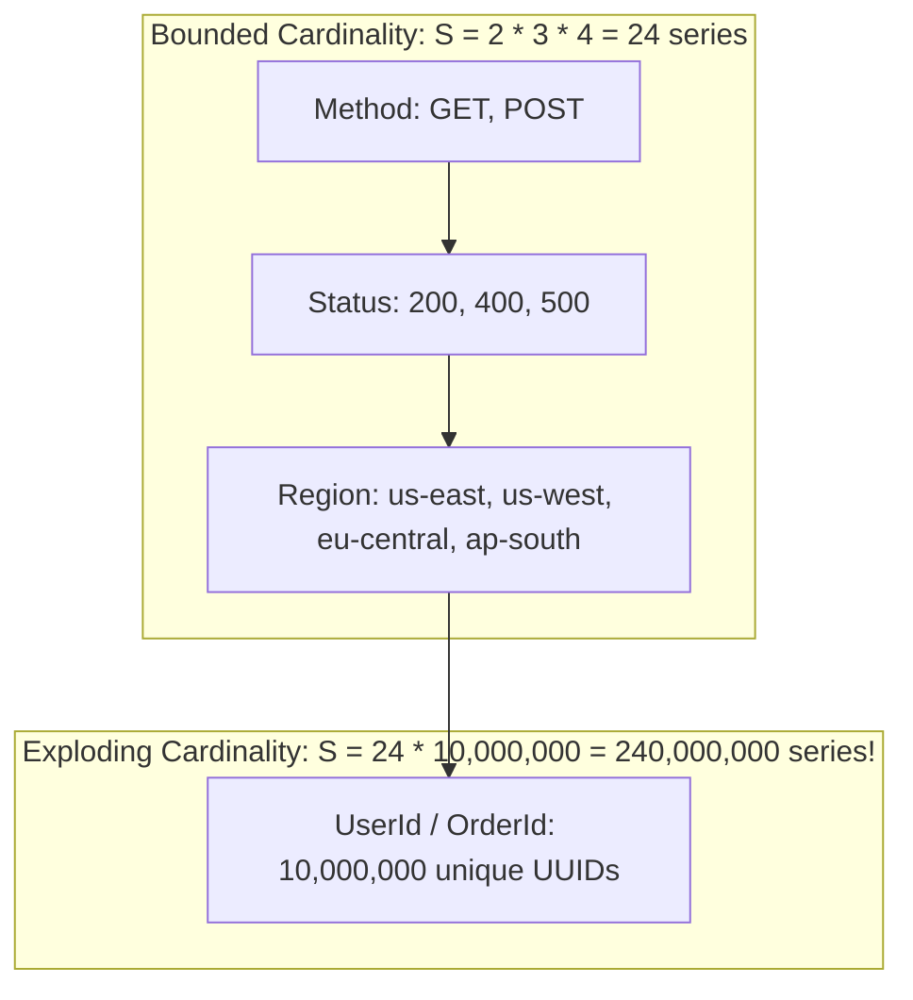
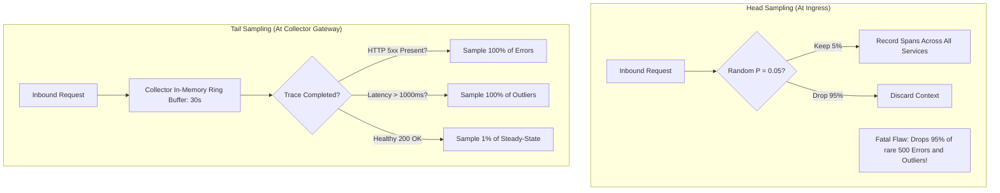

# System Requirements: Telemetry Budgeting, SLO Guarantees & Sampling Math

Production observability is governed by rigid physical and mathematical boundaries: network bandwidth, memory allocation for inverted indices, storage retention costs, and statistical significance in sampling.

---

## 1. The Mathematical Foundation of SLIs, SLOs & Error Budgets

### The Service Level Indicator (SLI)
An SLI is a quantifiable metric measuring service performance from the consumer's perspective. It must be structured as a ratio of good events over total valid events:

$$\text{SLI} = \frac{\sum_{i=1}^N \text{Good Events}_i}{\sum_{i=1}^N \text{Valid Events}_i} \times 100\%$$

- **Good Event (Availability)**: An HTTP request returning status code $< 500$ (or specific business success code).
- **Good Event (Latency)**: An HTTP request returning within the p99 threshold (e.g., $T_{\text{response}} \le 250\text{ ms}$).
- **Valid Event**: All inbound requests excluding client-induced errors (HTTP 4xx due to invalid user auth or client malformed body).

### The Service Level Objective (SLO)
The SLO is the target reliability commitment over a rolling compliance window (typically 28 or 30 days):

$$\text{SLO} = 99.9\% \quad (\text{over a rolling 30-day window})$$

### The Error Budget
The error budget represents the allowed unreliability of the system:

$$\text{Error Budget} = 100\% - \text{SLO} = 100\% - 99.9\% = 0.1\%$$

For a service handling 100,000,000 requests per month:
- **Allowed Bad Requests**: $100,000,000 \times 0.001 = 100,000$ failed requests.
- **Allowed Downtime (99.9%)**: $30 \times 24 \times 60 \text{ minutes} \times 0.001 = 43.2\text{ minutes/month}$.

---

## 2. High-Cardinality Telemetry Mathematics

In time-series databases (TSDB) like Prometheus, Thanos, Cortex, and M3DB, every metric consists of a metric name and a set of key-value labels (dimensions).

The total number of unique time series $S$ stored in memory is the cartesian product of the cardinalities of each individual label:

$$S = \prod_{j=1}^M |L_j| = |L_1| \times |L_2| \times \dots \times |L_M|$$

### Mathematical Impact on Inverted Index Memory
Prometheus maintains an in-memory inverted index mapping each `label=value` pair to an array of 32-bit series IDs (posting lists).

$$\text{RAM}_{\text{Index}} \approx S \times (\text{Series Struct Size} + \text{Posting List Overhead})$$

If a single label has $|L| = 10,000,000$ unique values:
- Average memory per metric series in memory: $\approx 2\text{ KB}$ (including chunk buffers and postings).
- Total RAM required: $10,000,000 \times 2\text{ KB} = 20\text{ GB}$ of RAM **for a single metric**.
- At 10 metrics with unconstrained labels: $200\text{ GB}$ of RAM $\rightarrow$ Kernel OOM crash.

> **Principal Law of Metrics**: Metric labels MUST have finite, bounded, low cardinality ($|L| < 100$). High-cardinality attributes (UUIDs, timestamps, full URLs) belong in **Distributed Traces (Span Attributes)** or **Structured Logs**, never in Metric Labels.

---

## 3. Trace Sampling Mathematics: Head vs. Tail Sampling

At scale (e.g., 50,000 requests/sec), capturing 100% of distributed traces is economically non-viable and causes massive network/disk I/O overhead:

$$\text{Data Rate} = 50,000 \text{ req/s} \times 10 \text{ spans/req} \times 1\text{ KB/span} = 500\text{ MB/sec} = 1.8\text{ TB/hour}$$

### Mathematical Evaluation of Sampling Strategies

| Sampling Strategy | Sampling Decision Point | Cost Efficiency | Outlier & Error Retention | Downstream I/O Impact |
|---|---|---|---|---|
| **100% Full Ingestion** | None | Extremely Low ($$$$) | 100% (Complete) | High risk of saturating network and storage |
| **Probabilistic Head Sampling** | Ingress Root Span | High ($) | Low (Retains only $P \times \text{Errors}$) | Zero collector buffer overhead |
| **Adaptive Tail Sampling** | OTel Collector Gateway | Balanced ($$) | **100% of Errors & Outliers** retained | Requires memory-backed collector ring buffers |
