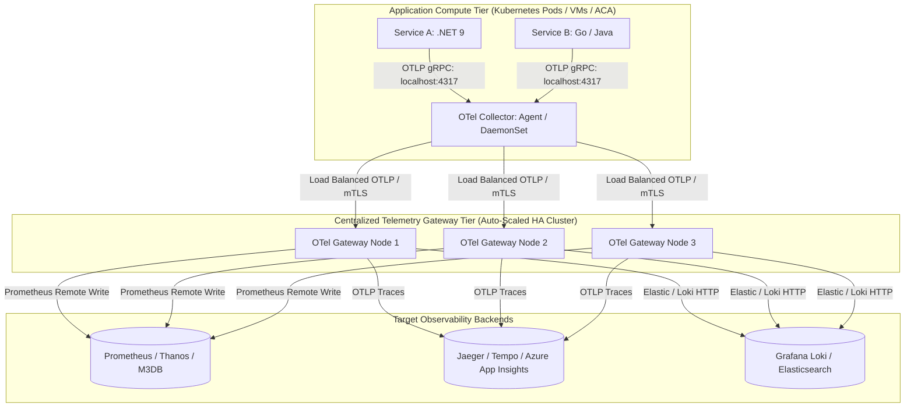
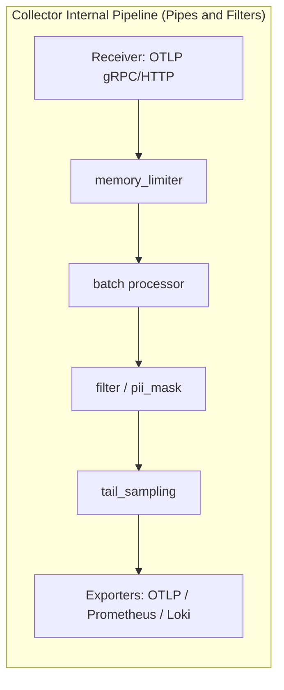

# Enterprise Observability Architecture: Agent vs. Gateway Topology

An enterprise-grade telemetry pipeline must ingest, scrub, enrich, sample, and route massive volumes of logs, metrics, and traces without imposing operational drag or downtime on production application workloads.

---

## 1. Enterprise OpenTelemetry Collector Topology

### The Two-Tier Architecture Explained

#### Tier 1: Local Agent (Sidecar or DaemonSet)
- **Deployment**: Runs collocated on the local host (listening on `localhost:4317` gRPC / `localhost:4318` HTTP).
- **Responsibilities**:
  - Offloads network transmission from the application runtime immediately via non-blocking in-memory buffers.
  - Injects host/container infrastructure metadata (Host IP, Pod Name, Node ID, Azure Resource ID).
  - Performs local batching and gzip compression before sending across the network.
  - Zero heavy business logic, zero stateful tail sampling.

#### Tier 2: Centralized Gateway Cluster
- **Deployment**: Dedicated, auto-scaling deployment running behind an internal Layer 4 Network Load Balancer (NLB).
- **Responsibilities**:
  - **Memory Limiter Processor**: Guarantees the collector drops data gracefully rather than crashing from Out-Of-Memory.
  - **PII Scrubbing**: Regex masking of credit card numbers, JWT tokens, email addresses, and passwords across all span attributes and logs.
  - **Tail-Based Sampling**: Buffers full traces across all microservice hops to ensure 100% of errors and p99 latency anomalies are persisted, while discarding 99% of boring 200 OK traces.
  - **Multi-Destination Routing**: Ships traces to Tempo, metrics to Prometheus, and logs to Loki or Azure Log Analytics.

---

## 2. OTel Collector Internal Pipeline Mechanics

### The Critical Processor Sequence
1. **`memory_limiter`**: MUST be the first processor in every pipeline. It monitors process heap usage. When memory exceeds `limit_percentage` (e.g., 80%), it begins shedding load and returning gRPC backpressure (`ResourceExhausted`) to agents.
2. **`batch`**: Amortizes network round-trip costs by accumulating records into batches of $N$ items (e.g., 8,192 records) or flushing every $T$ milliseconds (e.g., 200ms).
3. **`attributes / transform`**: Manipulates telemetry attributes, standardizes naming across disparate language SDKs, and scrubs sensitive PII strings.
4. **`tail_sampling`**: Evaluates completed traces using rule policies (Error status, Duration threshold, Probabilistic baseline).
5. **`exporter`**: Translates the in-memory OpenTelemetry Transformation Language (OTTL) structs into wire protocols (Prometheus Remote Write, OTLP, Elasticsearch bulk).
