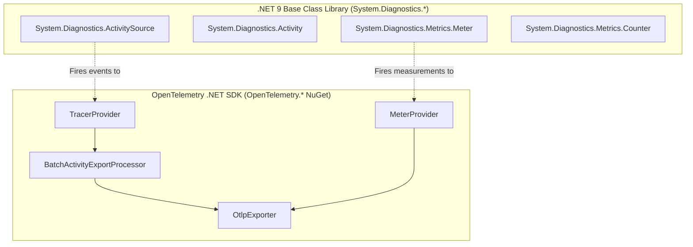

# OpenTelemetry Core SDK: .NET 9 Architecture & Resource Providers

In modern .NET (starting with .NET 6 and fully matured in .NET 9), Microsoft made a fundamental architectural decision: **the OpenTelemetry API is built directly into the .NET Base Class Library (BCL)**.

---

## 1. The Separation of API and SDK



- **The API Layer (`System.Diagnostics`)**: Native to the runtime. Zero external dependencies. Third-party library authors (e.g., MassTransit, EF Core, Npgsql) instrument their code using standard `ActivitySource` and `Meter` without referencing any OpenTelemetry packages.
- **The SDK Layer (`OpenTelemetry.Exporter.OpenTelemetryProtocol`)**: Configured only at the application composition root (`Program.cs`). It listens to the internal CLR activity/metric streams, aggregates them, and exports them via OTLP.

---

## 2. Production .NET 9 Composition Root (`Program.cs`)

```csharp
using System.Diagnostics;
using OpenTelemetry.Logs;
using OpenTelemetry.Metrics;
using OpenTelemetry.Resources;
using OpenTelemetry.Trace;

var builder = WebApplication.CreateBuilder(args);

// 1. Define Standardized Semantic Resource Attributes
var serviceName = "OrderProcessingService";
var serviceVersion = "2.4.1";

builder.Services.AddOpenTelemetry()
    .ConfigureResource(resource => resource
        .AddService(serviceName: serviceName, serviceVersion: serviceVersion)
        .AddAttributes(new[]
        {
            new KeyValuePair<string, object>("deployment.environment", builder.Environment.EnvironmentName),
            new KeyValuePair<string, object>("host.name", Environment.MachineName)
        }))
    .WithTracing(tracing => tracing
        // Listen to framework sources
        .AddAspNetCoreInstrumentation(opts =>
        {
            opts.RecordException = true;
            opts.Filter = httpContext => !httpContext.Request.Path.StartsWithSegments("/health");
        })
        .AddHttpClientInstrumentation()
        .AddEntityFrameworkCoreInstrumentation(opts =>
        {
            opts.SetDbStatementForText = true; // Caution: verify SQL sanitization
        })
        // Listen to custom domain ActivitySource
        .AddSource("Enterprise.OrderProcessing.*")
        .AddOtlpExporter(otlp =>
        {
            otlp.Endpoint = new Uri(builder.Configuration["Otlp:Endpoint"] ?? "http://localhost:4317");
            otlp.Protocol = OpenTelemetry.Exporter.OtlpExportProtocol.Grpc;
        }))
    .WithMetrics(metrics => metrics
        .AddAspNetCoreInstrumentation()
        .AddHttpClientInstrumentation()
        .AddRuntimeInstrumentation()
        .AddProcessInstrumentation()
        // Listen to custom domain Meter
        .AddMeter("Enterprise.OrderProcessing.Metrics")
        .AddOtlpExporter(otlp =>
        {
            otlp.Endpoint = new Uri(builder.Configuration["Otlp:Endpoint"] ?? "http://localhost:4317");
            otlp.Protocol = OpenTelemetry.Exporter.OtlpExportProtocol.Grpc;
        }));

var app = builder.Build();
app.Run();
```

---

## 3. High-Performance Zero-Allocation Instrumentation

When instrumenting high-throughput code paths, creating strings and allocating objects when nobody is listening destroys garbage collector efficiency.

```csharp
namespace Enterprise.OrderProcessing.Diagnostics;

public static class ApplicationDiagnostics
{
    // BCL ActivitySource (Tracing)
    public static readonly ActivitySource ActivitySource = new("Enterprise.OrderProcessing.Orders", "1.0.0");

    // BCL Meter (Metrics)
    public static readonly System.Diagnostics.Metrics.Meter Meter = new("Enterprise.OrderProcessing.Metrics", "1.0.0");

    // Pre-allocated Counter
    public static readonly System.Diagnostics.Metrics.Counter<long> OrdersProcessedCounter = 
        Meter.CreateCounter<long>("orders.processed.count", unit: "{orders}", description: "Total processed orders");

    // Pre-allocated Histogram for Latency
    public static readonly System.Diagnostics.Metrics.Histogram<double> OrderProcessingDuration = 
        Meter.CreateHistogram<double>("orders.processing.duration", unit: "ms", description: "Duration of order execution");
}
```

### The Fast-Path Check (`HasListeners()`)
```csharp
public async Task ProcessOrderAsync(Order order, CancellationToken ct)
{
    var stopwatch = Stopwatch.StartNew();

    // 1. Zero-Allocation Fast-Path Check for Tracing
    // If no listener is listening (e.g. Sampling dropped it or disabled), StartActivity returns null immediately!
    using Activity? activity = ApplicationDiagnostics.ActivitySource.StartActivity("ExecuteOrderPayment");
    
    if (activity is not null)
    {
        // Only set attributes when an active span was successfully sampled!
        activity.SetTag("order.payment_method", order.PaymentMethod);
        activity.SetTag("order.currency", order.Currency);
    }

    try
    {
        await ExecutePaymentLogicAsync(order, ct);

        // 2. Record Metrics with Low-Cardinality Tags
        ApplicationDiagnostics.OrdersProcessedCounter.Add(1,
            new KeyValuePair<string, object?>("status", "success"),
            new KeyValuePair<string, object?>("currency", order.Currency));
    }
    catch (Exception ex)
    {
        if (activity is not null)
        {
            activity.SetStatus(ActivityStatusCode.Error, ex.Message);
            activity.RecordException(ex);
        }

        ApplicationDiagnostics.OrdersProcessedCounter.Add(1,
            new KeyValuePair<string, object?>("status", "failure"),
            new KeyValuePair<string, object?>("error_type", ex.GetType().Name));

        throw;
    }
    finally
    {
        stopwatch.Stop();
        ApplicationDiagnostics.OrderProcessingDuration.Record(stopwatch.Elapsed.TotalMilliseconds,
            new KeyValuePair<string, object?>("currency", order.Currency));
    }
}
```
