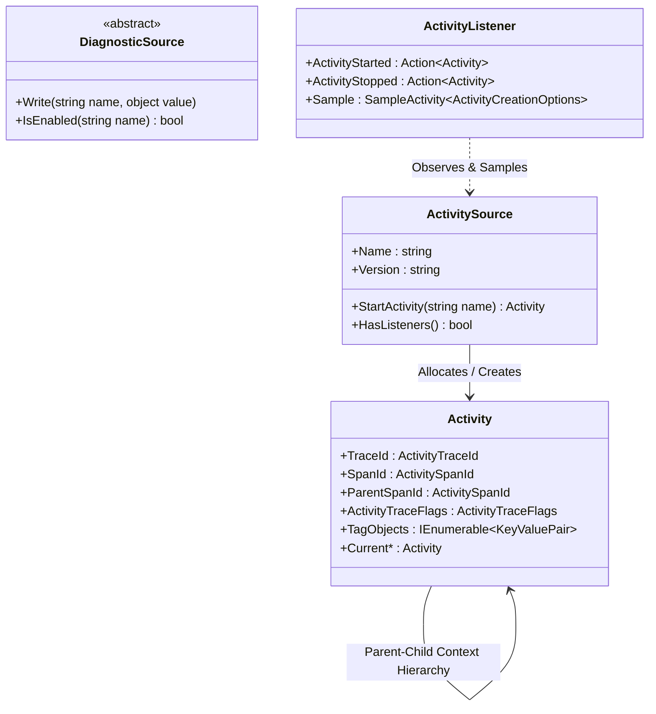
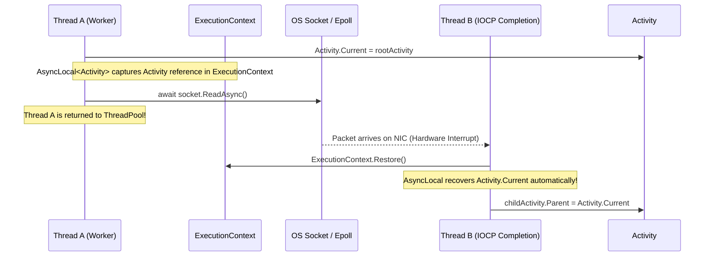

# CLR Internals: DiagnosticSource, ActivitySource, Activity & AsyncLocal Context Flow

To write zero-overhead telemetry in high-performance .NET runtimes, a Principal Architect must inspect how the CLR executes tracing at the machine and memory level.

---

## 1. The CLR Diagnostics Hierarchy



---

## 2. How `Activity.Current` Flows Across Async Await Boundaries

One of the most complex challenges in distributed systems tracing is maintaining the active span identity as threads change during asynchronous I/O completions.

The CLR achieves this using an `AsyncLocal<Activity?>`:



### The Source Code Pattern:
Under the hood in the .NET runtime repository (`src/libraries/System.Diagnostics.DiagnosticSource/src/System/Diagnostics/Activity.cs`):

```csharp
public class Activity : IDisposable
{
    // The internal engine that carries context across thread switches
    private static readonly AsyncLocal<Activity?> s_current = new AsyncLocal<Activity?>(CurrentChanged);

    public static Activity? Current
    {
        get => s_current.Value;
        set => s_current.Value = value;
    }
    
    // ...
}
```

When an asynchronous method awaits, the CLR captures the `ExecutionContext`, which contains the dictionary of all active `AsyncLocal<T>` variables. When the thread resumes on a ThreadPool worker thread or I/O completion port (IOCP), the CLR restores the `ExecutionContext`, guaranteeing that `Activity.Current` remains intact without manual variable passing!

---

## 3. The Zero-Allocation Listener & Sampling Pattern

Why does calling `ActivitySource.StartActivity` have near-zero overhead when no profiler or exporter is attached?

Let's examine the CLR source execution loop:

```csharp
public Activity? StartActivity(string name, ActivityKind kind = ActivityKind.Internal)
{
    // 1. FAST-PATH: If no listener is registered across the entire process, return null immediately!
    // No object allocation, no struct boxing, no Guid generation!
    if (!HasListeners())
    {
        return null;
    }

    // 2. SAMPLING CHECK: Call registered listeners to evaluate sampling rules
    ActivityCreationOptions<ActivityContext> options = new(...);
    ActivitySamplingResult sampleResult = ActivitySamplingResult.None;

    foreach (ActivityListener listener in _listeners)
    {
        if (listener.Sample is not null)
        {
            var result = listener.Sample(ref options);
            if (result > sampleResult) sampleResult = result;
        }
    }

    // If sampling decided to drop this trace, DO NOT allocate an Activity!
    if (sampleResult == ActivitySamplingResult.None)
    {
        return null;
    }

    // 3. SLOW-PATH: Allocate Activity on GC Heap only when confirmed sampled!
    Activity activity = new Activity(name);
    activity.Initialize(sampleResult, ...);
    return activity;
}
```

### Key Performance Takeaways for Principal Engineers
1. **Never allocate objects in method arguments of `StartActivity`**: Do not do `StartActivity($"ProcessOrder-{order.Id}")`. This forces string formatting on every call even if `StartActivity` returns `null`. Pass static string literals: `StartActivity("ProcessOrder")`.
2. **Always check for null**: `using var act = Source.StartActivity(...)` is safe, because disposing `null` is a no-op in C#. But before calling `.SetTag(...)` or `.AddEvent(...)`, verify `act is not null`.
