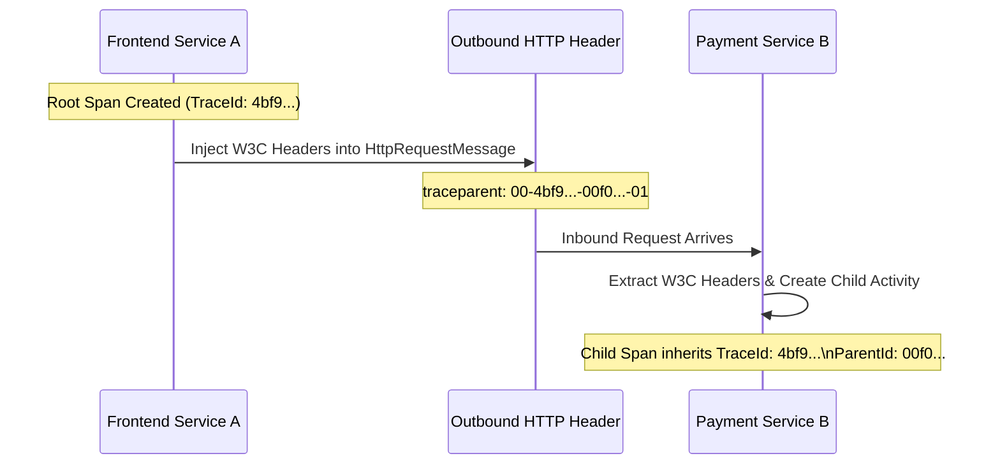

# Distributed Tracing & W3C TraceContext Specification

When an operation spans multiple microservices, message queues, and databases across geographic regions, a single cohesive distributed trace must stitch together every individual execution step.

The vendor-neutral standard governing this propagation is the **W3C TraceContext** specification.

---

## 1. The Anatomy of W3C `traceparent`

```text
traceparent: 00-4bf92f3577b34da6a3ce929d0e0e4736-00f067aa0ba902b7-01
             │  └──────────────┬───────────────┘ └───────┬──────┘ └─┬┘
             │                 │                         │          └── Trace Flags (8-bit)
             │                 │                         └───────────── Parent Span ID (64-bit hex)
             │                 └─────────────────────────────────────── Trace ID (128-bit hex)
             └───────────────────────────────────────────────────────── Version (8-bit hex: 00)
```

### Component Breakdown
1. **Version (`00`)**: 2 hex characters. Current specification version is `00`.
2. **Trace ID (`4bf92f3577b34da6a3ce929d0e0e4736`)**: 32 hex characters (16 bytes / 128 bits). Globally unique across all systems. Generated by the root initiator of the request.
3. **Parent Span ID (`00f067aa0ba902b7`)**: 16 hex characters (8 bytes / 64 bits). Uniquely identifies the immediate caller's span.
4. **Trace Flags (`01`)**: 2 hex characters (8 bits).
   - `01` = **Recorded / Sampled**: Informs downstream services that this trace was sampled and should be recorded.
   - `00` = **Not Sampled**: Downstream services propagate context but avoid writing spans to disk/exporters.

---

## 2. The `tracestate` and `baggage` Headers

### `tracestate`
Carries vendor-specific routing and state metadata across boundaries without mutating the vendor-neutral `traceparent`:
```text
tracestate: rojo=123,congo=456,az=appinsights:1
```

### `baggage` (W3C Baggage Specification)
While `traceparent` carries diagnostic identifiers, `baggage` carries application-level key-value metadata that flows transparently across every service in the call chain:
```text
baggage: tenantId=corp-enterprise-99,userId=usr-4412,datacenter=eastus2
```

> [!WARNING]
> **Baggage Security Hazard**: Baggage is passed as plain-text HTTP headers across public network hops and third-party APIs. **NEVER place PII, secrets, API tokens, or credit cards in baggage.** Limit baggage size to prevent HTTP 431 (Request Header Fields Too Large) errors.

---

## 3. End-to-End Context Propagation Engine in C# (.NET 9)



### Production Implementation: Custom Header Propagator
```csharp
using System.Diagnostics;
using System.Net.Http.Headers;

namespace Enterprise.Observability.Propagation;

public static class TraceContextPropagator
{
    private const string TraceParentHeaderName = "traceparent";
    private const string TraceStateHeaderName = "tracestate";

    // 1. Inject Context into Outbound HTTP Request
    public static void InjectTraceContext(HttpRequestMessage request, Activity? activity)
    {
        if (activity is null) return;

        // Formulate 00-TraceId-SpanId-Flags
        var traceParent = $"00-{activity.TraceId}-{activity.SpanId}-{(activity.ActivityTraceFlags.HasFlag(ActivityTraceFlags.Recorded) ? "01" : "00")}";
        request.Headers.TryAddWithoutValidation(TraceParentHeaderName, traceParent);

        if (!string.IsNullOrEmpty(activity.TraceStateString))
        {
            request.Headers.TryAddWithoutValidation(TraceStateHeaderName, activity.TraceStateString);
        }
    }

    // 2. Extract Context from Inbound HTTP Request
    public static ActivityContext ExtractTraceContext(HttpRequestHeaders headers)
    {
        if (!headers.TryGetValues(TraceParentHeaderName, out var values))
        {
            return default;
        }

        var traceparent = values.FirstOrDefault();
        if (string.IsNullOrWhiteSpace(traceparent))
        {
            return default;
        }

        var parts = traceparent.Split('-');
        if (parts.Length < 4 || parts[0] != "00")
        {
            return default; // Unsupported version or invalid format
        }

        var traceId = ActivityTraceId.CreateFromString(parts[1].AsSpan());
        var spanId = ActivitySpanId.CreateFromString(parts[2].AsSpan());
        var flags = parts[3] == "01" ? ActivityTraceFlags.Recorded : ActivityTraceFlags.None;

        string? traceState = null;
        if (headers.TryGetValues(TraceStateHeaderName, out var stateValues))
        {
            traceState = stateValues.FirstOrDefault();
        }

        return new ActivityContext(traceId, spanId, flags, traceState, isRemote: true);
    }
}
```
