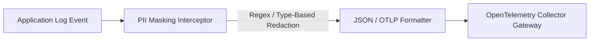

# High-Performance Structured Logging & Telemetry Pipelines

Logging is frequently the single largest source of memory allocations and thread synchronization contention in backend enterprise applications. A Principal Architect designs logging pipelines that deliver maximum diagnostic context while eliminating GC pressure.

---

## 1. The Allocation Tax of Legacy Logging

Consider the traditional string interpolation pattern:

```csharp
// FATAL ANTI-PATTERN: High-frequency allocation on hot paths
_logger.LogInformation($"Order {order.Id} processed for customer {order.CustomerId} with amount {order.Amount:C}");
```

When this line executes:
1. **String Allocation**: String interpolation (`$""`) allocates a new `string` object on the GC heap.
2. **Boxing Allocations**: Value types like `decimal Amount` or `Guid Id` are boxed into `object` wrappers.
3. **Format Parsing**: The runtime parses format specifiers at execution time.
4. **No Structural Querying**: In the logging backend (Elasticsearch, Loki), the message is a single unstructured string, requiring slow regex full-text scans.

---

## 2. Compile-Time Zero-Allocation: `[LoggerMessage]` Source Generator

In modern .NET (.NET 6 through .NET 9), the `[LoggerMessage]` source generator creates strongly typed, zero-allocation log delegates at compile time:

```csharp
using Microsoft.Extensions.Logging;

namespace Enterprise.Observability.Logging;

public static partial class LogDefinitions
{
    // Define strongly-typed, compile-time cached logger delegate
    [LoggerMessage(
        EventId = 1001,
        Level = LogLevel.Information,
        Message = "Order {OrderId} processed successfully for customer {CustomerId}. Total amount: {Amount} {Currency}.")]
    public static partial void OrderProcessedSuccessfully(
        ILogger logger, 
        string orderId, 
        string customerId, 
        decimal amount, 
        string currency);

    [LoggerMessage(
        EventId = 2001,
        Level = LogLevel.Error,
        Message = "Failed to charge payment for order {OrderId}. Reason: {FailureReason}")]
    public static partial void OrderPaymentFailed(
        ILogger logger, 
        Exception exception, 
        string orderId, 
        string failureReason);
}
```

### Why Compile-Time Logging is Unbeatable:
- **Zero Heap Allocations**: When the specified log level is disabled, **0 bytes** are allocated. The check `logger.IsEnabled(LogLevel.Information)` is inlined before any argument evaluation.
- **No Boxing**: Strongly typed arguments are passed directly to an internal struct that formats on demand.
- **Structural Integrity**: The property names (`OrderId`, `CustomerId`, `Amount`) are parsed at compile time into the log state dictionary for seamless ingestion into OpenTelemetry and Elasticsearch.

---

## 3. Automated PII Redaction & Interceptors

Regulatory compliance (GDPR, PCI-DSS, HIPAA) strictly forbids logging sensitive data (credit cards, passwords, SSNs).



### Redaction Implementation Pattern
```csharp
using System.Text.RegularExpressions;

namespace Enterprise.Observability.Security;

public static partial class PiiSanitizer
{
    // Matches standard 16-digit credit cards with optional hyphens/spaces
    [GeneratedRegex(@"(?:\d[ -]*?){13,16}")]
    private static partial Regex CreditCardRegex();

    // Matches standard Bearer JWT tokens
    [GeneratedRegex(@"Bearer\s+[A-Za-z0-9-_=]+\.[A-Za-z0-9-_=]+\.?[A-Za-z0-9-_.+/=]*")]
    private static partial Regex BearerTokenRegex();

    public static string Redact(string input)
    {
        if (string.IsNullOrEmpty(input)) return input;
        
        string masked = CreditCardRegex().Replace(input, "[REDACTED_CC]");
        return BearerTokenRegex().Replace(masked, "Bearer [REDACTED_TOKEN]");
    }
}
```
