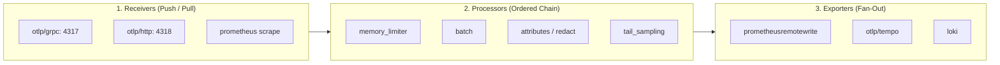

# OpenTelemetry Collector Architecture & Processing Pipelines

The OpenTelemetry Collector is the high-performance telemetry proxy that decouples application processes from vendor-specific observability backends.

---

## 1. Internal Pipeline Components



---

## 2. Production Hardened Configuration (`otel-collector-config.yaml`)

```yaml
receivers:
  otlp:
    protocols:
      grpc:
        endpoint: 0.0.0.0:4317
        max_concurrent_streams: 1024
      http:
        endpoint: 0.0.0.0:4318

processors:
  # 1. MANDATORY FIRST: Protects process from Out-Of-Memory termination
  memory_limiter:
    check_interval: 1s
    limit_percentage: 80
    spike_limit_percentage: 20

  # 2. Batch processor reduces network calls and compresses data
  batch:
    send_batch_size: 8192
    timeout: 200ms
    send_batch_max_size: 16384

  # 3. PII and sensitive attribute scrubbing
  attributes:
    actions:
      - key: credit_card
        action: delete
      - key: http.request.header.authorization
        action: hash

  # 4. Tail-based sampling to retain 100% of errors and slow requests
  tail_sampling:
    decision_wait: 10s
    num_traces: 100000
    expected_new_traces_per_sec: 2000
    policies:
      # Rule 1: Retain 100% of failed traces
      - name: drop-errors-policy
        type: status_code
        status_code: { status_codes: [ ERROR ] }
      
      # Rule 2: Retain 100% of slow traces (> 1000ms)
      - name: latency-outlier-policy
        type: latency
        latency: { threshold_ms: 1000 }

      # Rule 3: Sample 1% of normal 200 OK traffic for baseline monitoring
      - name: baseline-probabilistic-policy
        type: probabilistic
        probabilistic: { sampling_percentage: 1.0 }

exporters:
  otlp/tempo:
    endpoint: tempo.internal.corp:4317
    tls:
      insecure: false
      ca_file: /etc/ssl/certs/ca-bundle.crt

  prometheusremotewrite:
    endpoint: http://prometheus.internal.corp:9090/api/v1/write
    resource_to_telemetry_conversion:
      enabled: true

service:
  pipelines:
    traces:
      receivers: [otlp]
      processors: [memory_limiter, batch, attributes, tail_sampling]
      exporters: [otlp/tempo]
    metrics:
      receivers: [otlp]
      processors: [memory_limiter, batch, attributes]
      exporters: [prometheusremotewrite]
  telemetry:
    logs:
      level: info
    metrics:
      address: 0.0.0.0:8888
```
