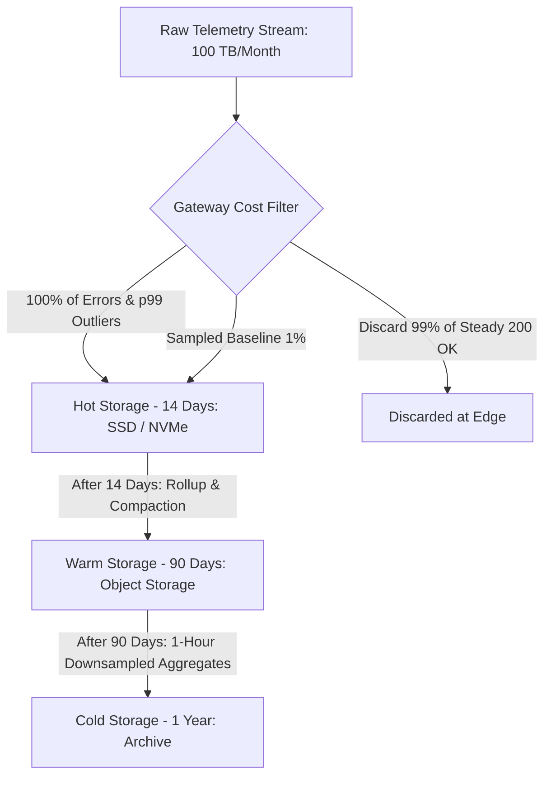

# High-Cardinality Telemetry & Cost Engineering (FinOps)

Telemetry is not free. Every metric label, span attribute, and log entry consumes CPU cycles on the host, bandwidth on the wire, memory in database indices, and dollars on the cloud bill.

---

## 1. The Mechanics of TSDB Inverted Index Bloat

```mermaid
graph TD
    subgraph MetricEntry ["Metric Measurement"]
        M[http_requests_total]
        L1[method: GET]
        L2[status: 200]
        L3[user_id: 10,000,000 UUIDs]
    end

    subgraph TSDB_Index ["Inverted Index Posting Lists"]
        P1["method=GET -> [1, 2, 3... 10M]"]
        P2["status=200 -> [1, 2, 3... 10M]"]
        P3["user_id=abc-1 -> [1]"]
        P4["user_id=abc-2 -> [2]"]
        P5["user_id=abc-10M -> [10M]"]
    end

    MetricEntry --> TSDB_Index
    Note over TSDB_Index: Posting list string table consumes 40GB RAM!
```

### The Inverted Index Trap
In TSDBs (Prometheus, VictoriaMetrics, M3DB), metrics are indexed by each label pair. When a label value has high cardinality:
1. The label string table explodes, consuming massive heap space.
2. The index posting lists (series pointers) fragment into single-item lists.
3. Garbage collection pauses spike as millions of short-lived series are rotated out every chunk interval (2 hours).

---

## 2. Cardinality Governance Framework

| Cardinality Tier | Value Range | Permitted Location | Examples |
|---|---|---|---|
| **Low / Bounded** | $1 - 50$ | Metric Labels, Spans, Logs | `environment`, `http_status_code`, `region` |
| **Medium** | $50 - 1,000$ | Metric Labels (with approval), Spans, Logs | `customer_tier`, `payment_provider`, `error_category` |
| **High / Unbounded** | $1,000 - \infty$ | **Spans & Logs ONLY** (Strictly prohibited in Metrics) | `order_id`, `user_id`, `credit_card_hash`, `email` |

---

## 3. Telemetry FinOps: Unit Economics & Retention Tiering



### Telemetry Cost Optimization Rules
1. **Never scrape what you do not alert on or query**: Audit Prometheus scrape configurations quarterly. Delete metric series with zero PromQL queries over 30 days.
2. **Apply Trace Tail Sampling**: Cut distributed tracing cloud costs by 80% to 90% by discarding repetitive successful traces while keeping all exceptions.
3. **Downsample Long-Term Metrics**: Keep 10-second resolution for 14 days, downsample to 5-minute resolution for 90 days, and downsample to 1-hour resolution for 1-year compliance.
