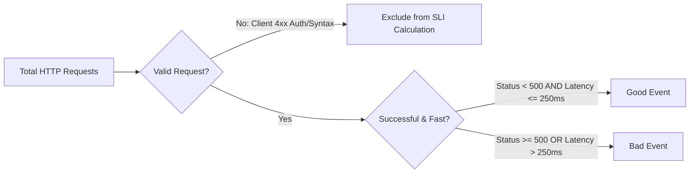
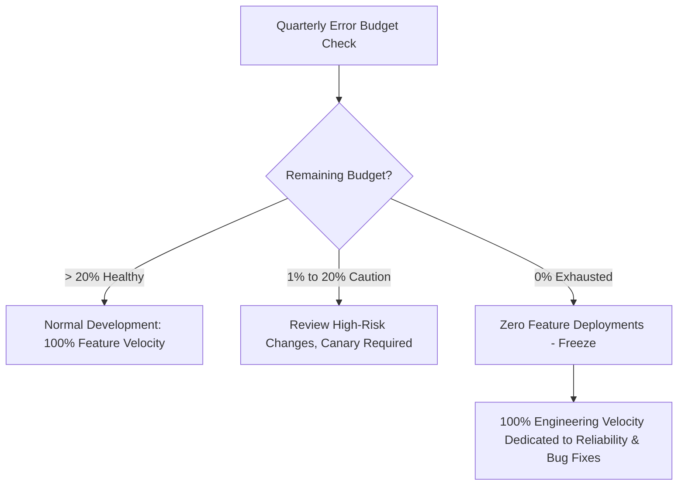

# SLIs, SLOs & Error Budget Engineering (Google SRE Framework)

Reliability is not the absence of failure; it is the adherence to an agreed-upon Service Level Objective (SLO). The Google Site Reliability Engineering (SRE) framework provides the mathematical and operational discipline to balance velocity with stability.

---

## 1. Defining Mathematically Rigorous SLIs

An SLI must be actionable, verifiable by the consumer, and free from external distortions.

### The Standard SLI Formulation
$$\text{Availability SLI} = \frac{\sum \text{Requests}(\text{code} < 500)}{\sum \text{Requests}(\text{valid requests})} \times 100\%$$

$$\text{Latency SLI} = \frac{\sum \text{Requests}(\text{duration} \le 250\text{ ms})}{\sum \text{Requests}(\text{valid requests})} \times 100\%$$

---

## 2. The Mechanics of the Error Budget

The Error Budget is the mathematical inverse of the SLO over a rolling evaluation window (typically 30 days or 720 hours).

$$\text{Error Budget} = 1 - \text{SLO}$$

### The Error Budget Burn Rate
The **Burn Rate ($B$)** measures how fast a service is consuming its error budget relative to the agreed SLO.

$$B = \frac{\text{Current Error Rate}}{1 - \text{SLO}}$$

- **Burn Rate = 1**: The service will consume exactly 100% of its error budget over the 30-day window. This is the equilibrium rate.
- **Burn Rate = 2**: The service will consume 100% of its budget in 15 days.
- **Burn Rate = 14.4**: The service will consume **100% of its error budget in 50 hours (or 2% in 1 hour)**. This constitutes an immediate SEV-1 paging emergency!

---

## 3. The Error Budget Policy & Enforcement Gates

### The Principal Governance Contract
1. **Deployment Freeze**: When the 30-day rolling error budget reaches 0%, all non-security deployments are automatically blocked by the CI/CD deployment pipeline.
2. **Resource Re-allocation**: 100% of team sprint capacity transitions to reliability engineering, architectural hardening, chaos testing, and observability refactoring.
3. **Executive Arbitration**: Only the VP of Engineering or CTO can grant an exception to override an error budget freeze.
