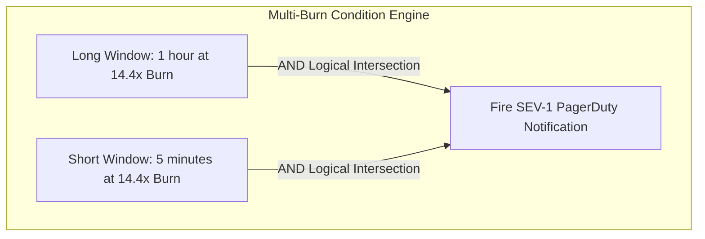

# Multi-Window Multi-Burn-Rate Alerting Architecture

Traditional alerting—triggering a page when `error_rate > 1%` over a 5-minute window—is broken. It causes constant false positives for brief transient spikes and fails completely to catch slow, catastrophic error budget drains.

The industry gold standard, established by Google SRE, is **Multi-Window Multi-Burn-Rate Alerting**.

---

## 1. The 4 Fatal Flaws of Simple Threshold Alerts

1. **High Precision vs. Low Recall**: A 5-minute alert window fires on single-second network hiccups that resolve themselves before an engineer can open a laptop (false alarm fatigue).
2. **Slow Reset Time**: A 24-hour alert window takes an entire day to clear after an incident is resolved, blinding engineers to subsequent failures.
3. **No Prioritization**: A failure burning 100% of budget in 1 hour looks identical to a failure burning 1% over 3 days.
4. **Arbitrary Thresholds**: Choosing "5% error rate" has no mathematical relationship to customer contractual SLAs.

---

## 2. The Multi-Window Multi-Burn-Rate Matrix

To avoid false alarms, Google SRE mandates that **two conditions must be true simultaneously** before paging:
1. A **Long Window** confirms that the burn rate has sustained long enough to threaten the budget.
2. A **Short Window** confirms that the incident is *still actively happening* right now (preventing pages for resolved transient spikes).



### Production Alerting Parameter Table (30-Day Window, 99.9% SLO)

| Severity | Target Budget Consumed | Burn Rate ($B$) | Long Window ($L$) | Short Window ($S$) | Notification Channel |
|---|---|---|---|---|---|
| **SEV-1 (Critical)** | 2.0% in 1 Hour | **14.4x** | 1 Hour | 5 Minutes | PagerDuty (Immediate Call) |
| **SEV-2 (High)** | 5.0% in 6 Hours | **6.0x** | 6 Hours | 30 Minutes | PagerDuty (Immediate Call) |
| **SEV-3 (Warning)** | 10.0% in 3 Days | **1.0x** | 3 Days | 6 Hours | Slack / Email Ticket |

---

## 3. Production PromQL Alerting Rules

```yaml
groups:
  - name: order-service-slo-alerts
    rules:
      # SEV-1: 2% budget burn in 1 hour (14.4x rate)
      # Evaluates both 1h long window AND 5m short window
      - alert: OrderServiceHighErrorBudgetBurn_1h
        expr: |
          (
            sum(rate(http_requests_total{job="order-service",status=~"5.."}[1h]))
            /
            sum(rate(http_requests_total{job="order-service"}[1h]))
          ) > (14.4 * (1 - 0.999))
          and
          (
            sum(rate(http_requests_total{job="order-service",status=~"5.."}[5m]))
            /
            sum(rate(http_requests_total{job="order-service"}[5m]))
          ) > (14.4 * (1 - 0.999))
        for: 2m
        labels:
          severity: critical
          tier: payment-gateway
        annotations:
          summary: "Order Service is burning 2% of monthly error budget in 1 hour!"
          description: "Current burn rate is > 14.4x. At this rate, the entire monthly budget is gone in 50 hours."
          runbook_url: "https://wiki.corp/runbooks/order-service-error-burn"

      # SEV-2: 5% budget burn in 6 hours (6.0x rate)
      - alert: OrderServiceModerateErrorBudgetBurn_6h
        expr: |
          (
            sum(rate(http_requests_total{job="order-service",status=~"5.."}[6h]))
            /
            sum(rate(http_requests_total{job="order-service"}[6h]))
          ) > (6.0 * (1 - 0.999))
          and
          (
            sum(rate(http_requests_total{job="order-service",status=~"5.."}[30m]))
            /
            sum(rate(http_requests_total{job="order-service"}[30m]))
          ) > (6.0 * (1 - 0.999))
        for: 5m
        labels:
          severity: page
        annotations:
          summary: "Order Service is burning 5% of monthly error budget in 6 hours."
```
