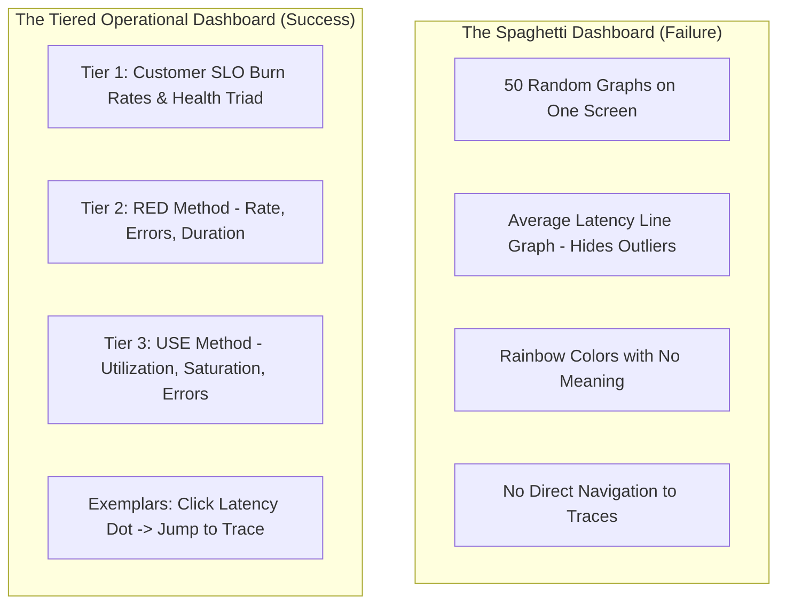

# Grafana Dashboard Architecture & Modern Visualization Patterns

During a SEV-1 incident, engineers suffer from cognitive overload. Dashboards with 50 uncoordinated graphs, rainbow color palettes, and arbitrary metrics actively impede incident resolution.

---

## 1. Dashboard Anti-Patterns vs. Principal Design

---

## 2. The RED and USE Methods Explained

### The RED Method (For Application Services)
Developed by Tom Wilkie, focused on request-driven microservices:
1. **Rate**: Throughput in requests per second (`sum(rate(http_requests_total[1m]))`).
2. **Errors**: Failed requests per second (`sum(rate(http_requests_total{status=~"5.."}[1m]))`).
3. **Duration**: Distribution of latency across requests (Histogram percentiles: p50, p95, p99).

### The USE Method (For Infrastructure Resources)
Developed by Brendan Gregg, focused on hardware resources (CPU, Memory, Disks, Network Interfaces):
1. **Utilization**: Percentage of time the resource was busy (e.g., CPU average utilization 75%).
2. **Saturation**: The degree to which work is queued waiting for the resource (e.g., ThreadPool queue depth, OS run queue length).
3. **Errors**: Hardware and kernel fault counts (e.g., NIC dropped packets, disk read errors).

---

## 3. Advanced Visualization: Latency Heatmaps & Exemplars

### Why Averages Lie
An average latency of 45ms can easily conceal a critical tail latency issue where 1% of users suffer 15,000ms timeouts:

$$\text{Avg Latency} = \frac{99 \times 10\text{ms} + 1 \times 15,000\text{ms}}{100} = 159.9\text{ms}$$

The average appears nominal, but 10,000 customers have aborted their shopping carts!

### Heatmap Visualization
Heatmaps display the entire distribution of request latencies over time, rendering high-density clusters as bright bands and rare outliers as distinct floating specks.

### Exemplar Integration
OpenTelemetry and Prometheus support **Exemplars**—linking a specific Trace ID directly to a point on a metric graph.
When an engineer hovers over a p99 latency spike on a Grafana panel, Grafana reveals the exact W3C Trace ID (`4bf92f...`). Clicking the dot opens the complete distributed trace in Jaeger/Tempo with zero searching required.
