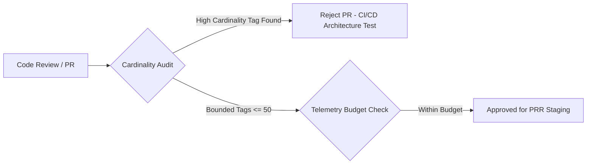
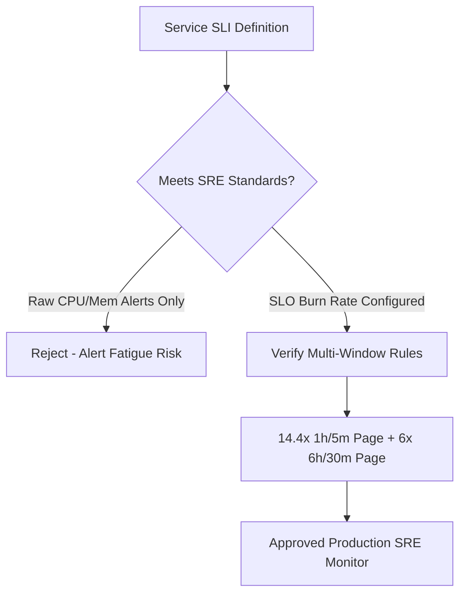

# Principal Observability Production Readiness Review (PRR) Checklist

Before any distributed microservice is approved for production deployment, it must pass this rigorous Observability Production Readiness Review (PRR). This checklist enforces reliability, privacy, cardinality limits, and Google SRE operational standards.

---

## 1. Metric Cardinality & Telemetry Hygiene Gate

- [ ] **Strict Metric Cardinality Bounds**: All metric dimensions/tags have finite, predictable cardinality ($|L| \le 50$). No UUIDs, user IDs, customer emails, IP addresses, or un-sanitized URL query parameters are used as metric tags.
- [ ] **Architecture Unit Tests**: CI/CD runs static analysis and architecture unit tests (e.g., NetArchTest) verifying that no code calls `Counter.Add()` or `Histogram.Record()` with forbidden parameter names.
- [ ] **Low-Allocation Instrumentation**: High-throughput code paths use pre-allocated static instruments (`ActivitySource`, `Meter`, `Counter<T>`, `Histogram<T>`).
- [ ] **Fast-Path Checks**: Dynamic span tag generation is protected by `activity is not null` checks to prevent string allocations on unsampled traces.

---

## 2. Distributed Tracing & W3C Context Gate

- [ ] **W3C TraceContext Compliance**: All HTTP, gRPC, and message bus consumers/producers propagate standard `traceparent` and `tracestate` headers.
- [ ] **Baggage Sanitation**: No secrets, PII, bearer tokens, or sensitive financial data are injected into W3C `baggage` headers.
- [ ] **Database & External Call Spans**: Remote calls (SQL queries, Redis lookups, external HTTP REST APIs) are wrapped in spans with sanitized statement attributes (passwords and raw parameter values scrubbed).
- [ ] **Trace Sampling Strategy**:
  - High-traffic production services have a defined sampling strategy (e.g., 100% of errors/outliers via Tail Sampling, 1% baseline probabilistic).
  - Health check endpoints (`/health/live`, `/health/ready`) are excluded from tracing via middleware filters.

---

## 3. High-Performance Logging & PII Gate

- [ ] **Compile-Time Source Generators**: All application log statements use the C# `[LoggerMessage]` source generator. Raw string interpolation (`$"..."`) in logging calls is disallowed by compiler analyzers.
- [ ] **Automated PII Redaction**: Log formatters and OTel Collector processors include regex sanitization rules for credit cards, Bearer tokens, passwords, and government IDs.
- [ ] **Structured Payload Consistency**: Logs emit structured JSON with standard semantic attributes (`service.name`, `service.version`, `trace_id`, `span_id`, `environment`).
- [ ] **Log Level Hygiene**: `LogLevel.Debug` and `LogLevel.Trace` are disabled in production configuration. Only `Information`, `Warning`, and `Error` are enabled by default.

---

## 4. Google SRE SLI/SLO & Alerting Gate

- [ ] **Customer-Facing SLIs Formulated**: Core availability and latency SLIs are formally documented as a ratio of good events over valid events.
- [ ] **Multi-Window Multi-Burn-Rate Alerting**:
  - Paging alerts use dual-window evaluation (Long Window + Short Window) to eliminate false alarms.
  - Critical SEV-1 page: 14.4x burn rate over 1h long / 5m short window (2% budget consumed).
  - High SEV-2 page: 6.0x burn rate over 6h long / 30m short window (5% budget consumed).
- [ ] **No Raw CPU/Memory Pager Alerts**: Alerts on raw infrastructure metrics (CPU > 80%, Memory > 85%) trigger informational tickets or auto-scaling events, never wake up on-call engineers at 3 AM unless an SLO is actively burning.
- [ ] **Actionable Runbooks Linked**: 100% of paging alerts contain a verified markdown runbook URL explaining immediate mitigation steps, triage dashboards, and escalation paths.

---

## 5. Collector & Infrastructure Resilience Gate

- [ ] **Memory Limiter Enabled**: Every OpenTelemetry Collector instance enforces a `memory_limiter` processor as the very first step in its pipeline (`limit_percentage: 80`).
- [ ] **Collector High Availability**: Collector gateways run with a minimum of 3 replicas across multiple Availability Zones behind an internal load balancer.
- [ ] **Network Backpressure Handling**: Collector agents handle gRPC backpressure gracefully using local bounded in-memory queues with automated shedding policies.
- [ ] **Data Retention & FinOps**: Telemetry storage retention policies are configured (e.g., 14-day hot NVMe storage, 90-day object storage, 1-year downsampled compliance archive).
