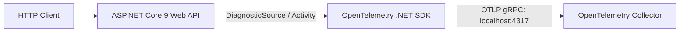

# Production Hands-On Observability Labs

These 5 hands-on labs provide production-grade, executable implementations of enterprise observability, distributed tracing, metrics aggregation, collector pipelines, and alerting.

---

## Lab 1: End-to-End .NET 9 OpenTelemetry Pipeline with OTLP Export

### Objective
Configure a complete .NET 9 Web API with OpenTelemetry tracing, metrics, resource attributes, and OTLP gRPC export.



### `Program.cs`
```csharp
using System.Diagnostics;
using Microsoft.AspNetCore.Mvc;
using OpenTelemetry.Metrics;
using OpenTelemetry.Resources;
using OpenTelemetry.Trace;

var builder = WebApplication.CreateBuilder(args);

// Define Diagnostic Sources
var serviceName = "CheckoutEngine";
var serviceVersion = "1.0.0";
var activitySource = new ActivitySource("Enterprise.CheckoutEngine");
var meter = new System.Diagnostics.Metrics.Meter("Enterprise.CheckoutEngine");

var checkoutCounter = meter.CreateCounter<long>("checkouts.total", unit: "{orders}", description: "Total completed checkouts");
var checkoutDuration = meter.CreateHistogram<double>("checkouts.duration.ms", unit: "ms", description: "Checkout latency in ms");

builder.Services.AddOpenTelemetry()
    .ConfigureResource(res => res
        .AddService(serviceName, serviceVersion: serviceVersion)
        .AddAttributes([
            new KeyValuePair<string, object>("deployment.environment", "production"),
            new KeyValuePair<string, object>("cloud.region", "eastus2")
        ]))
    .WithTracing(tracing => tracing
        .AddAspNetCoreInstrumentation(opts =>
        {
            opts.RecordException = true;
            opts.Filter = ctx => !ctx.Request.Path.StartsWithSegments("/health");
        })
        .AddHttpClientInstrumentation()
        .AddSource("Enterprise.CheckoutEngine")
        .AddOtlpExporter(opts =>
        {
            opts.Endpoint = new Uri("http://localhost:4317");
            opts.Protocol = OpenTelemetry.Exporter.OtlpExportProtocol.Grpc;
        }))
    .WithMetrics(metrics => metrics
        .AddAspNetCoreInstrumentation()
        .AddRuntimeInstrumentation()
        .AddMeter("Enterprise.CheckoutEngine")
        .AddOtlpExporter(opts =>
        {
            opts.Endpoint = new Uri("http://localhost:4317");
            opts.Protocol = OpenTelemetry.Exporter.OtlpExportProtocol.Grpc;
        }));

var app = builder.Build();

app.MapPost("/api/checkout", async ([FromBody] CheckoutRequest request) =>
{
    var sw = Stopwatch.StartNew();
    using var activity = activitySource.StartActivity("ExecuteCheckout");
    
    if (activity is not null)
    {
        activity.SetTag("checkout.payment_provider", request.Provider);
        activity.SetTag("checkout.currency", request.Currency);
    }

    try
    {
        // Simulate order processing logic
        await Task.Delay(Random.Shared.Next(20, 100));

        checkoutCounter.Add(1, 
            new KeyValuePair<string, object?>("status", "success"),
            new KeyValuePair<string, object?>("provider", request.Provider));

        return Results.Ok(new { status = "Approved", orderId = Guid.NewGuid() });
    }
    catch (Exception ex)
    {
        activity?.SetStatus(ActivityStatusCode.Error, ex.Message);
        activity?.RecordException(ex);

        checkoutCounter.Add(1, 
            new KeyValuePair<string, object?>("status", "failure"),
            new KeyValuePair<string, object?>("provider", request.Provider));

        throw;
    }
    finally
    {
        sw.Stop();
        checkoutDuration.Record(sw.Elapsed.TotalMilliseconds,
            new KeyValuePair<string, object?>("provider", request.Provider));
    }
});

app.Run();

public record CheckoutRequest(string Provider, string Currency, decimal Amount);
```

---

## Lab 2: Custom `ActivitySource` & W3C TraceContext Manual Propagation

### Objective
Implement manual W3C `traceparent` context extraction and child span creation for non-HTTP background workers (e.g. raw TCP, Kafka, or custom file queues).

```csharp
using System.Diagnostics;

namespace Enterprise.Observability.Labs;

public class CustomMessageConsumer
{
    private static readonly ActivitySource ActivitySource = new("Enterprise.Messaging.Consumer", "1.0.0");

    public void ProcessMessage(string rawTraceParent, byte[] payload)
    {
        // 1. Extract Parent Context from incoming raw wire header
        ActivityContext parentContext = default;
        if (!string.IsNullOrWhiteSpace(rawTraceParent))
        {
            var parts = rawTraceParent.Split('-');
            if (parts.Length == 4 && parts[0] == "00")
            {
                var traceId = ActivityTraceId.CreateFromString(parts[1].AsSpan());
                var spanId = ActivitySpanId.CreateFromString(parts[2].AsSpan());
                var flags = parts[3] == "01" ? ActivityTraceFlags.Recorded : ActivityTraceFlags.None;
                parentContext = new ActivityContext(traceId, spanId, flags, isRemote: true);
            }
        }

        // 2. Start Child Span linked directly to remote parent
        using Activity? activity = ActivitySource.StartActivity(
            name: "ProcessBrokerMessage",
            kind: ActivityKind.Consumer,
            parentContext: parentContext);

        if (activity is not null)
        {
            activity.SetTag("messaging.system", "custom_broker");
            activity.SetTag("messaging.payload_size_bytes", payload.Length);
        }

        // Execute processing logic
        HandlePayload(payload);
    }

    private void HandlePayload(byte[] payload)
    {
        // Business logic execution
    }
}
```

---

## Lab 3: OpenTelemetry Collector with Tail-Based Sampling & Memory Limiter

### Objective
Deploy an OpenTelemetry Collector gateway configuration that uses tail sampling to capture 100% of failed traces and p99 latency spikes, while sampling only 1% of normal requests.

### `otel-collector-config.yaml`
```yaml
receivers:
  otlp:
    protocols:
      grpc:
        endpoint: 0.0.0.0:4317

processors:
  # Memory Limiter MUST be first
  memory_limiter:
    check_interval: 1s
    limit_percentage: 80
    spike_limit_percentage: 20

  batch:
    send_batch_size: 4096
    timeout: 250ms

  tail_sampling:
    decision_wait: 10s
    num_traces: 50000
    expected_new_traces_per_sec: 1000
    policies:
      # Rule 1: Always sample errors
      - name: sample-errors
        type: status_code
        status_code: { status_codes: [ ERROR ] }

      # Rule 2: Always sample requests taking > 500ms
      - name: sample-latency-outliers
        type: latency
        latency: { threshold_ms: 500 }

      # Rule 3: 1% sample of healthy 200 OK traffic
      - name: sample-probabilistic
        type: probabilistic
        probabilistic: { sampling_percentage: 1.0 }

exporters:
  otlp/tempo:
    endpoint: tempo:4317
    tls:
      insecure: true

service:
  pipelines:
    traces:
      receivers: [otlp]
      processors: [memory_limiter, batch, tail_sampling]
      exporters: [otlp/tempo]
```

---

## Lab 4: Multi-Window Multi-Burn-Rate Prometheus Alerting

### Objective
Implement production Google SRE Multi-Window Multi-Burn-Rate alerting rules in Prometheus for an API with a 99.9% availability SLO.

### `prometheus-alerts.yaml`
```yaml
groups:
  - name: slo_alerts_checkout_api
    rules:
      # Rule 1: Critical Emergency - 2% Budget Burned in 1 Hour (14.4x rate)
      # Paging: Page on-call engineer immediately
      - alert: CheckoutApiHighErrorBurnRate_1h
        expr: |
          (
            sum(rate(http_requests_total{service="checkout-api",status=~"5.."}[1h]))
            /
            sum(rate(http_requests_total{service="checkout-api"}[1h]))
          ) > (14.4 * (1 - 0.999))
          and
          (
            sum(rate(http_requests_total{service="checkout-api",status=~"5.."}[5m]))
            /
            sum(rate(http_requests_total{service="checkout-api"}[5m]))
          ) > (14.4 * (1 - 0.999))
        for: 2m
        labels:
          severity: page
          tier: critical
        annotations:
          summary: "CRITICAL: Checkout API burning 2% of error budget in 1 hour"
          description: "Sustained burn rate > 14.4x across 1h and 5m windows. Budget exhausted in 50 hours."
          runbook_url: "https://wiki.corp/runbooks/checkout-api-error-burn"

      # Rule 2: High Urgency - 5% Budget Burned in 6 Hours (6x rate)
      - alert: CheckoutApiModerateErrorBurnRate_6h
        expr: |
          (
            sum(rate(http_requests_total{service="checkout-api",status=~"5.."}[6h]))
            /
            sum(rate(http_requests_total{service="checkout-api"}[6h]))
          ) > (6.0 * (1 - 0.999))
          and
          (
            sum(rate(http_requests_total{service="checkout-api",status=~"5.."}[30m]))
            /
            sum(rate(http_requests_total{service="checkout-api"}[30m]))
          ) > (6.0 * (1 - 0.999))
        for: 5m
        labels:
          severity: page
          tier: high
        annotations:
          summary: "URGENT: Checkout API burning 5% of error budget in 6 hours"
          description: "Sustained burn rate > 6.0x across 6h and 30m windows."
```

---

## Lab 5: Zero-Allocation Structured Logging with Source Generators & PII Scrubbing

### Objective
Create a zero-allocation logging layer using C# 13 and .NET 9 source generators with automated PII masking.

```csharp
using Microsoft.Extensions.Logging;

namespace Enterprise.Observability.Labs;

public record CustomerPaymentInfo(string CustomerId, string CardNumber, decimal Amount);

public static partial class PaymentLogExtensions
{
    [LoggerMessage(
        EventId = 5001,
        Level = LogLevel.Information,
        Message = "Payment processed for Customer: {CustomerId}. Masked Card: {MaskedCard}. Amount: {Amount:C}")]
    public static partial void LogPaymentProcessed(
        ILogger logger,
        string customerId,
        string maskedCard,
        decimal amount);
}

public class PaymentProcessor
{
    private readonly ILogger<PaymentProcessor> _logger;

    public PaymentProcessor(ILogger<PaymentProcessor> logger) => _logger = logger;

    public void ExecutePayment(CustomerPaymentInfo info)
    {
        // Mask credit card: retain only last 4 digits
        string maskedCard = info.CardNumber.Length >= 4 
            ? $"****-****-****-{info.CardNumber[^4..]}" 
            : "****";

        // Zero-allocation structured log invocation
        PaymentLogExtensions.LogPaymentProcessed(_logger, info.CustomerId, maskedCard, info.Amount);
    }
}
```
