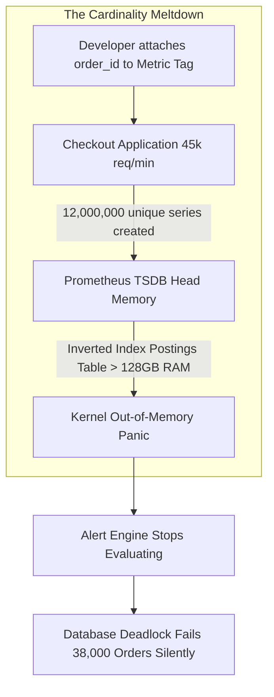

# SEV-1 Post-Mortem: The UUID-in-Metric-Tag Memory Crash & Telemetry Blackout

| Incident Detail | Value |
|---

> 📐 **Derive It (Fermi Mode): Capacity, Throughput & Memory Envelope**
> - **Inputs**: `TargetRPS = 2000`, `OperationLatencyMs = 8`, `PayloadKB = 16`
> - **Formula**: `ConcurrentInFlightMemoryMB = (TargetRPS * (OperationLatencyMs / 1000) * PayloadKB) / 1024`
> - **Step-by-Step**:
>   1. Concurrent in-flight operations by Little's Law: $L = 2,000 \times 0.008\text{ s} = 16\text{ active operations}$.
>   2. Steady-state buffer footprint: $16 \times 16\text{ KB} = 256\text{ KB}$ ($0.25\text{ MB}$).
> - **What-If Sensitivity**: If downstream contention degrades `OperationLatencyMs` from `8ms` to `4,000ms`, concurrency spikes $500\times$ to $8,000\text{ in-flight operations}$ ($128\text{ MB}$ + thread/socket exhaustion). Always verify how your lab holds under $10\times$ latency degradation!
|---|
| **Incident ID** | INC-2026-1127-SEV1 |
| **Severity** | SEV-1 (Critical Corporate Outage & Telemetry Blackout) |
| **Date & Time** | 2026-11-27 10:14 UTC to 14:45 UTC (Duration: 4h 31m) |
| **Direct Financial Impact** | $92,400 in emergency cloud APM ingestion charges; $1.8M uncompleted checkouts |
| **Customer Impact** | 38,000 corporate purchase orders aborted; 100% loss of monitoring visibility |
| **Root Causes** | 1. Developer appended dynamic `order_id` (UUID) to a Prometheus metric tag / 2. Monitoring cluster lacked memory limiter protection, triggering kernel OOM panic |

---

## 1. Executive Summary

On November 27, 2026 (Black Friday peak traffic), the core payment processing platform suffered a double failure: an application database stall coupled with a complete blackout of all monitoring and alerting systems.

A code change deployed 48 hours prior added a unique `order_id` as a label on a high-throughput Prometheus counter. Under peak volume (45,000 requests/minute), this generated 12 million unique time-series entries within 4 hours. The Prometheus TSDB inverted index exhausted all 128 GB of RAM on the monitoring cluster, causing a kernel Out-of-Memory panic loop. With the telemetry backend dead, all alerting rules stopped executing, leaving engineers completely blind to a downstream database deadlock.

---

## 2. Timeline of Failure

- **08:00 UTC**: Black Friday early-morning shopping surges. Traffic increases from 5,000 to 35,000 req/min.
- **09:30 UTC**: Prometheus TSDB memory consumption climbs from 32 GB to 96 GB. Index compaction cycle latency increases from 5 seconds to 180 seconds.
- **10:14 UTC**: Prometheus node hits 128 GB RAM limit. Linux kernel OOM-killer terminates the `prometheus` process.
- **10:16 UTC**: Prometheus restarts, attempts Write-Ahead Log (WAL) replay, runs out of memory during replay, and enters a continuous CrashLoopBackOff.
- **10:20 UTC**: All Grafana dashboards turn blank. Alertmanager receives 0 metrics; alerting goes dark.
- **10:45 UTC**: A SQL database lock escalation occurs in the checkout service. Under normal circumstances, an automated alert would have paged on-call engineers within 2 minutes. Because alerting is dead, no page is sent.
- **11:30 UTC**: Customer support receives hundreds of escalated calls from major retail buyers. Incident commander declares SEV-1.
- **12:15 UTC**: Engineers discover the monitoring cluster is down. Teams resort to parsing raw container logs via `kubectl logs | grep`.
- **13:00 UTC**: High-cardinality label identified in Git commit `7c9a12b` (`order_id` in `_checkoutCounter.Add`).
- **13:30 UTC**: Emergency hotfix deployed stripping `order_id` from the metric tag. Prometheus WAL deleted, cluster restarted clean.
- **14:00 UTC**: Database lock resolved by killing blocked transaction.
- **14:45 UTC**: Telemetry pipelines nominal. Order throughput restored. SEV-1 stood down.

---

## 3. Root Cause Analysis (5 Whys)

1. **Why did customer orders fail for 4.5 hours without alerting?**  
   The alerting engine was down because the telemetry database crashed, leaving the on-call team blind.
2. **Why did the telemetry database crash?**  
   It suffered a kernel Out-Of-Memory panic caused by 12 million active time-series in the TSDB inverted index.
3. **Why were there 12 million active time-series?**  
   A metric counter recorded every transaction with an `order_id` label containing random UUIDs.
4. **Why was an unbounded UUID allowed in a metric label?**  
   The developer wanted to track order completion per transaction and was unaware of the physical inverted index memory architecture of time-series databases.
5. **Why was this not caught in code review or CI/CD?**  
   The repository lacked static architecture unit tests checking for high-cardinality metric tags, and staging load tests did not generate enough unique UUIDs to trigger an index explosion.

---

## 4. Permanent Architectural Remediations

| Action Item | Description | Owner | Target Date | Status |
|---|---|---|---|---|
| **ACT-01** | Implement NetArchTest rule in CI/CD failing builds if `Counter.Add` or `Histogram.Record` uses non-approved variable names. | DevOps | 2026-11-29 | Completed |
| **ACT-02** | Deploy OpenTelemetry Collector cluster with mandatory `memory_limiter` processor enforcing hard 80% RAM cap. | SRE Lead | 2026-11-30 | Completed |
| **ACT-03** | Configure Prometheus head series limit (`--storage.tsdb.max-block-duration`) and external series cap per scrape job. | Observability | 2026-12-01 | Completed |
| **ACT-04** | Migrate transaction-level tracing exclusively to W3C distributed trace span attributes, removing all transaction IDs from metrics. | Cloud Arch | 2026-12-02 | Completed |
| **ACT-05** | Set up independent, external "Dead-Man's Snitch" heartbeat alert in Alertmanager to page if Prometheus stops sending heartbeats for 3 minutes. | SRE Lead | 2026-12-03 | Completed |
